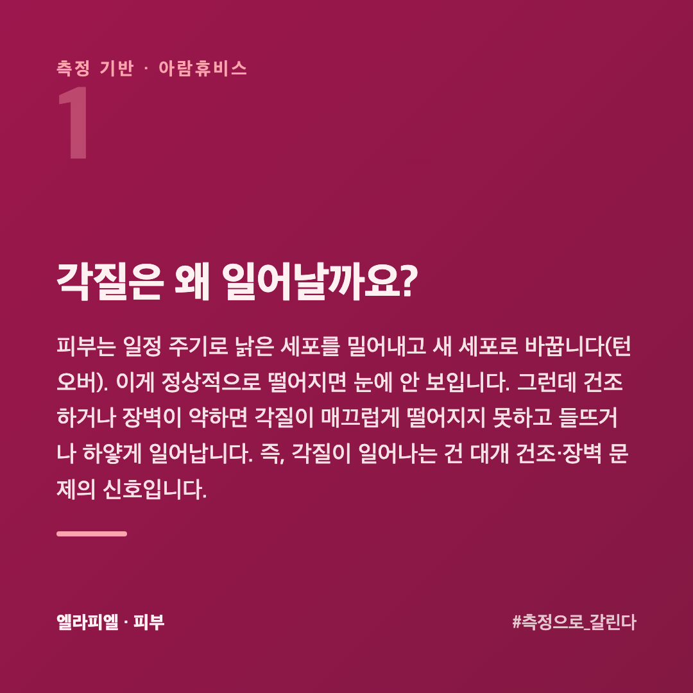
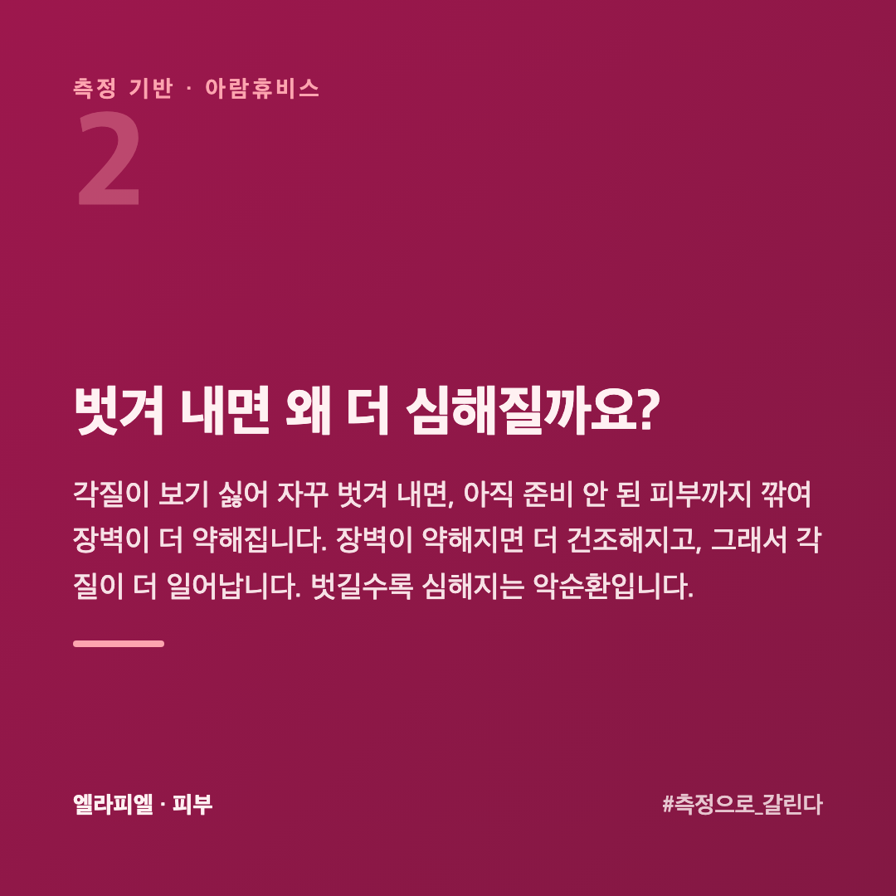
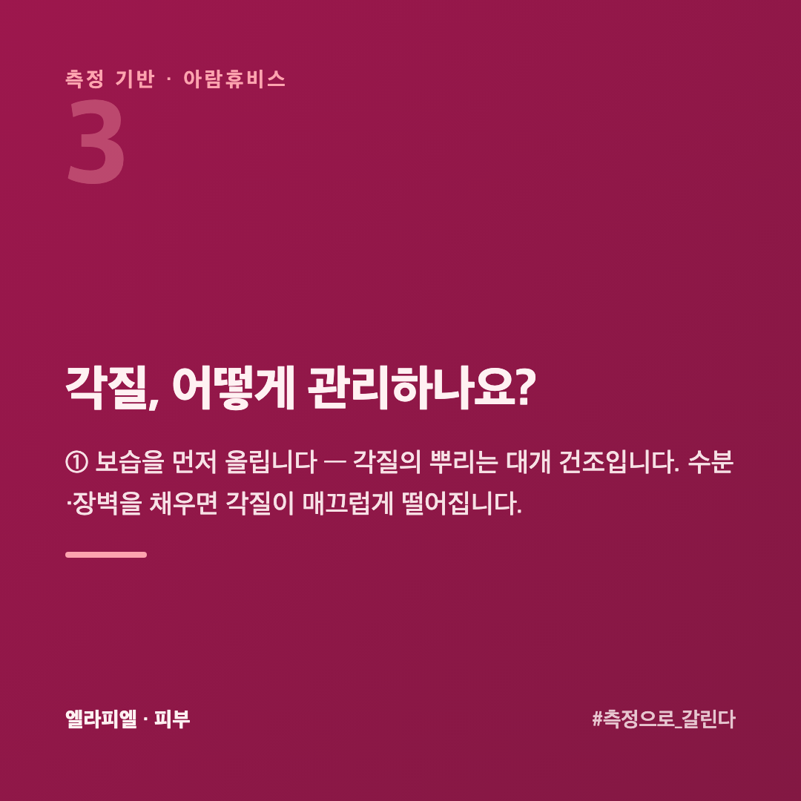
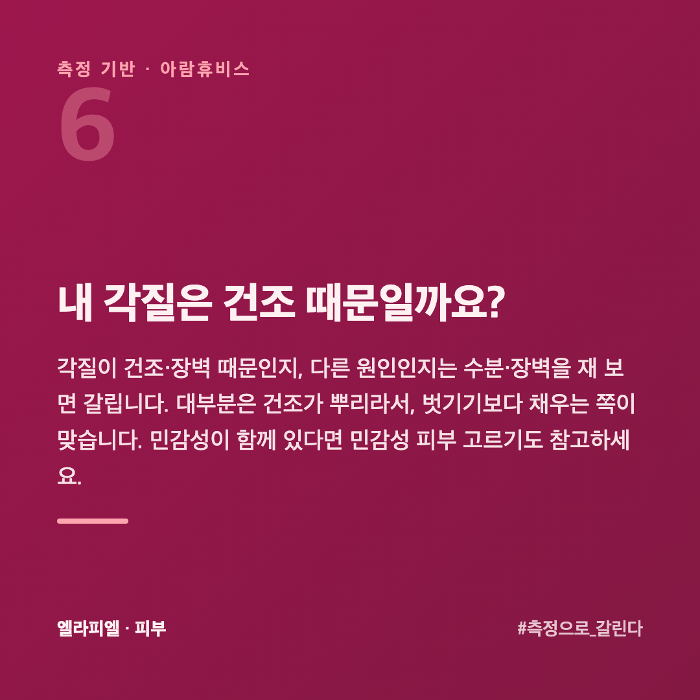
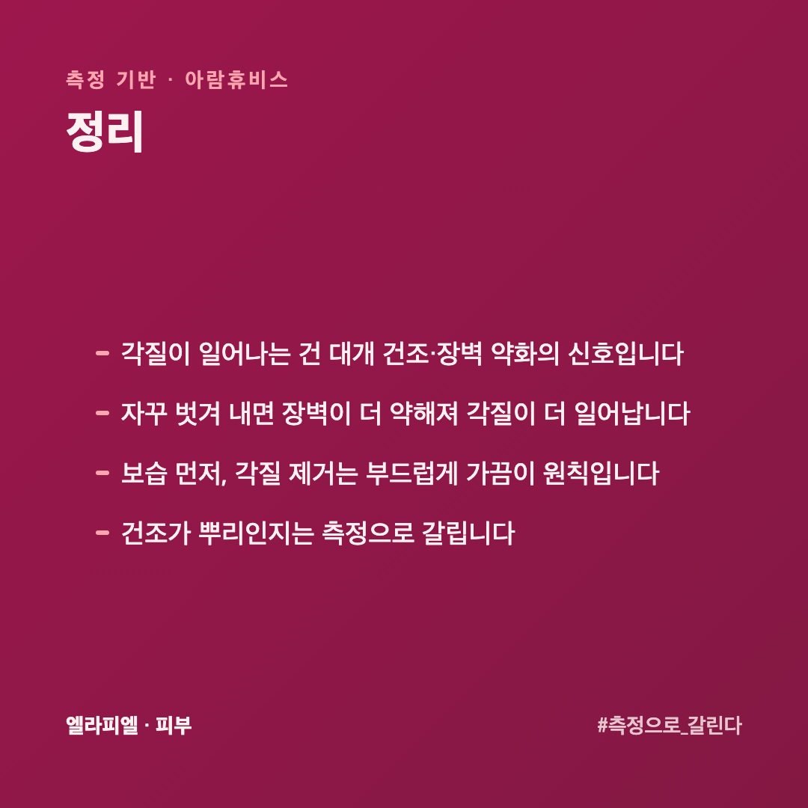
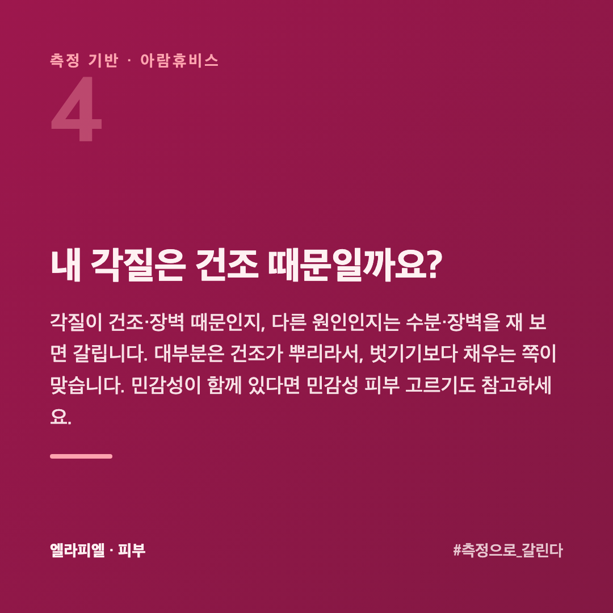

# 각질이 자꾸 일어나는 피부, 벗겨내면 될까 아니면 채워야 할까

화장을 하면 각질이 들뜨고, 세안 후엔 하얗게 일어납니다. 그래서 각질 제거제로 벗겨 내지만, 며칠 지나면 다시 생깁니다. 심지어 더 심해지기도 합니다. 각질은 벗겨 내는 게 답이 아닐 때가 많습니다.

이 글은 피부를 수치로 재 온 회사 입장에서, 각질이 일어나는 이유와 올바른 접근을 정리했습니다.

## 각질은 왜 일어날까요?

피부는 일정 주기로 낡은 세포를 밀어내고 새 세포로 바꿉니다(턴오버). 이게 정상적으로 떨어지면 눈에 안 보입니다. 그런데 **건조하거나 장벽이 약하면** 각질이 매끄럽게 떨어지지 못하고 들뜨거나 하얗게 일어납니다. 즉, 각질이 일어나는 건 대개 **건조·장벽 문제의 신호**입니다.

## 벗겨 내면 왜 더 심해질까요?

각질이 보기 싫어 자꾸 벗겨 내면, 아직 준비 안 된 피부까지 깎여 **장벽이 더 약해집니다.** 장벽이 약해지면 더 건조해지고, 그래서 각질이 **더** 일어납니다. 벗길수록 심해지는 악순환입니다.

"각질이 많으니 각질 제거를 더 자주"는 가장 흔한 실수입니다.

## 각질, 어떻게 관리하나요?

**① 보습을 먼저 올립니다** — 각질의 뿌리는 대개 건조입니다. 수분·장벽을 채우면 각질이 매끄럽게 떨어집니다.

**② 각질 제거는 부드럽게, 가끔** — 아예 안 하는 게 아니라 **빈도와 강도**를 낮춥니다. 강한 스크럽보다 순한 방식으로.

**③ 세안을 과하게 하지 않습니다** — 뜨거운 물·강한 클렌저는 장벽을 깎습니다.

**④ 한 번에 하나만 바꿉니다** — 뭐가 효과인지 가릴 수 있게.

## 각질 제품은 어떻게 고르나요?

「물리적으로 밀어내는 것」과 「성분으로 녹이는 것」이 다릅니다.

**스크럽처럼 문질러 밀어내는 것** — 즉시 매끈합니다. 다만 장벽이 얇아진 상태에서는 상처를 더합니다. 각질이 일어나는 **원인이 건조라면 이쪽은 피하는** 쪽이 낫습니다.

**AHA·BHA 처럼 성분으로 푸는 것** — 문지르지 않아 자극이 덜합니다. 대신 농도와 횟수를 지켜야 합니다. **주 1~2회부터** 시작해 괜찮으면 늘립니다.

어느 쪽이든 **쓴 날은 보습을 더** 합니다. 각질을 걷어 낸 자리는 수분이 더 빨리 빠집니다.

## 각질이 일어나는데 보습만 해도 되나요?

대부분은 그 편이 빠릅니다. 각질이 일어나는 이유가 건조와 장벽 약화라면, **채우면 저절로 가라앉습니다.**

다만 각질이 두껍게 쌓여 보습제가 겉돌 때가 있습니다. 발라도 흡수되는 느낌이 없고 가루가 밀리는 상태입니다. 이때는 **아주 약하게 한 번** 정리하고 다시 채우는 쪽이 낫습니다.

순서를 뒤집지 않는 것이 핵심입니다. **벗기고 채우는 게 아니라, 채우고 그래도 남으면 정리**합니다.

## 내 각질은 건조 때문일까요?

각질이 건조·장벽 때문인지, 다른 원인인지는 수분·장벽을 재 보면 갈립니다. 대부분은 건조가 뿌리라서, 벗기기보다 **채우는 쪽**이 맞습니다. 민감성이 함께 있다면 [민감성 피부, 화장품 고를 때 볼 것](https://blog.naver.com/ianlove80/224451155409)도 참고하세요.

엘라피엘은 그 측정 관점에서 수분·장벽 라인을 설계했습니다 → [ellapiel.co.kr](https://ellapiel.co.kr)

## 정리

- 각질이 일어나는 건 대개 **건조·장벽 약화의 신호**입니다
- 자꾸 **벗겨 내면 장벽이 더 약해져** 각질이 더 일어납니다
- **보습 먼저**, 각질 제거는 **부드럽게 가끔**이 원칙입니다
- 건조가 뿌리인지는 **측정으로** 갈립니다
