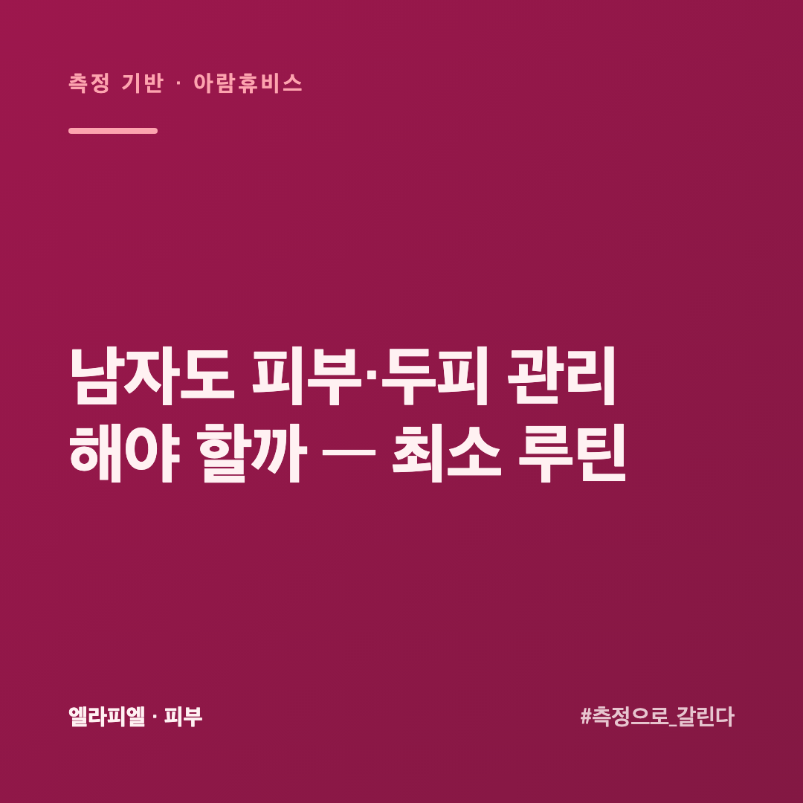
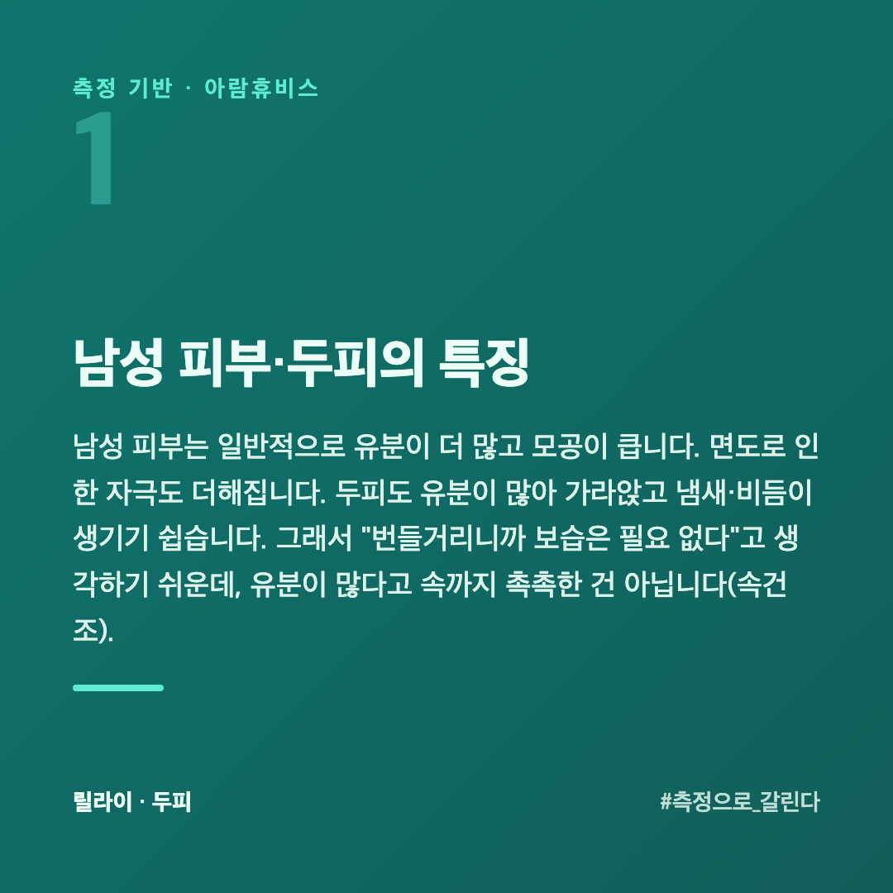
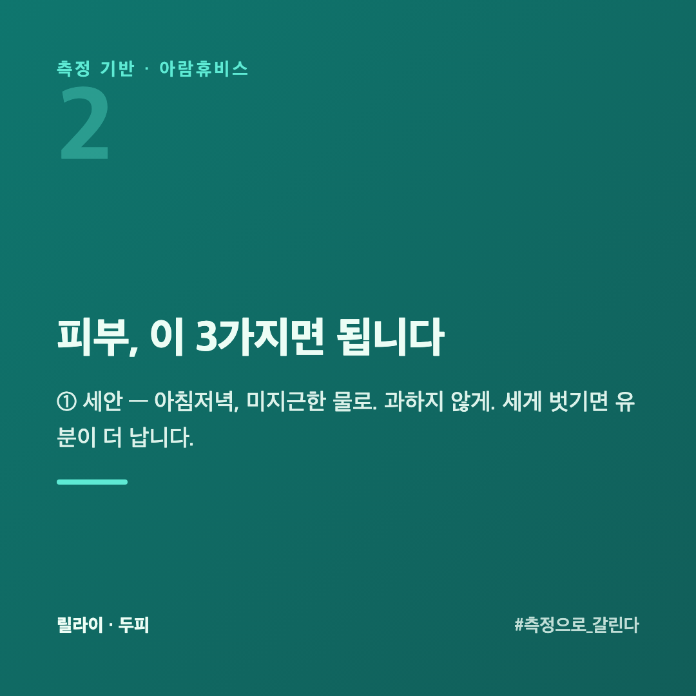
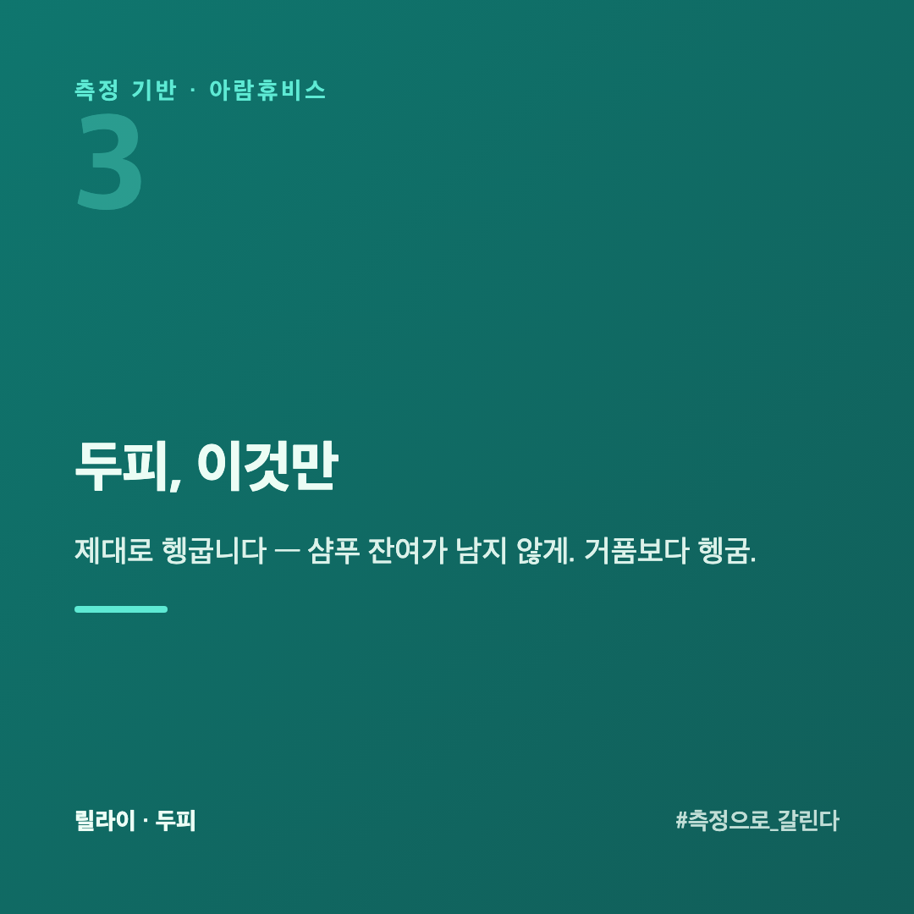
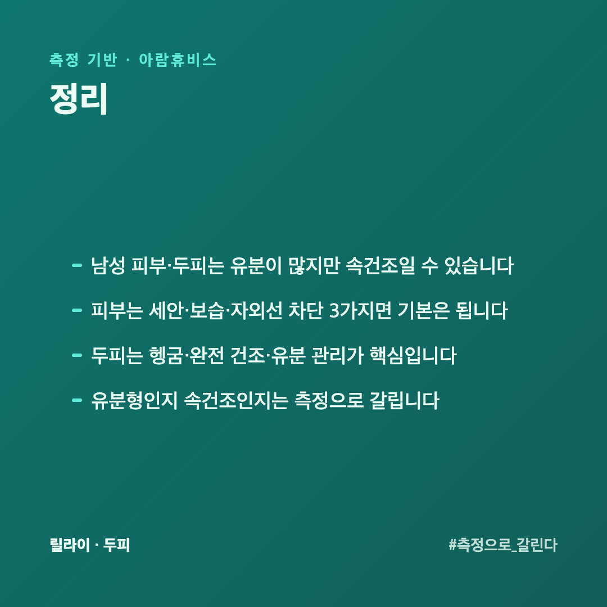
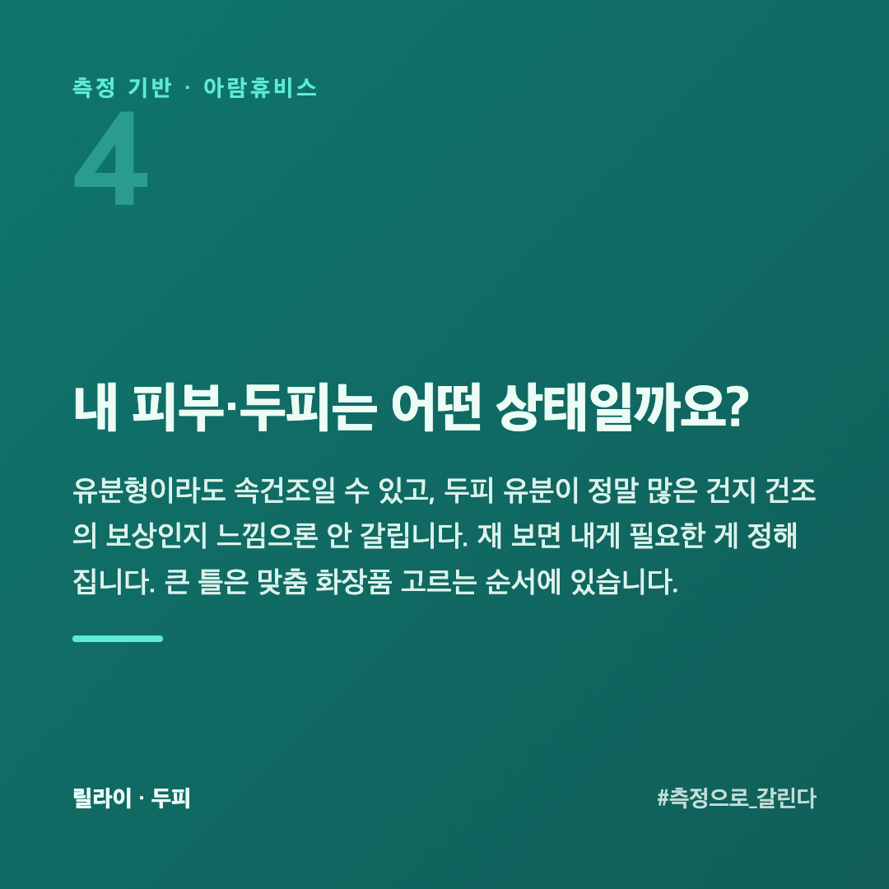

# 남자도 피부·두피 관리해야 할까 — 최소 루틴

"남자가 뭘 바르냐"던 시절은 지났지만, 막상 시작하려면 뭐부터 할지 막막합니다. 복잡한 단계는 부담스럽고, 그렇다고 아무것도 안 하긴 찜찜합니다. 피부를 수치로 재 온 회사 입장에서, 남성에게 맞는 **최소 루틴**을 정리했습니다. 핵심만, 과하지 않게.

## 남성 피부·두피의 특징

남성 피부는 일반적으로 **유분이 더 많고** 모공이 큽니다. 면도로 인한 자극도 더해집니다. 두피도 유분이 많아 가라앉고 냄새·비듬이 생기기 쉽습니다. 그래서 "번들거리니까 보습은 필요 없다"고 생각하기 쉬운데, 유분이 많다고 **속까지 촉촉한 건 아닙니다**(속건조).

## 피부, 이 3가지면 됩니다

**① 세안** — 아침저녁, 미지근한 물로. 과하지 않게. 세게 벗기면 유분이 더 납니다.

**② 보습** — 가볍게라도 꼭. 유분형이라도 수분은 필요합니다. 끈적임이 싫으면 가벼운 제형으로.

**③ 자외선 차단** — 가장 효과 좋은 안티에이징입니다. 번거로워도 이것 하나는 챙기면 차이가 큽니다.

면도 후엔 자극받은 상태이니, 강한 제품보다 진정·보습 쪽이 낫습니다.

## 두피, 이것만

- **제대로 헹굽니다** — 샴푸 잔여가 남지 않게. 거품보다 헹굼.

- **완전히 말립니다** — 젖은 채 두면 냄새·세균의 원인([두피 냄새](https://blog.naver.com/ianlove80)).
- **유분이 심하면 관리** — 단, 과한 세정은 [지성 두피에서 역효과가 나는 이유](https://blog.naver.com/ianlove80/224450821499)이니 적절히.

## 면도 뒤가 따가운데 뭘 바꿔야 하나요?

면도는 수염만 깎는 게 아니라 **표면 각질까지 같이 밀어냅니다.** 그래서 면도 뒤 피부는 장벽이 일시적으로 얇아진 상태입니다. 평소 괜찮던 제품도 그때는 따갑습니다.

순서를 바꿉니다. **씻고 → 수염을 불리고 → 깎고 → 바로 덮습니다.** 마른 얼굴에 바로 깎으면 더 긁힙니다. 따뜻한 물로 1분만 적셔도 다릅니다.

면도 직후에는 **알코올이 든 것을 피합니다.** 시원해서 개운하게 느껴지지만 얇아진 자리에서는 자극이 됩니다. 알코올 없는 로션이나 크림으로 덮는 쪽이 낫습니다.

날이 무뎌지면 같은 자리를 여러 번 긁게 됩니다. **날을 자주 바꾸는 것**이 제품을 바꾸는 것보다 효과가 큽니다.

## 뭘 발라야 할지 모르겠으면 몇 개부터 시작하나요?

**두 개면 시작할 수 있습니다.** 씻는 것 하나, 덮는 것 하나입니다.

여러 단계를 한꺼번에 들이면 대개 못 지킵니다. 안 쓰게 되면 아무 효과도 없습니다. **매일 지킬 수 있는 두 단계**가 지키지 못하는 다섯 단계보다 낫습니다.

익숙해지면 하나씩 더합니다. 순서는 **선크림 → 그다음 필요에 맞는 것**입니다. 선크림이 먼저인 이유는 들인 노력이 제일 덜 깎이기 때문입니다.

## 내 피부·두피는 어떤 상태일까요?

유분형이라도 속건조일 수 있고, 두피 유분이 정말 많은 건지 건조의 보상인지 느낌으론 안 갈립니다. 재 보면 내게 필요한 게 정해집니다. 큰 틀은 [맞춤 화장품 고르는 순서](https://blog.naver.com/ianlove80/224450574979)에 있습니다.

피부는 [ellapiel.co.kr](https://ellapiel.co.kr), 두피는 [lilai.ai](https://lilai.ai)

## 정리

- 남성 피부·두피는 **유분이 많지만 속건조일 수** 있습니다
- 피부는 **세안·보습·자외선 차단** 3가지면 기본은 됩니다
- 두피는 **헹굼·완전 건조·유분 관리**가 핵심입니다
- 유분형인지 속건조인지는 **측정으로** 갈립니다
