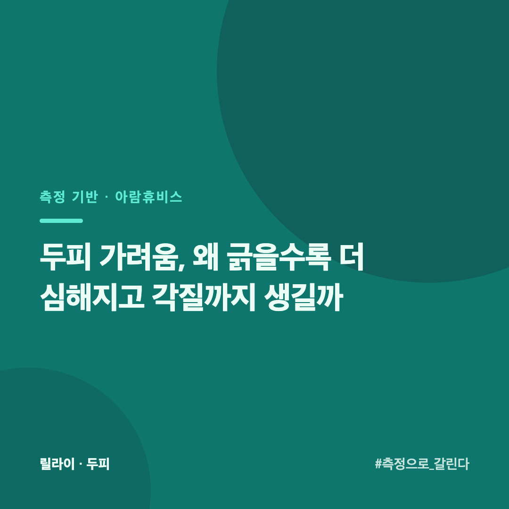
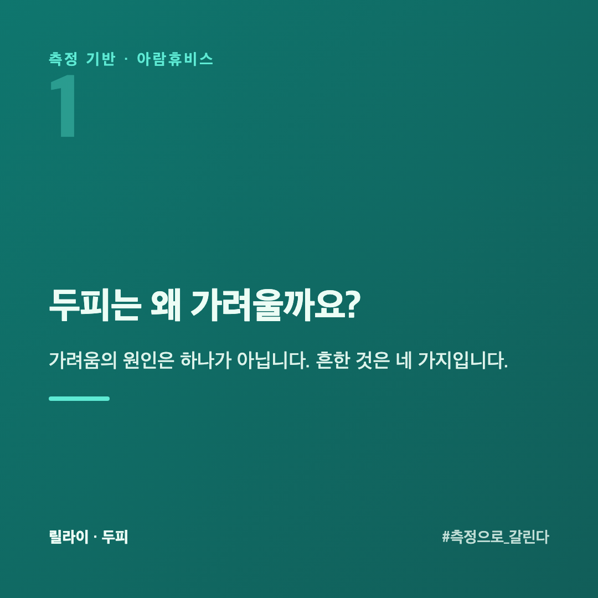
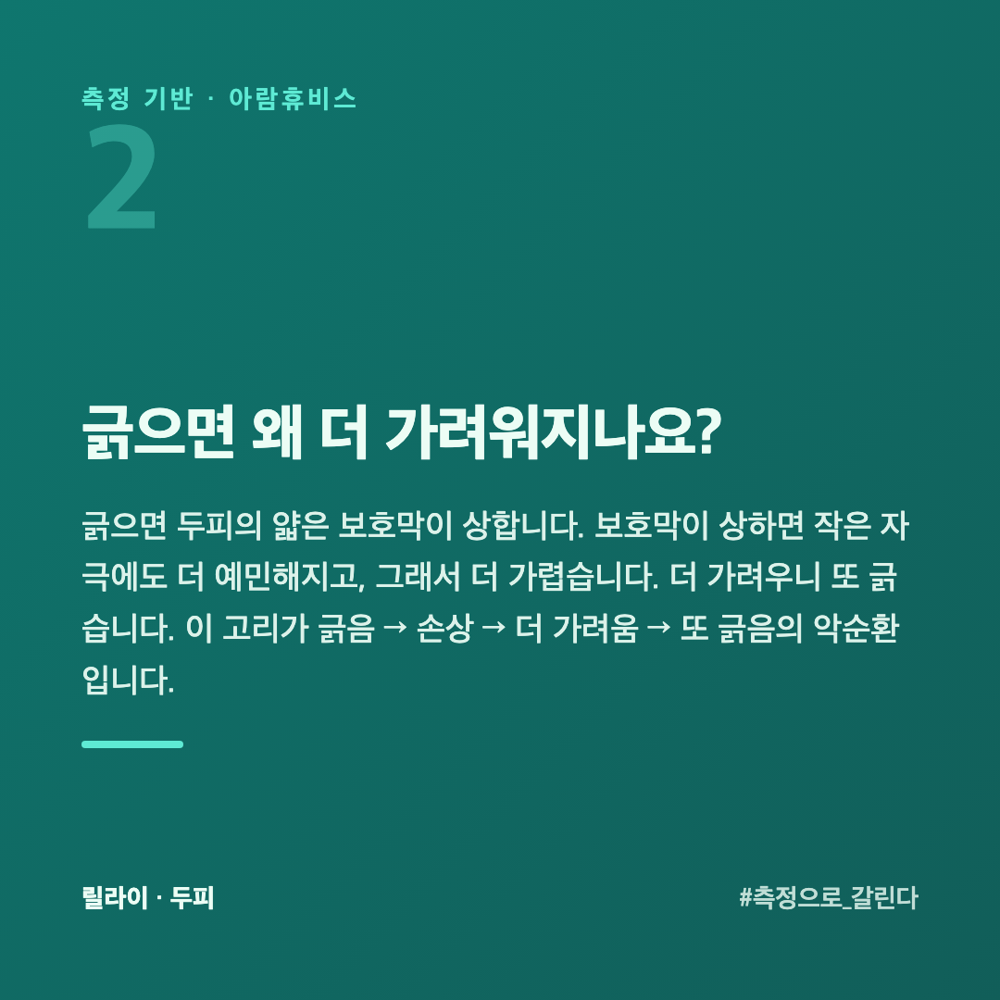
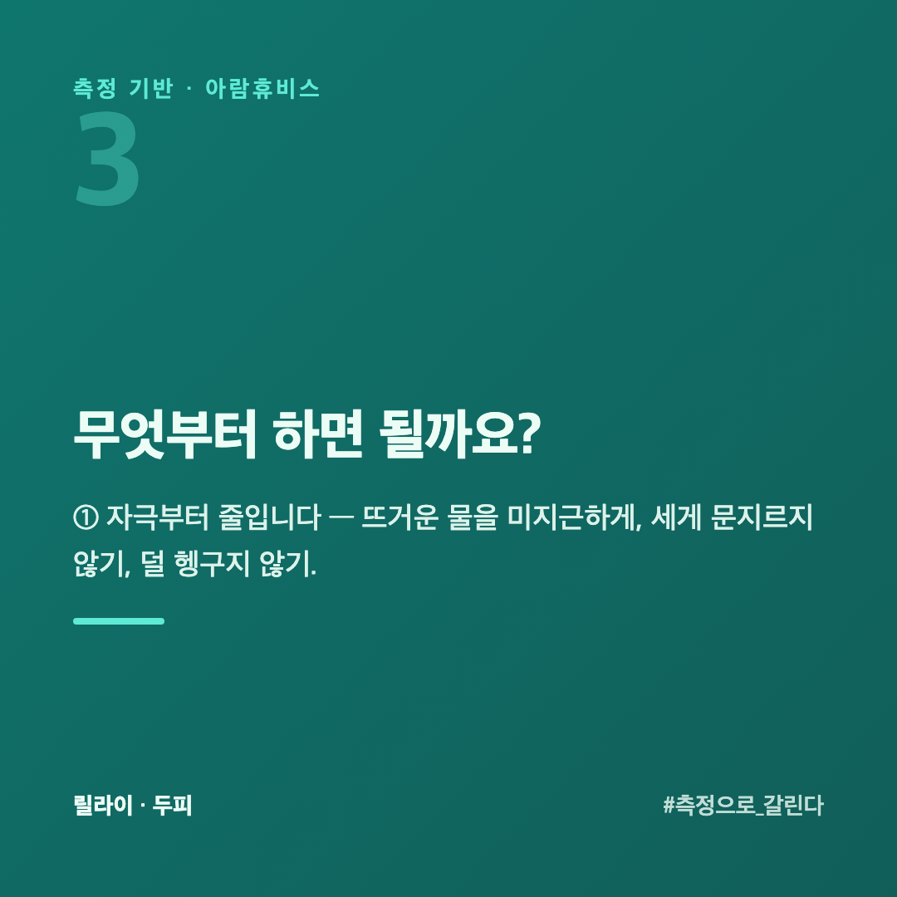
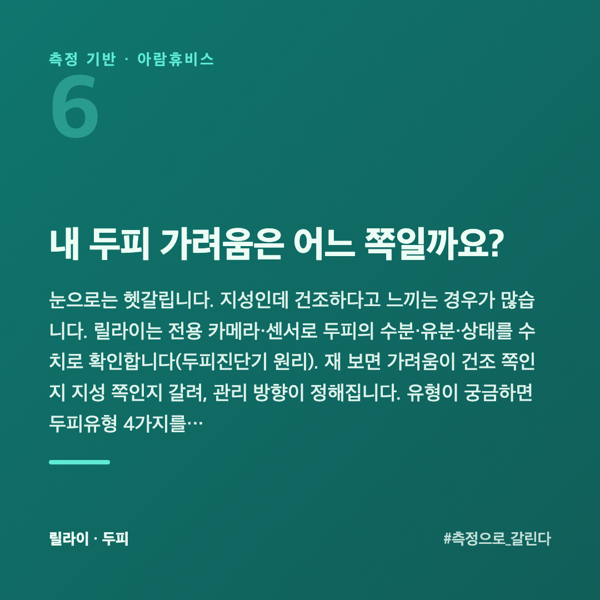
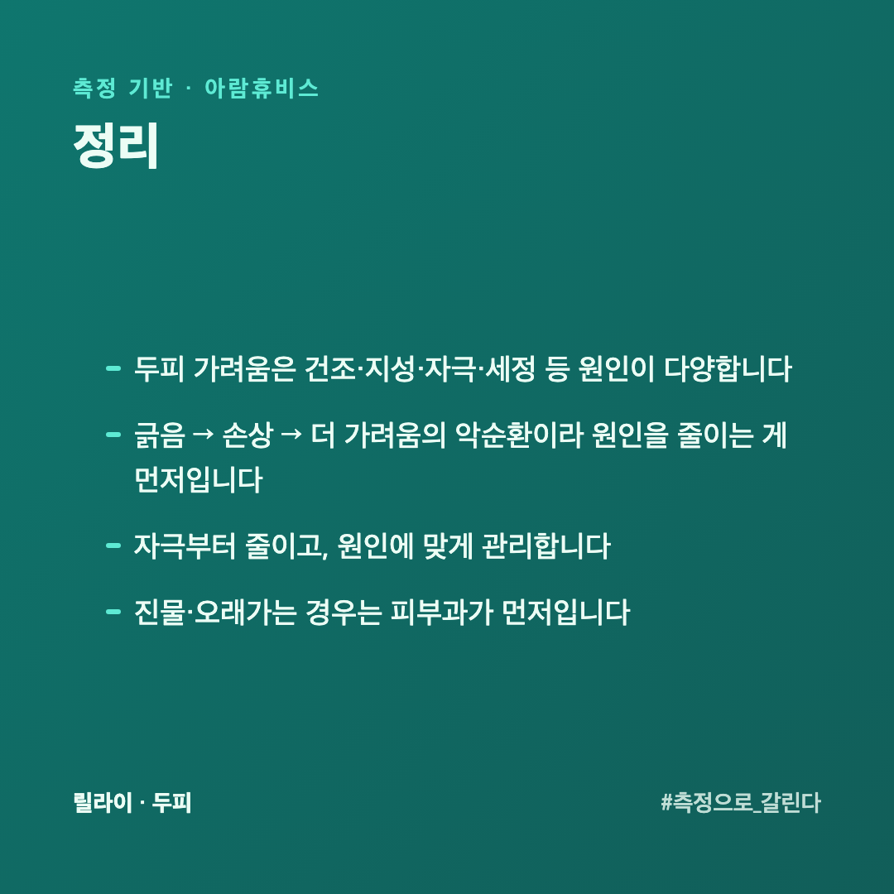
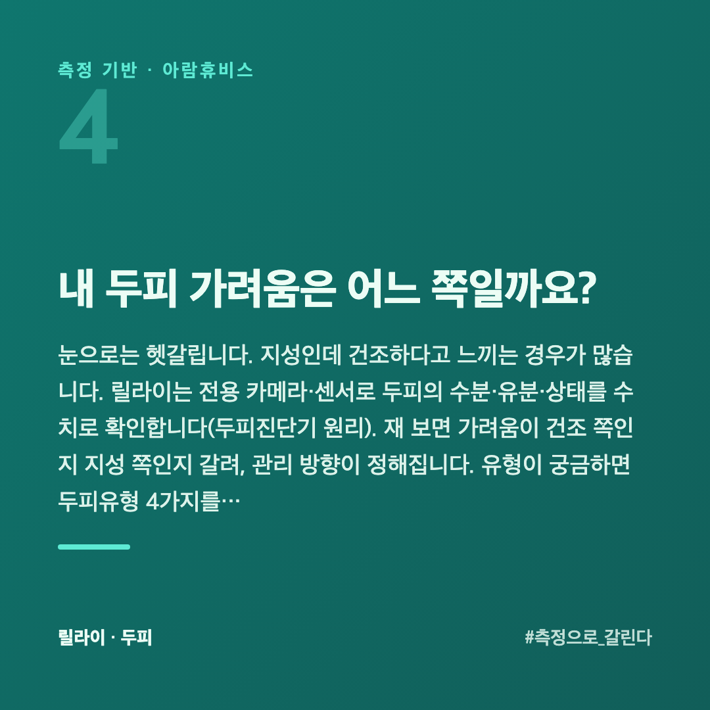

# 두피 가려움, 왜 긁을수록 더 심해지고 각질까지 생길까

두피가 가려워 긁으면 그 순간은 시원합니다. 그런데 조금 지나면 더 가렵습니다. 긁을수록 심해지는 데는 이유가 있습니다.

이 글은 두피를 수치로 재 온 회사 입장에서, 두피 가려움의 원인과 긁음의 악순환, 그리고 무엇부터 봐야 하는지를 정리했습니다.

## 두피는 왜 가려울까요?

가려움의 원인은 하나가 아닙니다. 흔한 것은 네 가지입니다.

- **건조** — 두피가 메말라 각질이 일고 당기면서 가렵습니다.
- **지성·비듬** — 유분이 많아 각질과 엉기고, 그 과정에서 가렵습니다.
- **자극·민감** — 샴푸 성분, 뜨거운 물, 잦은 염색·펌이 두피를 자극합니다.
- **세정 문제** — 덜 헹군 잔여물, 또는 지나친 세정으로 장벽이 상합니다.

원인이 다르면 해야 할 일도 다릅니다. 건조는 수분·진정, 지성은 유분 관리, 자극은 원인 제거가 먼저입니다.

## 긁으면 왜 더 가려워지나요?

긁으면 두피의 얇은 보호막이 상합니다. 보호막이 상하면 작은 자극에도 더 예민해지고, 그래서 더 가렵습니다. 더 가려우니 또 긁습니다. 이 고리가 **긁음 → 손상 → 더 가려움 → 또 긁음**의 악순환입니다.

그래서 "가려움을 참자"가 아니라 **가려운 원인을 줄이는 것**이 먼저입니다. 원인이 남아 있으면 긁지 않기가 어렵습니다.

## 무엇부터 하면 될까요?

**① 자극부터 줄입니다** — 뜨거운 물을 미지근하게, 세게 문지르지 않기, 덜 헹구지 않기.

**② 원인에 맞게 관리합니다** — 건조하면 보습·진정, 지성이면 유분 관리. 둘을 반대로 하면 더 나빠집니다.

**③ 안 나아지면 전문가에게** — 진물이 나거나 오래 가면 두피 자체의 문제일 수 있습니다. 제품보다 피부과가 먼저입니다.

## 샴푸를 바꿨더니 가려워졌으면 어떻게 하나요?

**원래 쓰던 것으로 돌아갑니다.** 바꾼 뒤에 생긴 것이면 그게 가장 빠른 확인입니다. 돌아가서 가라앉으면 원인이 분명해집니다.

그래도 새 제품을 쓰고 싶다면 **섞어 쓰지 않습니다.** 두 개를 번갈아 쓰면 무엇 때문인지 또 못 가립니다.

바꿀 때는 **한 번에 하나만** 바꿉니다. 샴푸와 트리트먼트와 에센스를 같이 바꾸면 범인을 못 찾습니다.

새 제품은 **2주**를 봅니다. 첫 며칠 가렵다가 가라앉는 경우도 있지만, 2주가 지나도 그대로면 안 맞는 것입니다.

## 밤에 유독 가려운 이유가 있나요?

있습니다. 세 가지가 겹칩니다.

**체온이 오릅니다** — 누우면 두피 쪽 혈류가 늘고 가려움이 더 크게 느껴집니다.

**할 일이 없습니다** — 낮에는 다른 데 신경이 가 있어 덜 느끼지만 밤에는 그 감각만 남습니다.

**낮에 긁은 자리가 있습니다** — 이미 자극된 자리가 밤에 올라옵니다.

밤에 심하다면 **저녁에 감고 완전히 말리는** 쪽으로 바꿔 봅니다. 자기 전 두피가 깨끗하고 마른 상태면 밤의 가려움이 줄어듭니다.

## 내 두피 가려움은 어느 쪽일까요?

눈으로는 헷갈립니다. 지성인데 건조하다고 느끼는 경우가 많습니다. 릴라이는 전용 카메라·센서로 두피의 수분·유분·상태를 수치로 확인합니다([두피진단기 원리](https://blog.naver.com/ianlove80/224448093055)). 재 보면 가려움이 건조 쪽인지 지성 쪽인지 갈려, 관리 방향이 정해집니다. 유형이 궁금하면 [두피유형 4가지](https://blog.naver.com/ianlove80/224451102482)를 함께 보세요.

릴라이 공식몰 → [lilai.ai](https://lilai.ai)

## 정리

- 두피 가려움은 **건조·지성·자극·세정** 등 원인이 다양합니다
- **긁음 → 손상 → 더 가려움**의 악순환이라 원인을 줄이는 게 먼저입니다
- 자극부터 줄이고, **원인에 맞게** 관리합니다
- 진물·오래가는 경우는 **피부과가 먼저**입니다
