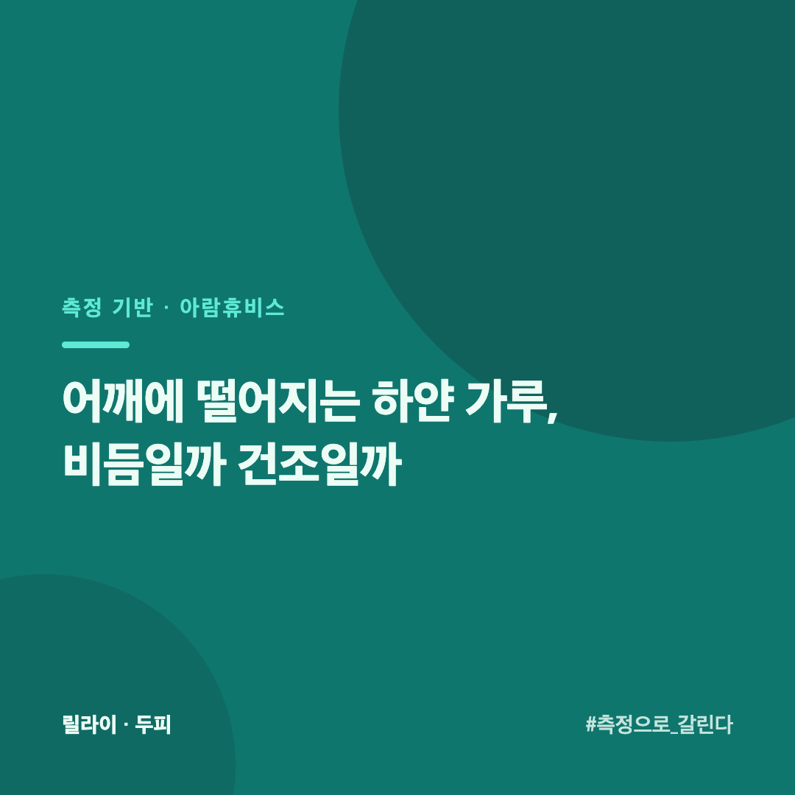
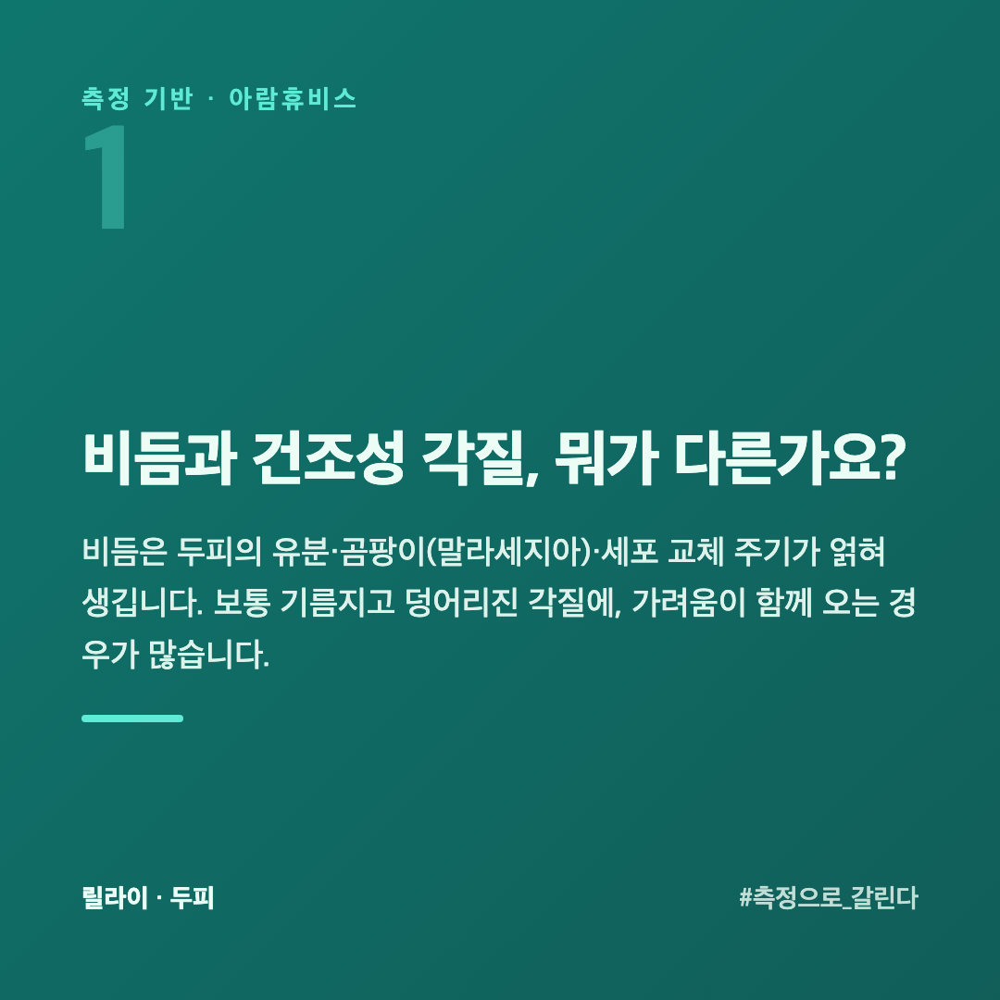
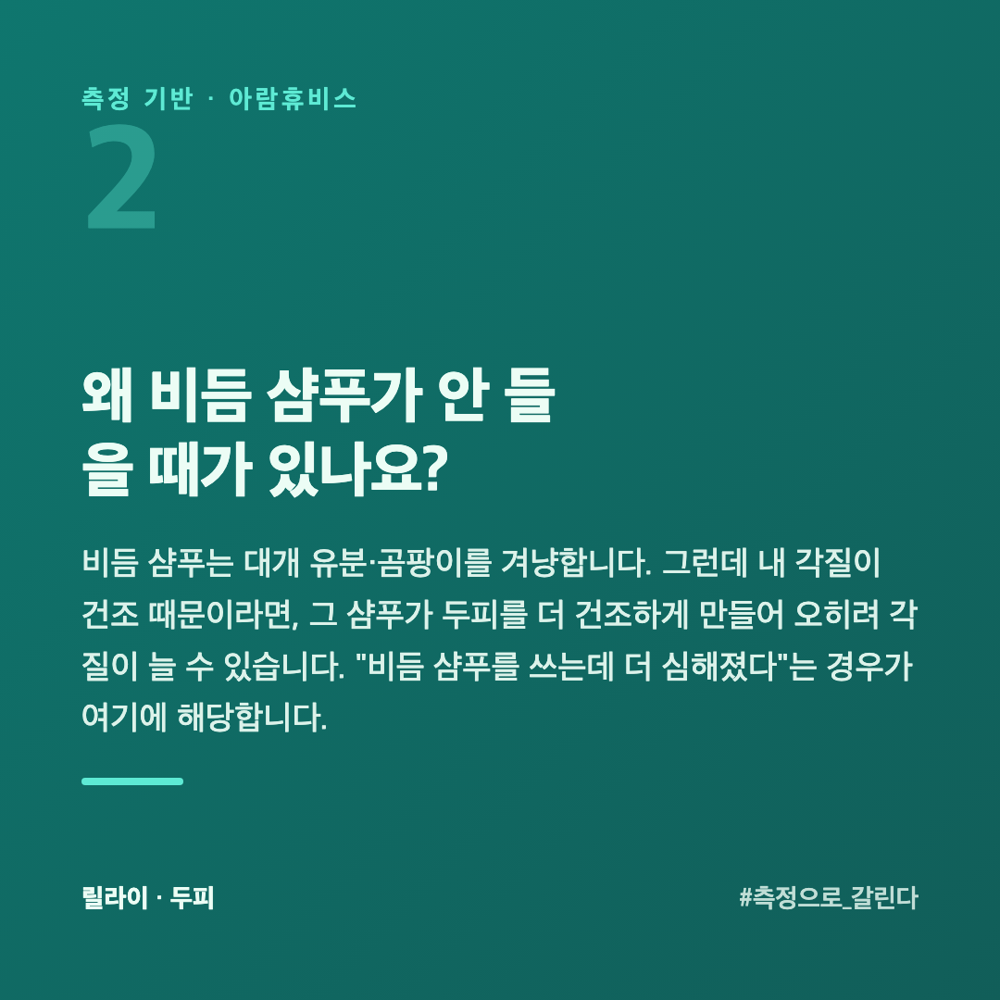
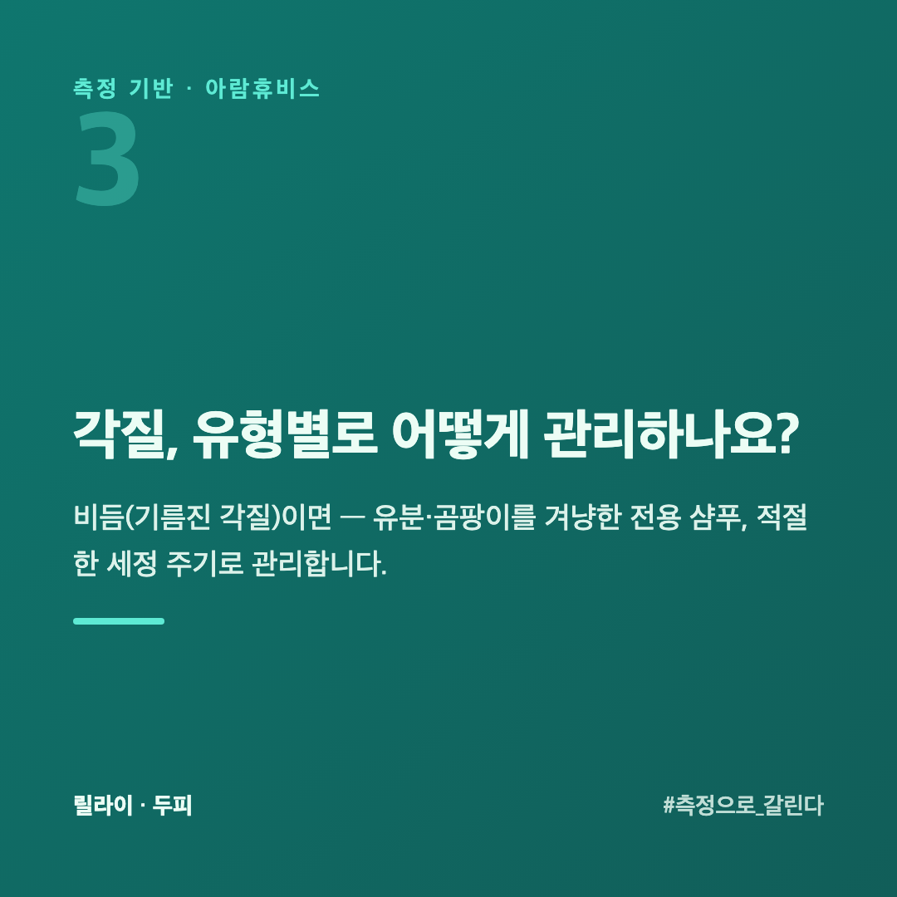
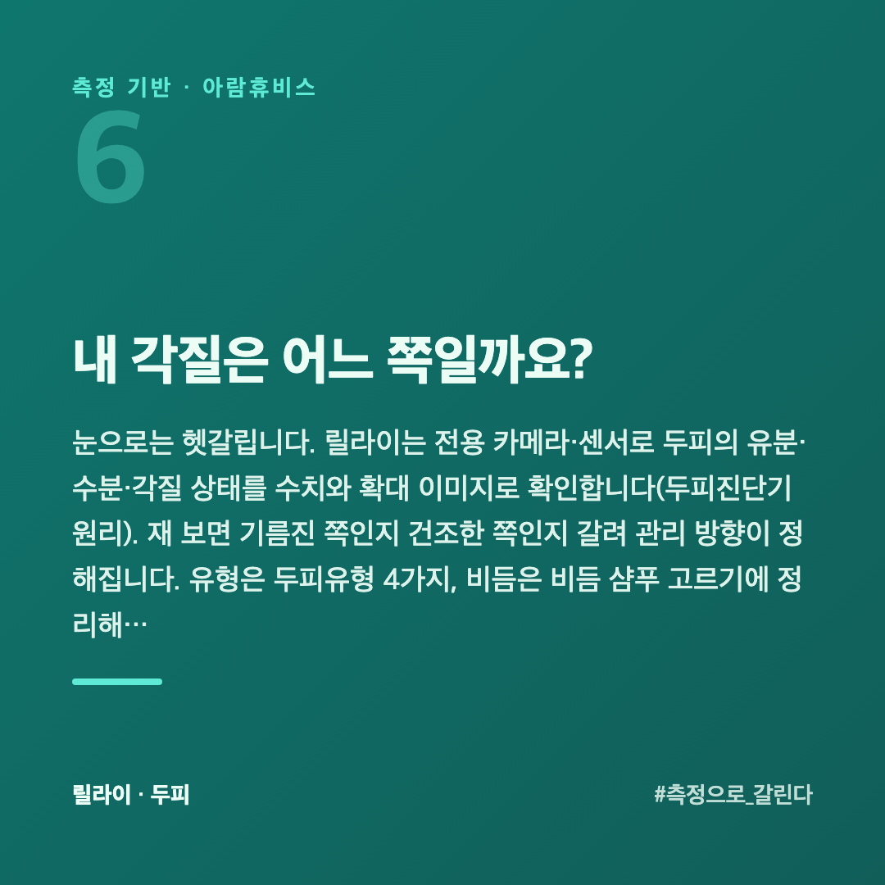
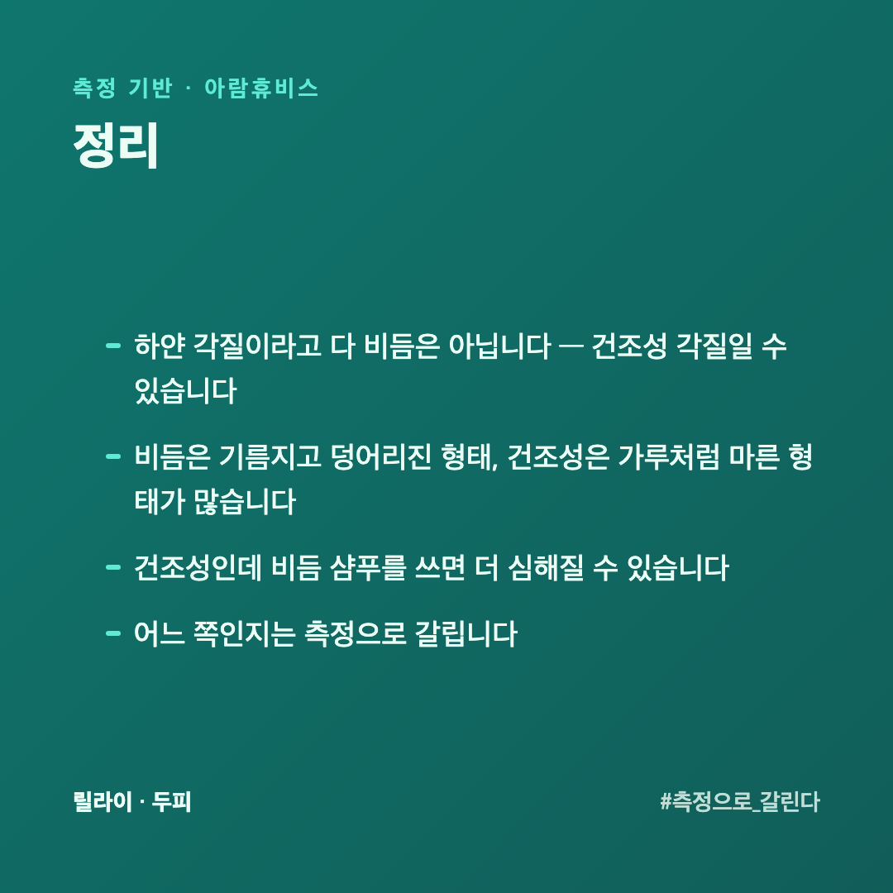

# 어깨에 떨어지는 하얀 가루, 비듬일까 건조일까

검은 옷을 입으면 어깨에 하얀 가루가 보입니다. "비듬인가" 싶어 비듬 샴푸를 쓰는데 나아지지 않습니다. 사실 하얀 각질이라고 다 비듬은 아닙니다. 비듬과 건조성 각질은 원인이 다르고, 관리도 다릅니다.

이 글은 두피를 수치로 재 온 회사 입장에서, 둘을 어떻게 구분하고 관리하는지 정리했습니다.

## 비듬과 건조성 각질, 뭐가 다른가요?

**비듬**은 두피의 유분·곰팡이(말라세지아)·세포 교체 주기가 얽혀 생깁니다. 보통 **기름지고 덩어리진** 각질에, 가려움이 함께 오는 경우가 많습니다.

**건조성 각질**은 말 그대로 두피가 건조해서 생깁니다. **가루처럼 곱고 마른** 형태가 많고, 당기는 느낌이 함께 옵니다.

이 둘을 구분하지 않으면 관리가 어긋납니다.

## 왜 비듬 샴푸가 안 들을 때가 있나요?

비듬 샴푸는 대개 유분·곰팡이를 겨냥합니다. 그런데 내 각질이 **건조 때문**이라면, 그 샴푸가 두피를 더 건조하게 만들어 **오히려 각질이 늘 수** 있습니다. "비듬 샴푸를 쓰는데 더 심해졌다"는 경우가 여기에 해당합니다.

## 각질, 유형별로 어떻게 관리하나요?

**비듬(기름진 각질)이면** — 유분·곰팡이를 겨냥한 전용 샴푸, 적절한 세정 주기로 관리합니다.

**건조성 각질이면** — 세정을 과하게 하지 않고, 두피 보습·수분을 챙깁니다. 뜨거운 물과 강한 세정은 피합니다.

**둘이 섞여 있으면** — 흔합니다. 이럴수록 정확한 진단이 필요합니다.

## 각질이 생기는 자리가 정해져 있나요?

보는 자리가 단서가 됩니다.

**정수리와 가르마 쪽** — 유분이 많이 나는 자리입니다. 여기에 몰려 있으면 지성 쪽일 가능성이 큽니다.

**이마 가장자리와 귀 뒤** — 헹굼이 잘 안 되는 자리입니다. 여기만 유독 심하면 **각질이 아니라 샴푸 잔여물**일 수 있습니다.

**머리 전체에 고르게** — 건조 쪽에 가깝습니다. 계절을 타면 더 그렇습니다.

어느 자리인지 한 번 보고 나면, 바꿀 것이 달라집니다. 전체를 바꾸기 전에 **그 자리만 더 헹궈 보는 것**으로 풀리는 경우가 꽤 있습니다.

## 머리를 안 감으면 각질이 줄어드나요?

줄지 않습니다. 오히려 쌓입니다. 각질은 계속 만들어지는데 씻어 내지 않으면 유분과 엉겨 덩어리가 됩니다.

반대로 너무 자주, 너무 세게 감는 것도 답이 아닙니다. 건조 쪽 각질이면 감을수록 더 일어납니다.

기준은 **두피 상태**입니다. 기름져서 가라앉는 느낌이면 감는 쪽이 맞고, 당기고 가루가 날리면 **세기를 줄이고 보습을 더하는** 쪽이 맞습니다. 횟수를 정해 놓고 따르기보다 상태를 보고 조절하는 편이 낫습니다.

## 내 각질은 어느 쪽일까요?

눈으로는 헷갈립니다. 릴라이는 전용 카메라·센서로 두피의 유분·수분·각질 상태를 수치와 확대 이미지로 확인합니다([두피진단기 원리](https://blog.naver.com/ianlove80/224448093055)). 재 보면 기름진 쪽인지 건조한 쪽인지 갈려 관리 방향이 정해집니다. 유형은 [두피유형 4가지](https://blog.naver.com/ianlove80/224451102482), 비듬은 [비듬 샴푸, 비듬 종류부터 알고 고르기](https://blog.naver.com/ianlove80/224451146616)에 정리해 두었습니다.

릴라이 공식몰 → [lilai.ai](https://lilai.ai)

## 정리

- 하얀 각질이라고 **다 비듬은 아닙니다** — 건조성 각질일 수 있습니다
- 비듬은 **기름지고 덩어리진** 형태, 건조성은 **가루처럼 마른** 형태가 많습니다
- 건조성인데 비듬 샴푸를 쓰면 **더 심해질 수** 있습니다
- 어느 쪽인지는 **측정으로** 갈립니다
