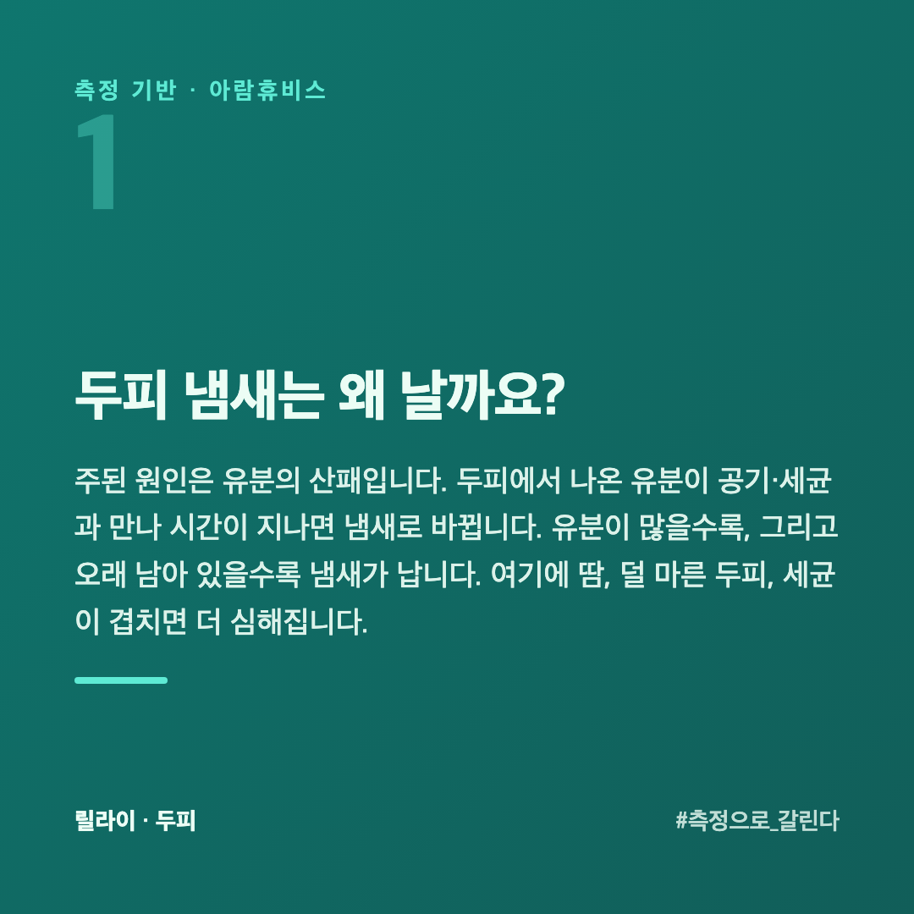
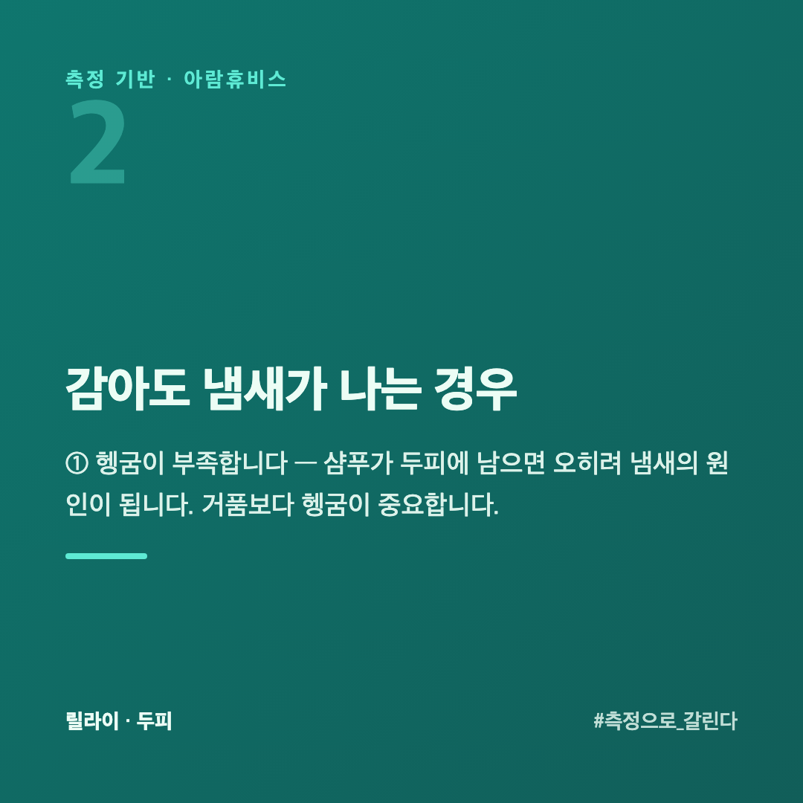
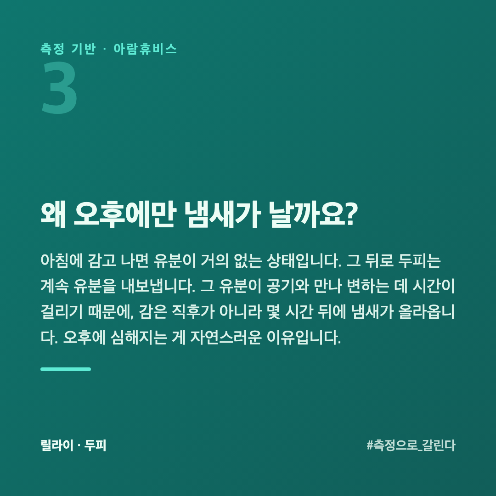
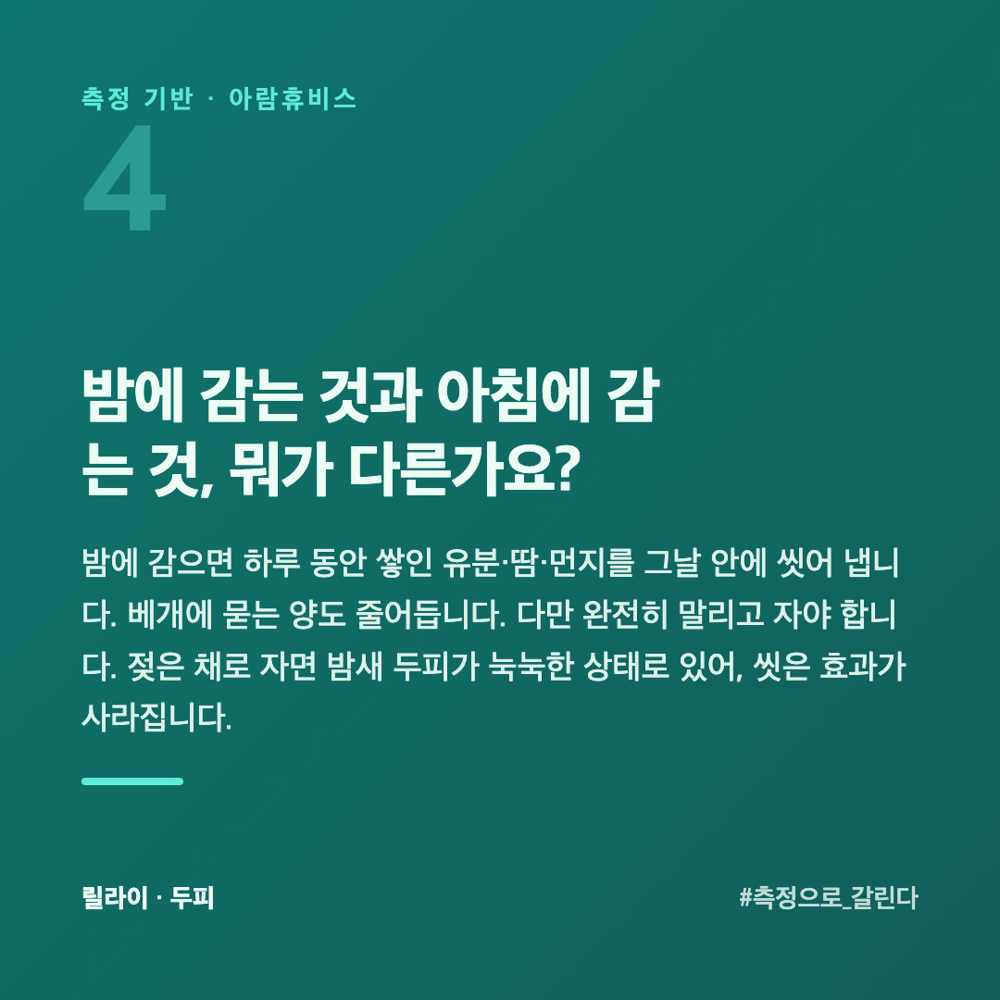
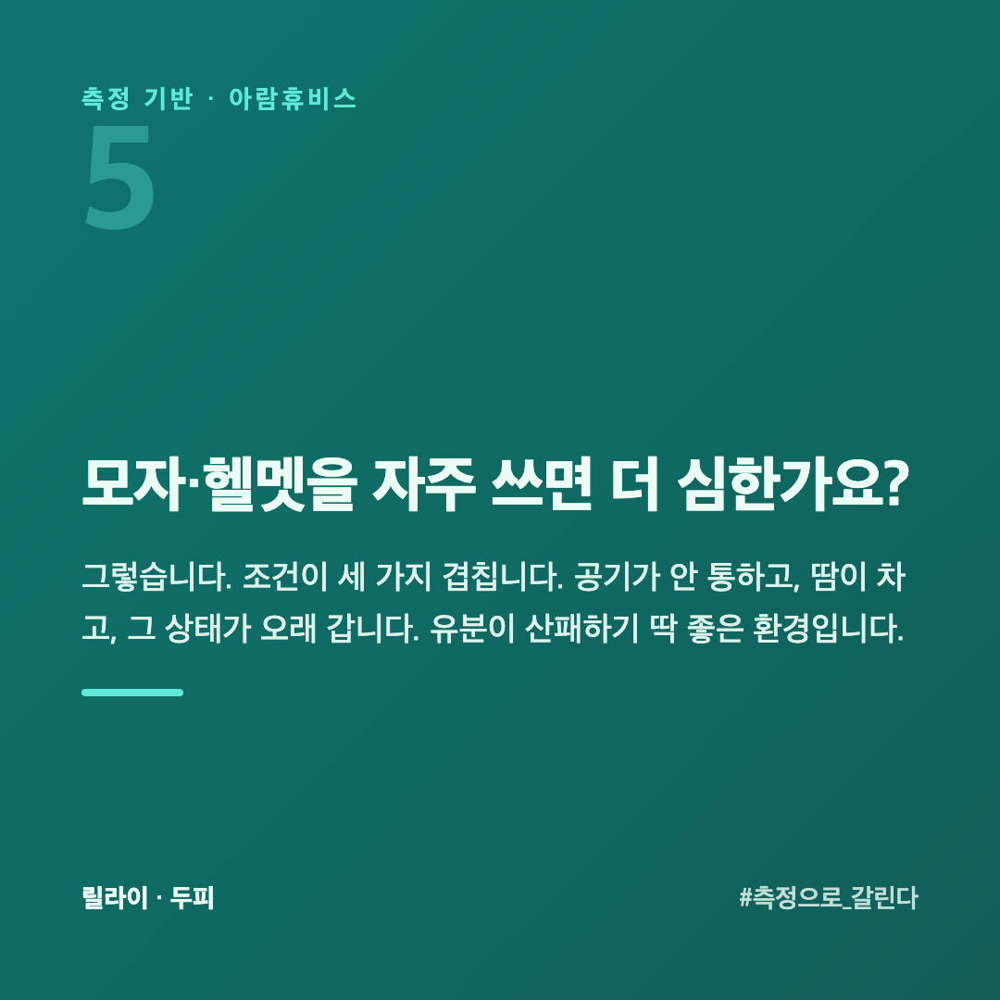
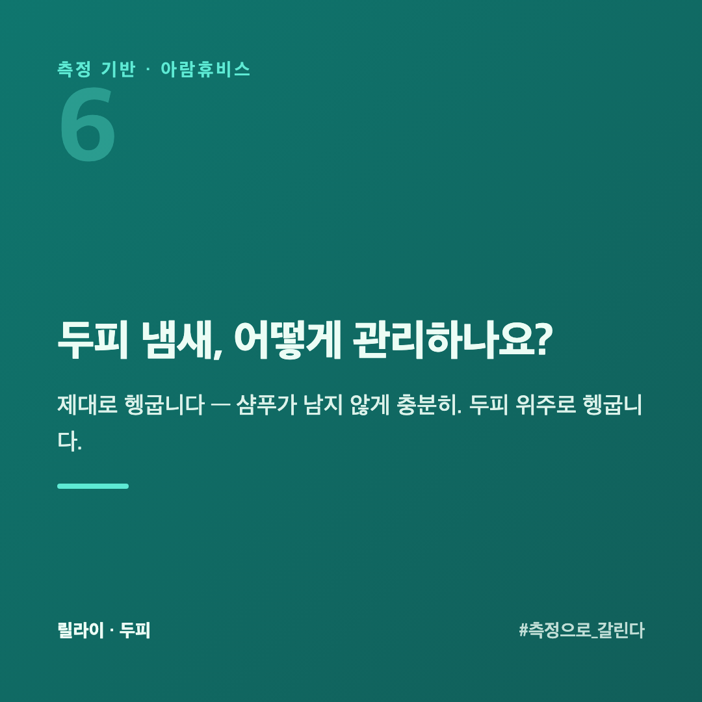
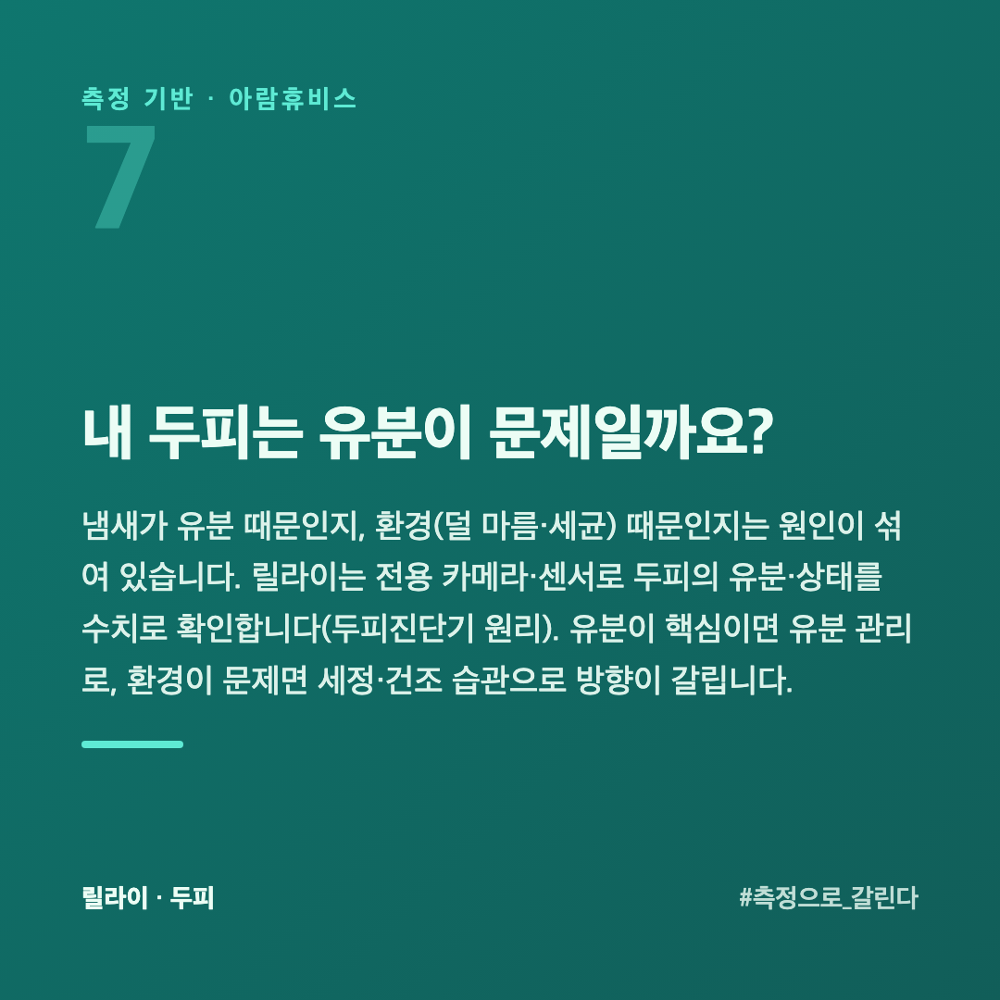

# 두피 냄새, 아침에 감았는데 오후만 되면 나는 이유

분명 아침에 감았는데 오후가 되면 두피에서 냄새가 납니다. 손으로 쓸어 보면 더 확실합니다. 감는 횟수를 늘려도 그때뿐입니다. 두피 냄새는 "안 감아서"가 아니라, 다른 원인이 있는 경우가 많습니다.

이 글은 두피를 수치로 재 온 회사 입장에서, 두피 냄새의 원인과 관리를 정리했습니다.

## 두피 냄새는 왜 날까요?

주된 원인은 **유분의 산패**입니다. 두피에서 나온 유분이 공기·세균과 만나 시간이 지나면 냄새로 바뀝니다. 유분이 많을수록, 그리고 오래 남아 있을수록 냄새가 납니다. 여기에 **땀, 덜 마른 두피, 세균**이 겹치면 더 심해집니다.

## 감아도 냄새가 나는 경우

**① 헹굼이 부족합니다** — 샴푸가 두피에 남으면 오히려 냄새의 원인이 됩니다. 거품보다 **헹굼**이 중요합니다.

**② 유분이 많습니다** — 지성 두피는 감은 뒤에도 유분이 빠르게 올라와 냄새가 빨리 돌아옵니다.

**③ 덜 말린 채로 둡니다** — 젖은 두피는 세균이 번식하기 좋은 환경입니다. 자연 건조로 오래 두면 쉰내가 날 수 있습니다.

## 왜 오후에만 냄새가 날까요?

아침에 감고 나면 유분이 거의 없는 상태입니다. 그 뒤로 두피는 계속 유분을 내보냅니다. 그 유분이 공기와 만나 변하는 데 시간이 걸리기 때문에, 감은 직후가 아니라 **몇 시간 뒤**에 냄새가 올라옵니다. 오후에 심해지는 게 자연스러운 이유입니다.

그래서 "더 자주 감자"는 답이 되기 어렵습니다. 강하게 걷어 낼수록 두피는 모자란다고 느껴 유분을 더 내보냅니다. 감은 뒤 냄새가 더 빨리 돌아오는 경험이 여기서 나옵니다.

## 밤에 감는 것과 아침에 감는 것, 뭐가 다른가요?

**밤에 감으면** 하루 동안 쌓인 유분·땀·먼지를 그날 안에 씻어 냅니다. 베개에 묻는 양도 줄어듭니다. 다만 **완전히 말리고 자야** 합니다. 젖은 채로 자면 밤새 두피가 눅눅한 상태로 있어, 씻은 효과가 사라집니다.

**아침에 감으면** 출근 직후는 개운하지만, 전날 밤 쌓인 것을 베개에 그대로 묻히고 잔 셈이 됩니다. 베개 커버를 자주 바꾸지 않으면 그게 다시 두피로 돌아옵니다.

밤에 감고 완전히 말리는 쪽이 냄새에는 유리합니다. 아침에 감아야 한다면 **베개 커버를 주 1~2회** 바꾸는 것이 같이 가야 합니다.

## 모자·헬멧을 자주 쓰면 더 심한가요?

그렇습니다. 조건이 세 가지 겹칩니다. 공기가 안 통하고, 땀이 차고, 그 상태가 오래 갑니다. 유분이 산패하기 딱 좋은 환경입니다.

바꿀 수 있는 것부터 봅니다. **쓰기 전에 두피를 완전히 말립니다.** 중간에 벗어 **10분 정도 바람을 쐬어** 줍니다. 모자 안쪽도 땀이 배므로 **빨거나 바꿔 줍니다** — 두피만 관리하고 모자를 그대로 두면 다시 돌아옵니다.

## 두피 냄새, 어떻게 관리하나요?

- **제대로 헹굽니다** — 샴푸가 남지 않게 충분히. 두피 위주로 헹굽니다.

- **완전히 말립니다** — 특히 두피 속까지. 젖은 채 자거나 모자를 쓰지 않습니다.
- **유분을 관리합니다** — 지성 두피면 유분 관리가 핵심입니다. 단, 과한 세정은 [지성 두피에서 역효과가 나는 이유](https://blog.naver.com/ianlove80/224450821499)이니 적절히.
- **냄새가 심하고 가려움·각질이 동반되면** 지루성 두피 문제일 수 있으니 전문가 상담을 권합니다.

## 내 두피는 유분이 문제일까요?

냄새가 유분 때문인지, 환경(덜 마름·세균) 때문인지는 원인이 섞여 있습니다. 릴라이는 전용 카메라·센서로 두피의 유분·상태를 수치로 확인합니다([두피진단기 원리](https://blog.naver.com/ianlove80/224448093055)). 유분이 핵심이면 유분 관리로, 환경이 문제면 세정·건조 습관으로 방향이 갈립니다.

릴라이 공식몰 → [lilai.ai](https://lilai.ai)

## 정리

- 두피 냄새의 주원인은 **유분의 산패**, 여기에 땀·세균·덜 마른 두피가 겹칩니다
- 감아도 나는 건 **헹굼 부족·유분 과다·덜 마름** 때문인 경우가 많습니다
- **제대로 헹구고, 완전히 말리고, 유분을 관리**하는 게 기본입니다
- 유분이 핵심인지 환경이 문제인지는 **측정으로** 갈립니다
- 오후에 심해지는 건 **유분이 변하는 데 시간이 걸려서**입니다 — 더 자주 감는 건 답이 아닙니다
- **밤에 감고 완전히 말리는** 쪽이 냄새에는 유리합니다
- 모자·헬멧을 쓴다면 **모자 안쪽도 같이** 관리합니다
