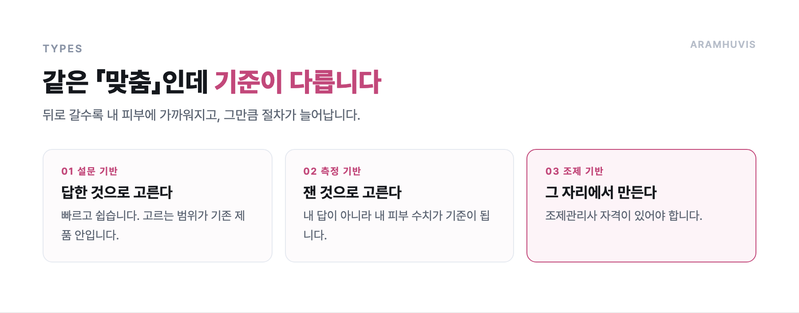
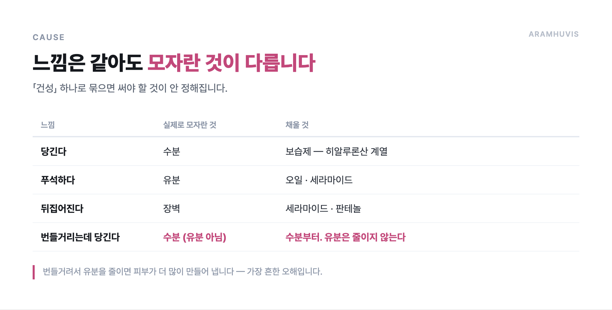
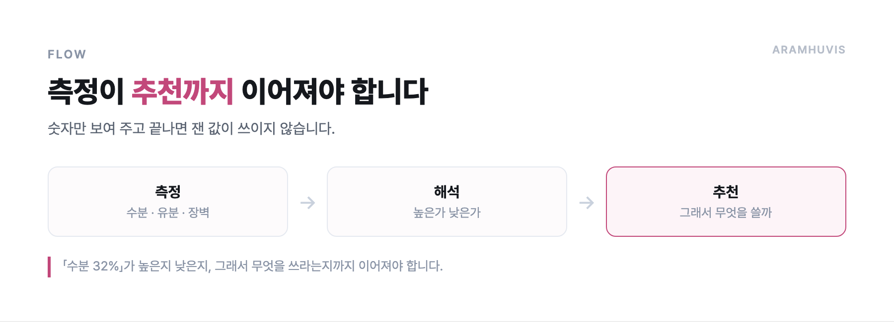
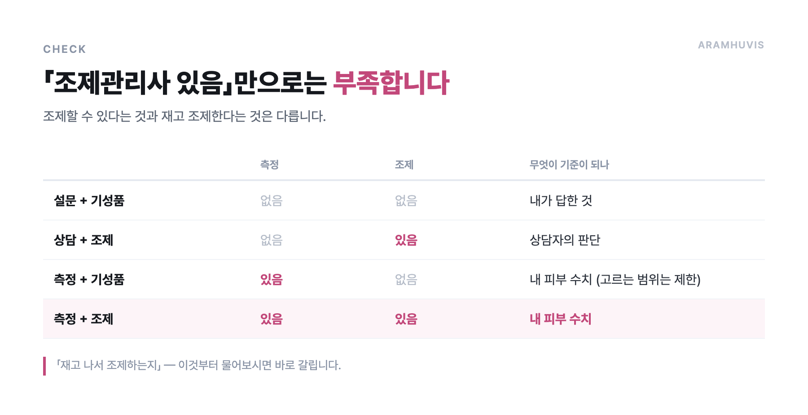
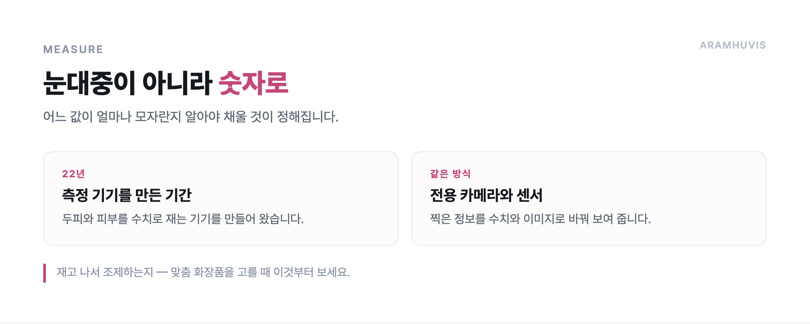

# 맞춤형 화장품, 내 피부에 맞는 걸 고르는 순서

"맞춤"이라는 말이 붙은 화장품이 많아졌습니다. 그런데 무엇을 기준으로 맞춘 것인지는 제품마다 다릅니다. 설문으로 고른 것도 맞춤이라 하고, 피부를 재서 조제한 것도 맞춤이라 합니다.

이 글은 피부를 수치로 재는 기기를 22년 만들어 온 입장에서, 맞춤 화장품을 고를 때 실제로 볼 것을 정리했습니다.

## 맞춤형 화장품 브랜드는 무엇으로 구분하나요?

맞춤 화장품은 크게 세 가지로 나뉩니다. 설문 기반, 측정 기반, 조제 기반입니다. 뒤로 갈수록 내 피부에 가까워지지만 그만큼 절차가 늘어납니다.

**① 설문 기반** — 질문에 답하면 이미 만들어진 제품 중에서 골라 줍니다. 빠르고 쉽지만, 고르는 범위가 기존 제품 안입니다.

**② 측정 기반** — 기기로 피부 상태를 재고 그 결과로 제품을 추천합니다. 내 답이 아니라 **내 피부 수치**가 기준이 됩니다.

**③ 조제 기반** — 측정 결과에 맞춰 그 자리에서 섞어 만듭니다. 국내에서는 **맞춤형화장품 조제관리사** 자격이 있어야 합니다.

## 내 피부 타입에 맞는 제품을 어떻게 고르나요?

타입을 먼저 정하고 제품을 고르는 순서가 아닙니다. **지금 상태를 재고, 모자란 것부터 채우는** 순서입니다.

흔히 쓰는 지성·건성·복합성은 평균값입니다. 같은 "건성"이라도 수분이 모자란 사람과 유분이 모자란 사람은 써야 할 것이 다릅니다. 둘 다 "건조하다"고 느끼지만 원인이 다릅니다.

| 느낌 | 실제로 모자란 것 | 채울 것 |
|---|---|---|
| 당긴다 | 수분 | 보습제 — 히알루론산 계열 |
| 푸석하다 | 유분 | 유분 — 오일·세라마이드 |
| 뒤집어진다 | 장벽 | 장벽 성분 — 세라마이드·판테놀 |
| 번들거리는데 당긴다 | **수분 (유분 아님)** | 수분부터. 유분은 줄이지 않는다 |

마지막 줄이 가장 흔한 오해입니다. 번들거려서 유분을 줄이면 피부가 더 많이 만들어 냅니다. **수분이 모자라서 유분으로 메우려는 상태**인 경우가 많습니다.

## 피부 진단 후 제품을 추천받을 수 있는 곳이 있나요?

측정 기기를 둔 매장에서 받을 수 있습니다. 다만 받기 전에 두 가지를 확인하시면 좋습니다.

**무엇을 재는지** — 수분량만 재는 곳과, 수분·유분·장벽·색소·모공을 함께 재는 곳은 결과가 다릅니다. 항목이 많을수록 좋다기보다, **추천으로 이어지는 항목**을 재는지가 중요합니다.

**결과를 설명해 주는지** — 숫자만 보여 주고 끝나면 소용이 없습니다. "수분 32%"가 높은지 낮은지, 그래서 무엇을 쓰라는지까지 이어져야 측정한 값이 쓰입니다.

## 맞춤화장품 조제관리사가 있는 브랜드는 무엇이 다른가요?

조제관리사는 **화장품법에 따른 국가 자격**입니다. 맞춤형화장품판매업소에는 조제관리사를 두어야 하고, 내용물에 원료를 섞거나 소분해 파는 일을 이 사람이 합니다.

그래서 "조제관리사가 있다"는 말은 **그 자리에서 섞어 만들 수 있다**는 뜻입니다. 이미 만들어진 제품 중에서 고르는 것과 다릅니다.

다만 조제관리사가 있다고 모두 측정 기반인 것은 아닙니다. 측정 없이 상담만으로 조제하는 곳도 있습니다. **재고 나서 조제하는지**를 함께 보시면 됩니다.

## 측정해서 만든다는 건 무슨 뜻인가요?

눈으로 "건조해 보인다"가 아니라 수분량·유분량·장벽 상태를 숫자로 재는 것입니다. 어느 값이 얼마나 모자란지 알아야 무엇을 채울지 정해집니다.

저희는 두피와 피부를 재는 기기를 22년 만들어 왔습니다. 무엇을 어떻게 재는지는 [두피진단기 원리](https://blog.naver.com/ianlove80/224448093055) 글에 정리해 두었습니다. 피부도 같은 방식입니다 — 전용 카메라와 센서로 찍고, 그 정보를 수치로 바꿔 보여 줍니다.

측정 결과에서 출발한 맞춤 스킨케어는 [엘라피엘](https://ellapiel.co.kr)에서 볼 수 있습니다.

## 정리

- 맞춤 화장품은 **설문 · 측정 · 조제** 세 가지로 나뉩니다
- 타입을 정하고 고르는 게 아니라 **재고 모자란 것부터** 채웁니다
- 번들거리는데 당기면 **유분이 아니라 수분**이 모자란 경우가 많습니다
- 조제관리사가 있으면 **그 자리에서 섞어 만들 수** 있습니다
- 측정 없이 조제만 하는 곳도 있으니 **재고 나서 조제하는지** 보세요

내 피부를 재 보고 싶으시면 측정부터 도와드립니다.
