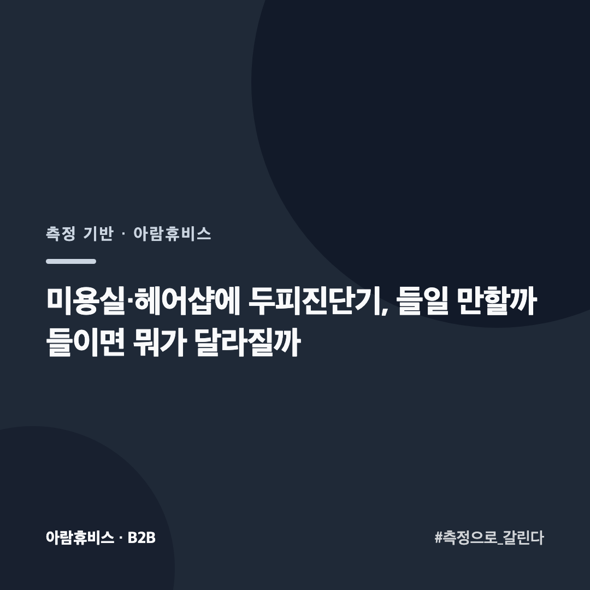
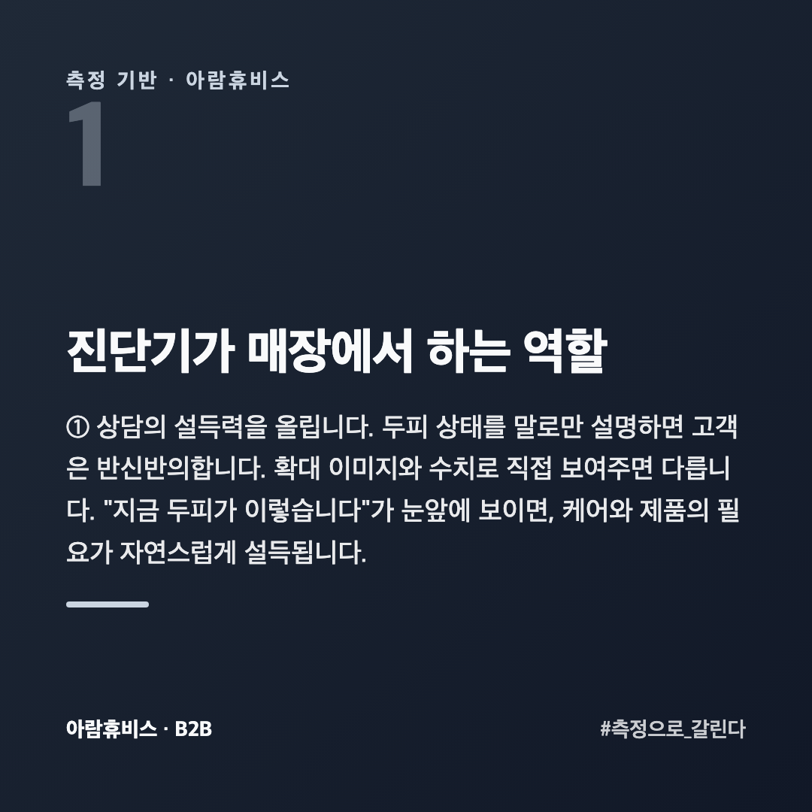
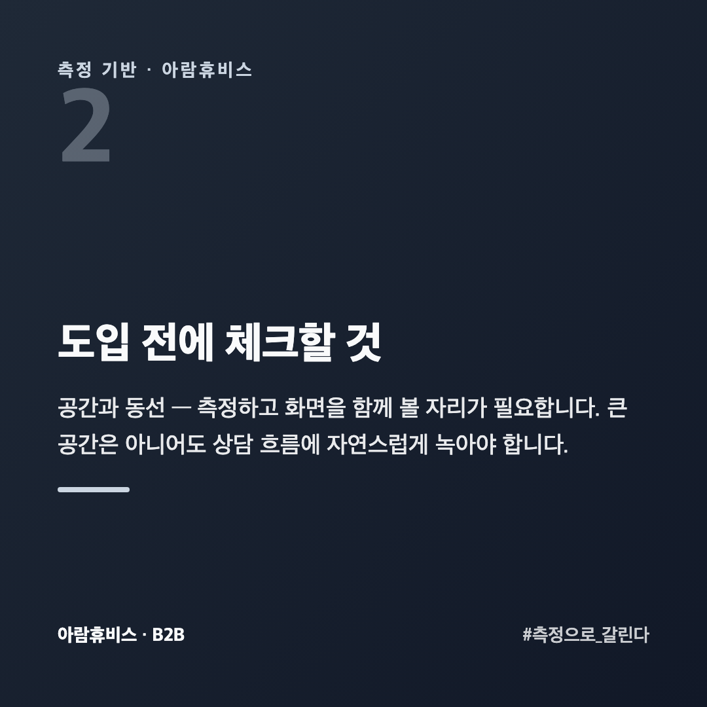
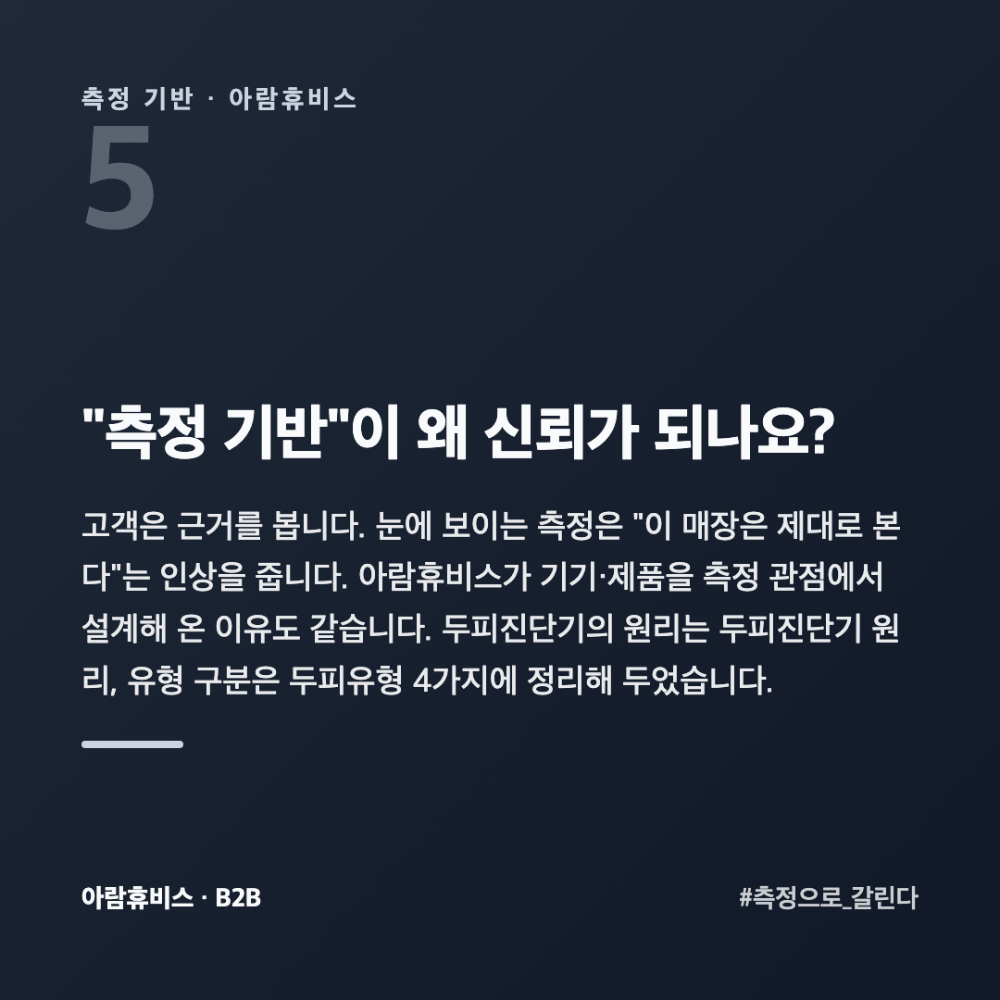
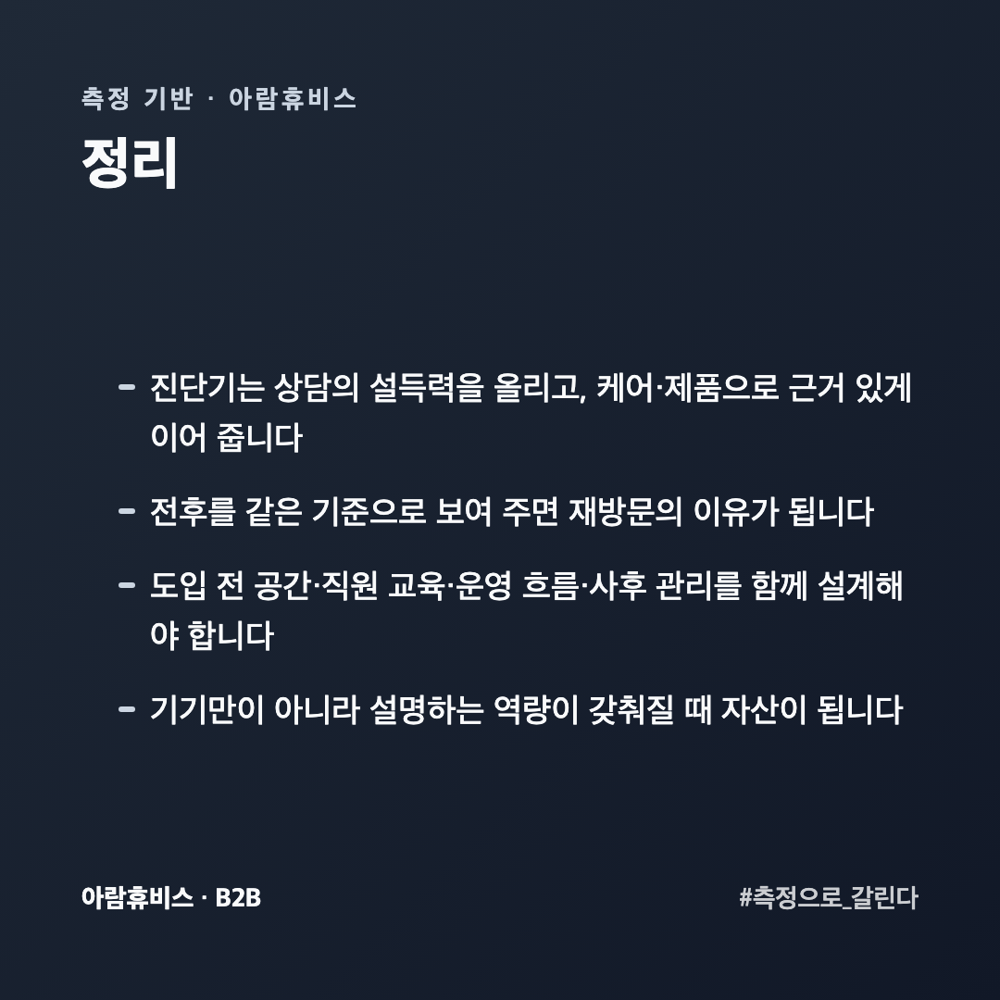

# 미용실·헤어샵에 두피진단기, 들일 만할까 들이면 뭐가 달라질까

두피·탈모 케어를 시작하려는 미용실·헤어샵에서 자주 묻습니다. "두피진단기를 꼭 들여야 하나요?" 기기 값과 공간이 들어가니 당연한 고민입니다.

이 글은 두피 측정 기기를 만들어 온 회사 입장에서, 진단기가 매장에서 실제로 하는 역할과 도입 전 체크포인트를 정리했습니다. 과장 없이, 판단에 필요한 것만 적었습니다.

## 진단기가 매장에서 하는 역할

**① 상담의 설득력을 올립니다.** 두피 상태를 말로만 설명하면 고객은 반신반의합니다. 확대 이미지와 수치로 **직접 보여주면** 다릅니다. "지금 두피가 이렇습니다"가 눈앞에 보이면, 케어와 제품의 필요가 자연스럽게 설득됩니다.

**② 케어·제품으로 이어집니다.** 측정 → 설명 → 제안의 흐름이 생깁니다. 막연한 권유가 아니라 **근거 있는 제안**이 됩니다.

**③ 변화를 보여줄 수 있습니다.** 케어 전후를 같은 기준으로 재면, 고객이 변화를 눈으로 확인합니다. 이게 재방문의 이유가 됩니다.

## 도입 전에 체크할 것

**공간과 동선** — 측정하고 화면을 함께 볼 자리가 필요합니다. 큰 공간은 아니어도 상담 흐름에 자연스럽게 녹아야 합니다.

**직원 교육** — 기기만 있다고 되는 게 아닙니다. 측정 결과를 **고객에게 어떻게 설명할지**가 핵심입니다. 설명이 되면 기기값은 상담의 자산이 됩니다.

**운영 흐름** — 측정을 어느 단계에 넣을지(접수 직후 / 케어 전) 미리 정해 두면 자연스럽습니다.

**사후 관리** — 측정 데이터를 고객별로 남겨 다음 방문에 이어 보면 더 강력합니다.

## 얼마에 회수되나요?

숫자로 따져 봅니다. 기기값을 손님 한 분당 받는 금액으로 나누면 몇 명을 봐야 하는지가 나옵니다.

중요한 건 **진단 자체로 돈을 받느냐**입니다. 진단을 서비스로 끼워 주면 회수는 제품 판매로만 일어납니다. 진단에 값을 매기면 그 자체가 매출이 되고, 제품은 그 위에 붙습니다.

**재방문**도 같이 봅니다. 한 번 재고 끝나면 일회성이지만, 4~8주 뒤 다시 재서 변화를 보여 주면 방문이 한 번 더 생깁니다. 회수 기간을 가르는 건 기기값이 아니라 **다시 오게 만드는 설계**입니다.

## 직원이 쓸 수 있어야 하는데 어렵지 않나요?

기기를 고를 때 **누가 쓰느냐**를 먼저 봅니다. 원장만 쓸 수 있는 기기는 원장이 없는 날 멈춥니다.

볼 것은 세 가지입니다. **재는 데 걸리는 시간**(손님을 앉혀 두는 시간입니다), **결과 화면이 손님에게 바로 설명되는지**(숫자만 나오면 직원이 해석해야 합니다), **기록이 남아 다음에 불러올 수 있는지**입니다.

교육은 한 번으로 끝나지 않습니다. 직원이 바뀌면 다시 가르쳐야 합니다. **설명서보다 화면이 쉬운 쪽**을 고르는 게 길게 보면 싸게 먹힙니다.

## "측정 기반"이 왜 신뢰가 되나요?

고객은 근거를 봅니다. 눈에 보이는 측정은 "이 매장은 제대로 본다"는 인상을 줍니다. 아람휴비스가 기기·제품을 측정 관점에서 설계해 온 이유도 같습니다. 두피진단기의 원리는 [두피진단기 원리](https://blog.naver.com/ianlove80/224448093055), 유형 구분은 [두피유형 4가지](https://blog.naver.com/ianlove80/224451102482)에 정리해 두었습니다.

릴라이 두피케어·기기 도입 문의 → [lilai.ai](https://lilai.ai)

## 정리

- 진단기는 **상담의 설득력**을 올리고, 케어·제품으로 **근거 있게** 이어 줍니다
- 전후를 같은 기준으로 보여 주면 **재방문의 이유**가 됩니다
- 도입 전 **공간·직원 교육·운영 흐름·사후 관리**를 함께 설계해야 합니다
- 기기만이 아니라 **설명하는 역량**이 갖춰질 때 자산이 됩니다
