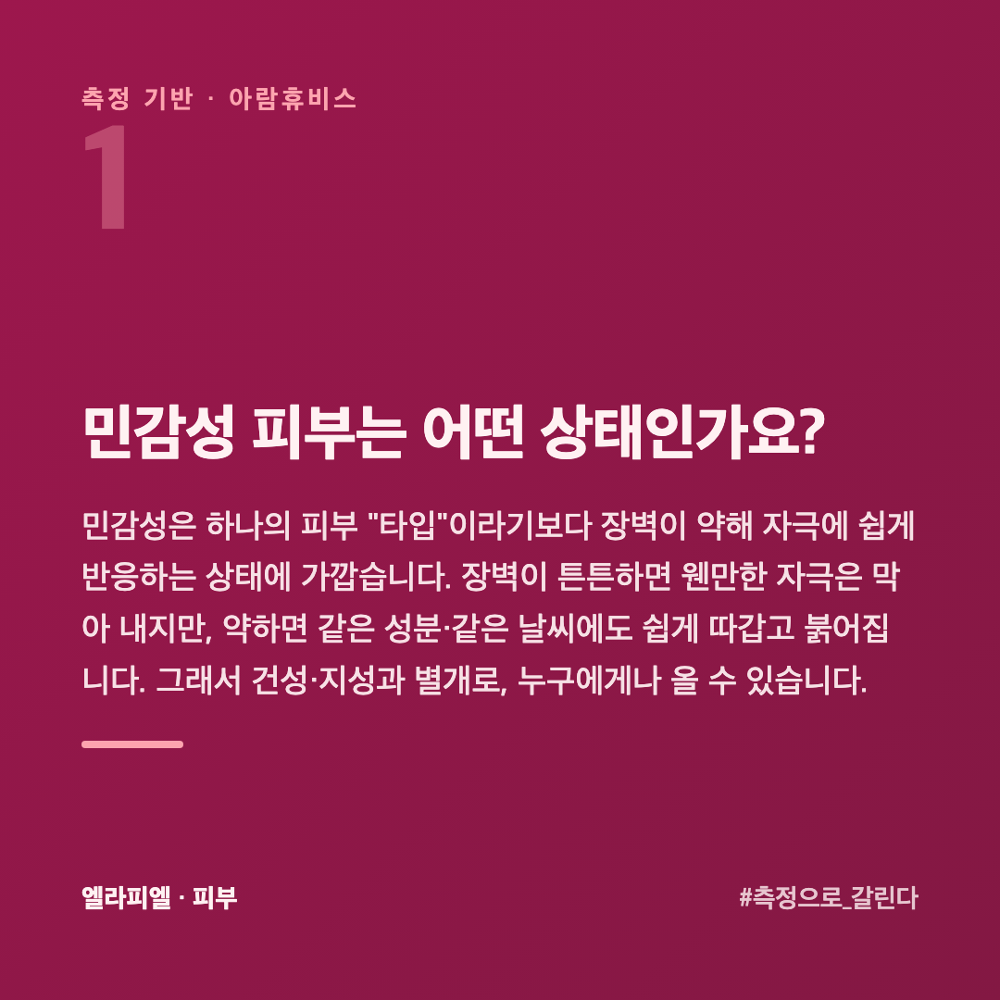
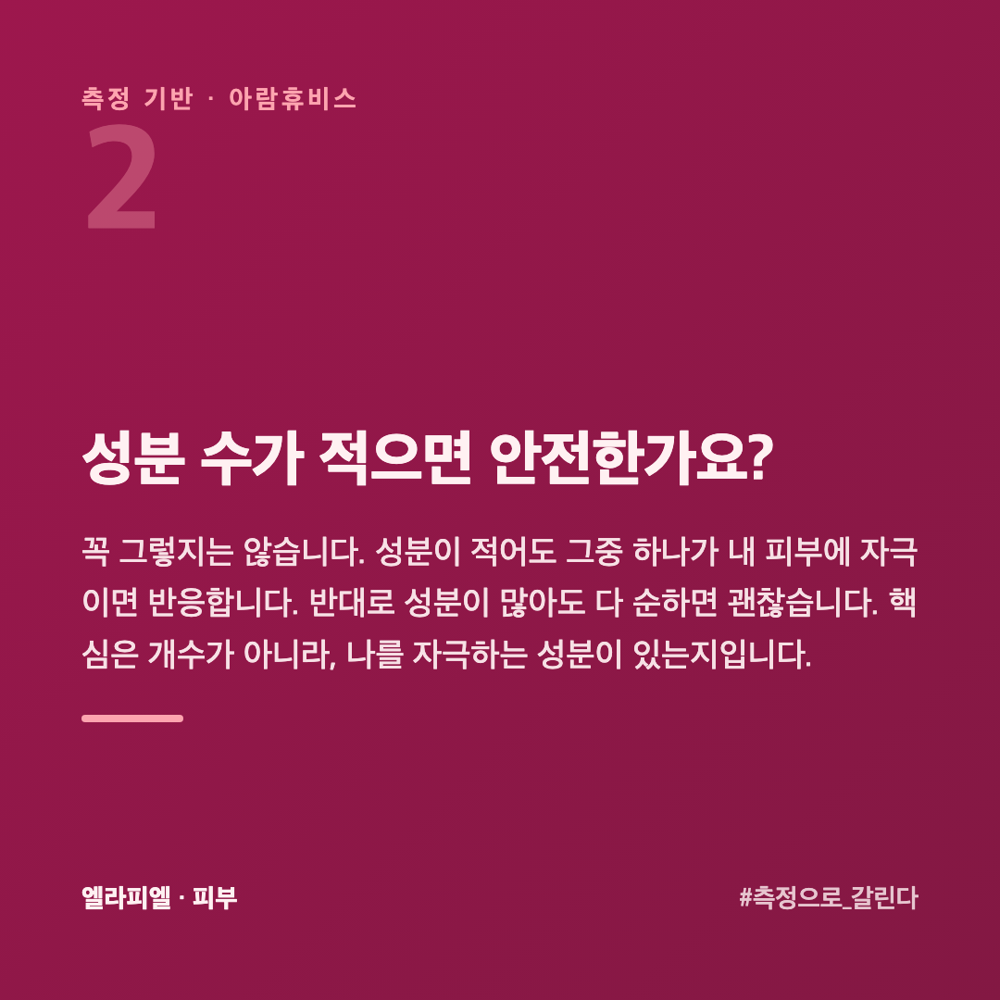
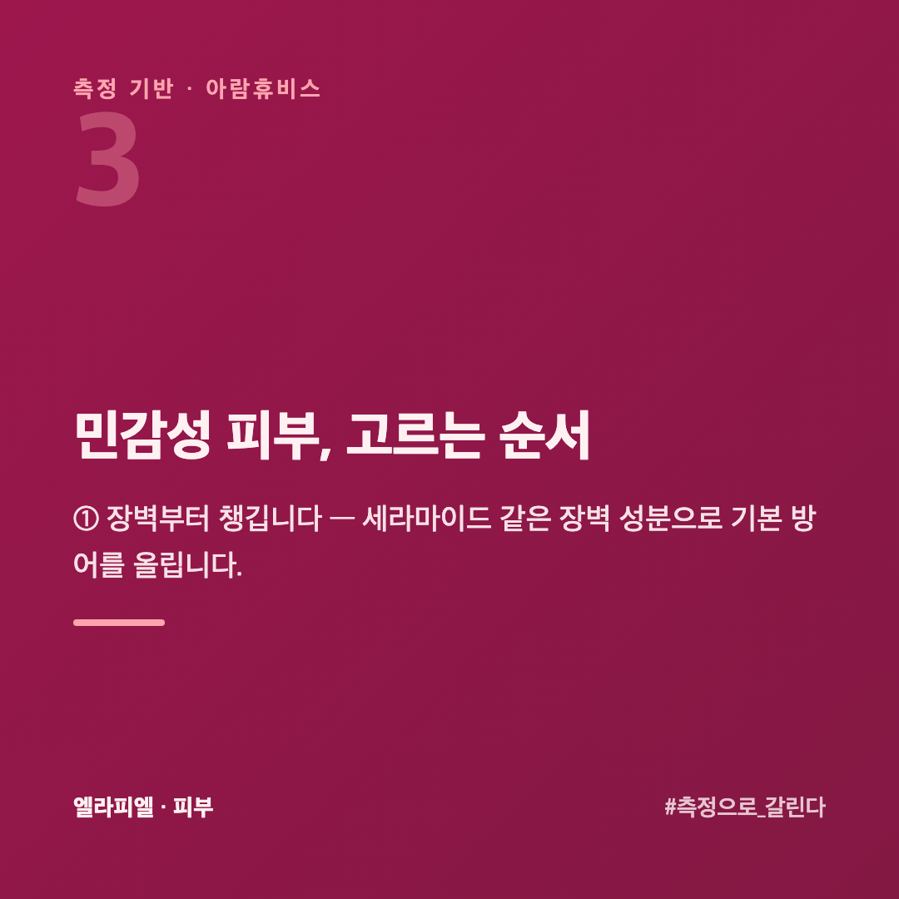

# 민감성 피부, 화장품 고를 때 성분표에서 뭘 봐야 할까

조금만 바꿔도 따갑거나 붉어집니다. 그래서 화장품 바꾸기가 겁납니다. "순한 거"를 찾지만, 순함의 기준이 뭔지는 애매합니다.

이 글은 피부를 수치로 재 온 회사 입장에서, 민감성 피부가 화장품을 고를 때 무엇을 봐야 하는지 정리했습니다.

## 민감성 피부는 어떤 상태인가요?

민감성은 하나의 피부 "타입"이라기보다 **장벽이 약해 자극에 쉽게 반응하는 상태**에 가깝습니다. 장벽이 튼튼하면 웬만한 자극은 막아 내지만, 약하면 같은 성분·같은 날씨에도 쉽게 따갑고 붉어집니다. 그래서 건성·지성과 별개로, 누구에게나 올 수 있습니다.

## 성분 수가 적으면 안전한가요?

꼭 그렇지는 않습니다. 성분이 적어도 그중 하나가 내 피부에 자극이면 반응합니다. 반대로 성분이 많아도 다 순하면 괜찮습니다. 핵심은 **개수가 아니라, 나를 자극하는 성분이 있는지**입니다.

흔한 자극 요인은 향료, 일부 알코올, 강한 각질 성분 등입니다. 다만 성분표만 보고 가를 수는 없습니다. 같은 향료에도 사람마다 반응이 다릅니다. **내 피부가 반응하는지**가 기준입니다.

## 민감성 피부, 고르는 순서

**① 장벽부터 챙깁니다** — 세라마이드 같은 장벽 성분으로 기본 방어를 올립니다.

**② 자극 요인을 피합니다** — 향료·강한 각질 성분이 적은 쪽을 고릅니다.

**③ 새 제품은 패치 테스트** — 귀 뒤나 팔 안쪽에 며칠 발라 보고 얼굴에 올립니다.

**④ 한 번에 하나만 바꿉니다** — 여러 개를 동시에 바꾸면 뭐가 문제인지 못 가립니다.

## 패치 테스트는 어떻게 하는 게 맞나요?

귀 뒤나 팔 안쪽처럼 **얇고 잘 안 보이는 자리**에 바릅니다. 얼굴보다 반응이 비슷하게 나오면서, 붉어져도 티가 덜 납니다.

한 번 바르고 끝내지 않습니다. **같은 자리에 하루 한 번씩 3~4일** 발라 봅니다. 자극은 바로 오기도 하지만, 며칠 쌓인 뒤에 오는 경우가 더 흔합니다. 첫날 괜찮았다고 안심하고 얼굴에 올렸다가 사흘 뒤에 올라오는 일이 여기서 생깁니다.

따갑거나 붉어지거나 오돌토돌해지면 그 제품은 넘깁니다. 아무 일 없으면 **얼굴의 한쪽 볼에만** 며칠 더 써 보고, 그다음에 전체로 넓힙니다.

## 계절이 바뀌면 왜 갑자기 민감해지나요?

장벽이 버티는 조건이 달라지기 때문입니다. 세 가지가 한꺼번에 바뀝니다.

**공기가 건조해집니다** — 수분이 빠져나가는 속도가 빨라집니다. 같은 제품을 써도 전만큼 안 덮입니다.

**기온 차가 커집니다** — 찬 바깥과 따뜻한 실내를 오갈 때 혈관이 수축과 확장을 반복합니다. 붉어짐이 잘 올라오는 이유입니다.

**난방·온수를 더 씁니다** — 뜨거운 물로 오래 씻으면 장벽의 지질이 더 빠집니다.

그래서 환절기에 "제품이 안 맞게 됐다"고 느끼는 경우가 많은데, **제품이 아니라 조건이 바뀐 것**인 때가 많습니다. 제품을 바꾸기 전에 물 온도와 보습 양부터 손보는 편이 빠릅니다.

## 나는 진짜 민감성일까, 일시적으로 약해진 걸까?

둘은 관리가 다릅니다. 타고난 민감성이면 꾸준한 장벽 관리가 필요하고, 일시적으로 약해진 거라면 회복하면 괜찮아집니다. 느낌으로는 안 갈립니다. 수분·장벽을 수치로 재면 지금 상태가 갈립니다. 고르는 큰 틀은 [맞춤 화장품 고르는 순서](https://blog.naver.com/ianlove80/224450574979)에 정리해 두었습니다.

엘라피엘은 그 측정 관점에서 장벽·저자극 라인을 설계했습니다 → [ellapiel.co.kr](https://ellapiel.co.kr)

## 정리

- 민감성은 타입보다 **장벽이 약해 쉽게 반응하는 상태**입니다
- 안전함의 기준은 성분 개수가 아니라 **나를 자극하는 성분이 있는지**입니다
- **장벽 먼저 → 자극 회피 → 패치 테스트 → 한 번에 하나만** 순서로 고릅니다
- 타고난 민감성인지 일시적인지는 **측정으로** 갈립니다
