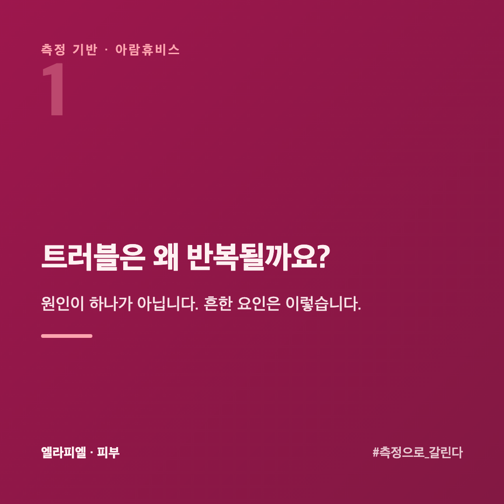
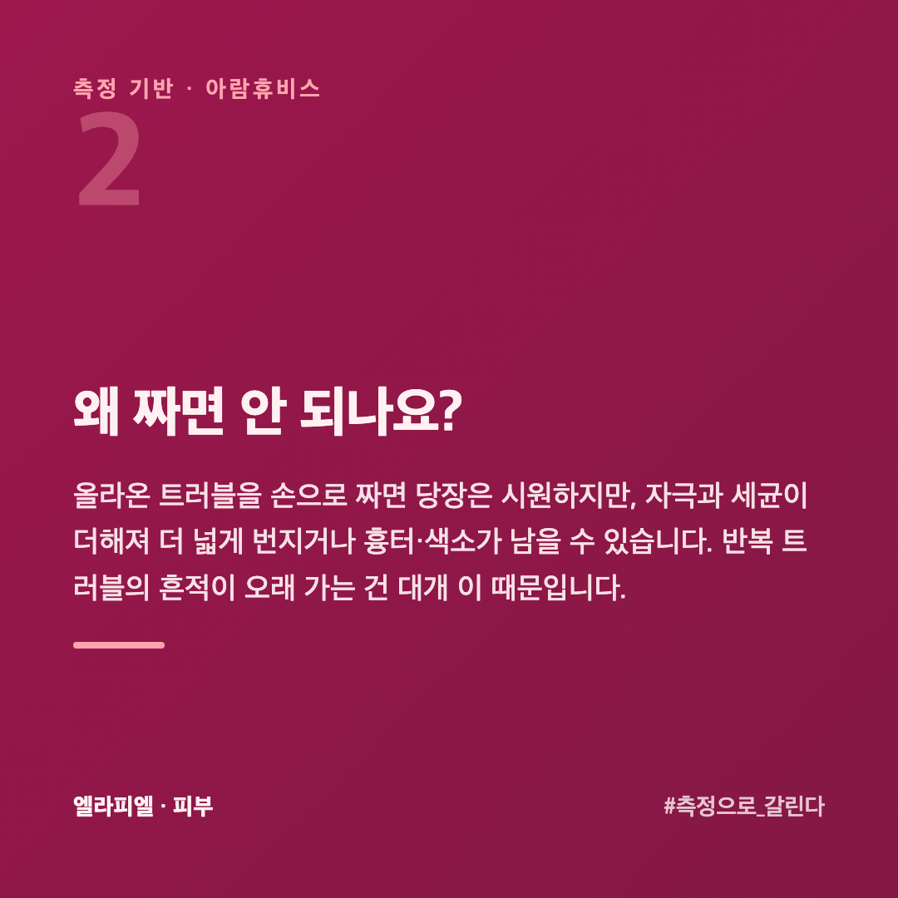
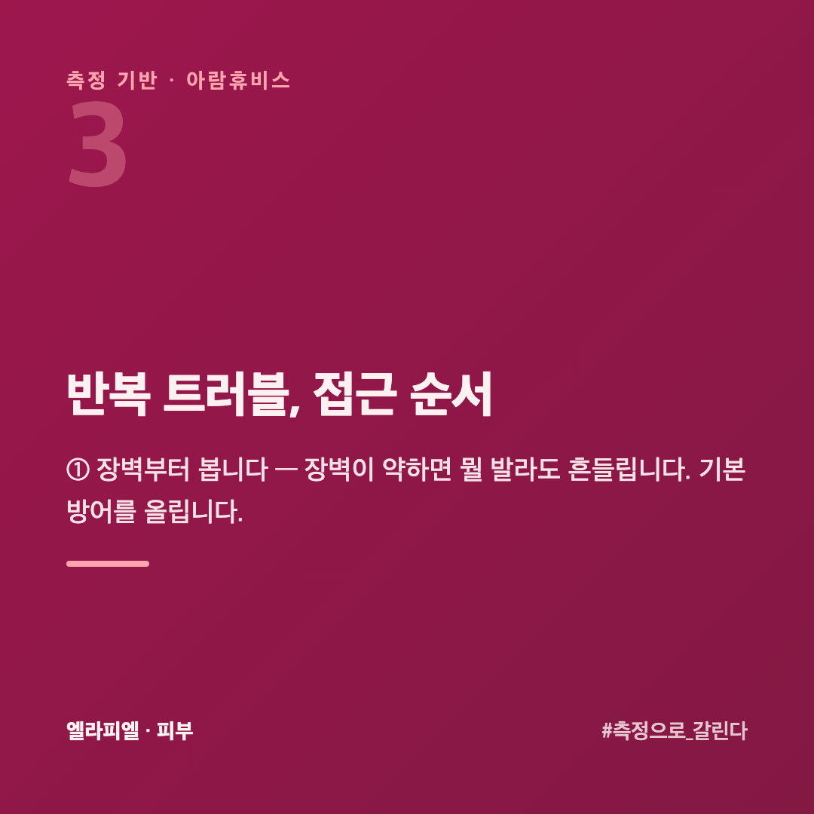
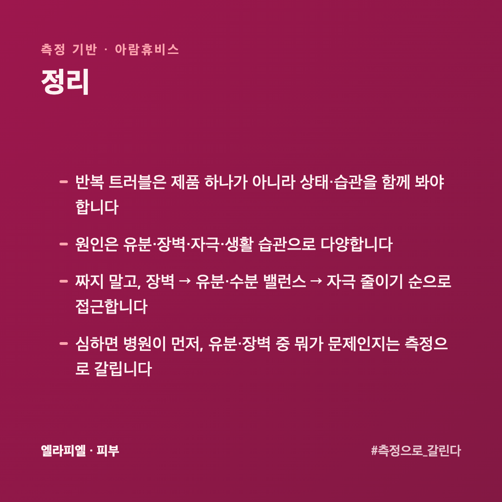
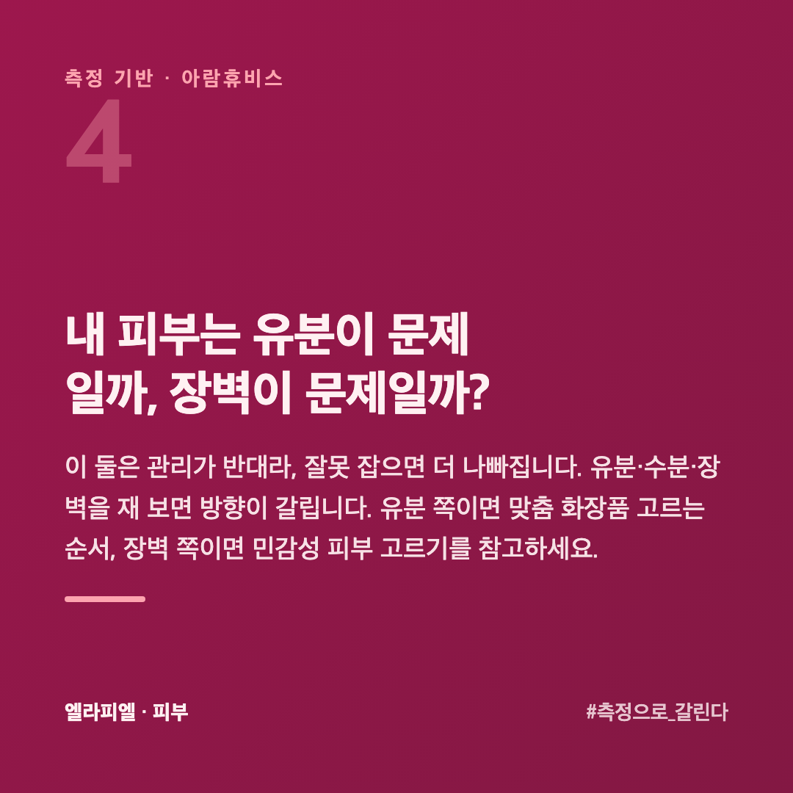

# 트러블이 반복되는 피부, 제품부터 바꾸기 전에 뭐부터 봐야 할까

같은 자리에 자꾸 트러블이 올라옵니다. 가라앉았다 싶으면 또 생깁니다. 좋다는 제품을 바꿔 봐도 그때뿐입니다. 반복되는 트러블은 "제품 하나"의 문제가 아니라 피부 상태와 습관을 함께 봐야 하는 경우가 많습니다.

이 글은 피부를 수치로 재 온 회사 입장에서, 반복 트러블에 접근하는 순서를 정리했습니다. 단, 심한 여드름은 의료 영역이라 병원이 먼저입니다.

## 트러블은 왜 반복될까요?

원인이 하나가 아닙니다. 흔한 요인은 이렇습니다.

- **유분 과다** — 유분이 많으면 모공이 막히기 쉽습니다
- **장벽 약화** — 장벽이 무너지면 자극·세균에 쉽게 반응합니다
- **자극** — 과한 세정, 강한 제품, 잦은 손 접촉
- **생활 습관** — 수면·스트레스·식습관·베개·마스크 등

그래서 "유분을 잡는 제품" 하나로 해결 안 되는 경우가 많습니다. 유분형인지, 장벽이 무너진 건지에 따라 방향이 반대일 수 있습니다.

## 왜 짜면 안 되나요?

올라온 트러블을 손으로 짜면 당장은 시원하지만, **자극과 세균이 더해져** 더 넓게 번지거나 흉터·색소가 남을 수 있습니다. 반복 트러블의 흔적이 오래 가는 건 대개 이 때문입니다.

## 반복 트러블, 접근 순서

**① 장벽부터 봅니다** — 장벽이 약하면 뭘 발라도 흔들립니다. 기본 방어를 올립니다.

**② 유분·수분 밸런스를 봅니다** — 유분형이면 유분 관리, 속건조면 수분 보충. 방향이 다릅니다.

**③ 자극을 줄입니다** — 과한 세정·강한 제품·손 접촉을 줄입니다.

**④ 한 번에 하나만 바꿉니다** — 뭐가 원인인지 가릴 수 있어야 합니다.

**⑤ 심하면 병원** — 염증성·낭종성 여드름은 화장품으로 해결하려 하지 말고 피부과 진료를 받습니다.

## 베개나 수건 같은 것도 영향이 있나요?

있습니다. 제품만 보다 놓치는 쪽입니다.

**베개 커버** — 머리카락의 유분과 스타일링 제품이 그대로 묻습니다. 얼굴 옆쪽에만 트러블이 몰린다면 여기를 먼저 봅니다. **주 1~2회** 바꾸는 것으로 달라지는 경우가 있습니다.

**수건** — 젖은 채 걸어 둔 수건은 마르는 동안 세균이 늡니다. 문질러 닦지 말고 **눌러서** 물기를 걷습니다.

**손과 휴대폰** — 턱과 뺨에 반복된다면 괴는 습관과 통화 자세를 봅니다.

제품을 바꾸기 전에 **이 네 가지를 2주만** 손봐도 달라지는지 보입니다. 돈이 안 드는 쪽부터 보는 게 순서입니다.

## 좋아졌다 나빠졌다 반복되면 뭘 봐야 하나요?

**언제 나빠지는지**를 봅니다. 주기가 있으면 원인도 대개 주기를 따릅니다.

**달마다 비슷한 시기** — 호르몬 쪽 주기입니다. 그 시기에 맞춰 단계를 줄이고 자극을 낮추는 쪽으로 준비합니다.

**계절이 바뀔 때** — 장벽 쪽입니다. 조건이 바뀌면서 버티던 선이 무너집니다.

**바쁜 시기마다** — 잠과 스트레스 쪽입니다. 제품으로 메우기 어려운 자리입니다.

주기가 안 보이고 계속 나빠지기만 한다면 **쓰는 것 중에 맞는 게 없을** 가능성이 큽니다. 그때는 하나씩 빼 봅니다.

## 내 피부는 유분이 문제일까, 장벽이 문제일까?

이 둘은 관리가 반대라, 잘못 잡으면 더 나빠집니다. 유분·수분·장벽을 재 보면 방향이 갈립니다. 유분 쪽이면 [맞춤 화장품 고르는 순서](https://blog.naver.com/ianlove80/224450574979), 장벽 쪽이면 [민감성 피부 고르기](https://blog.naver.com/ianlove80)를 참고하세요.

엘라피엘은 그 측정 관점에서 유분·장벽을 함께 보는 라인을 설계했습니다 → [ellapiel.co.kr](https://ellapiel.co.kr)

## 정리

- 반복 트러블은 **제품 하나**가 아니라 상태·습관을 함께 봐야 합니다
- 원인은 **유분·장벽·자극·생활 습관**으로 다양합니다
- **짜지 말고**, 장벽 → 유분·수분 밸런스 → 자극 줄이기 순으로 접근합니다
- **심하면 병원이 먼저**, 유분·장벽 중 뭐가 문제인지는 **측정으로** 갈립니다
