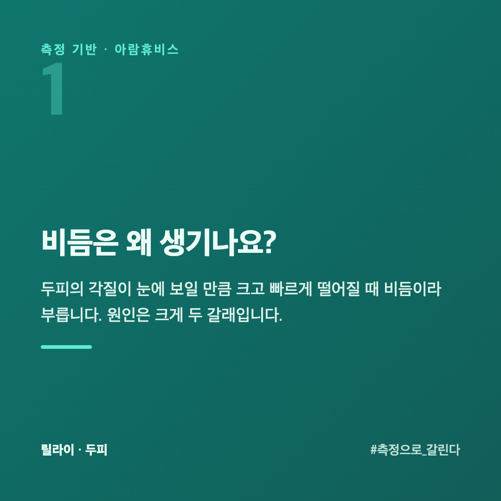
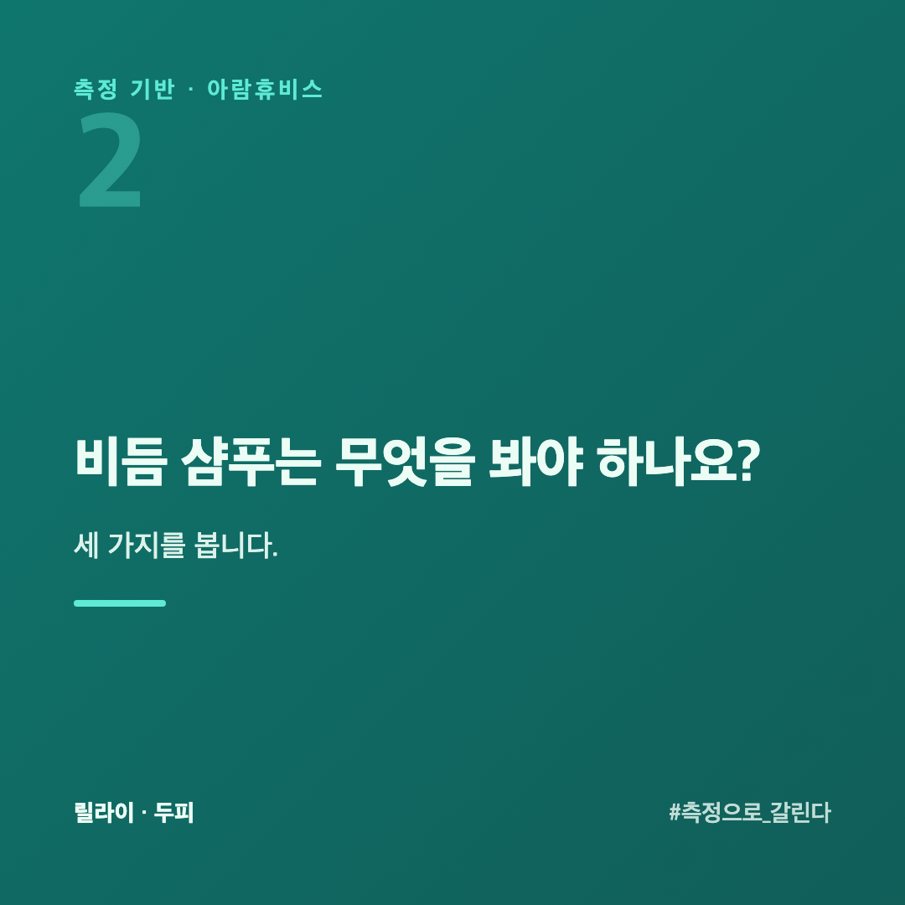
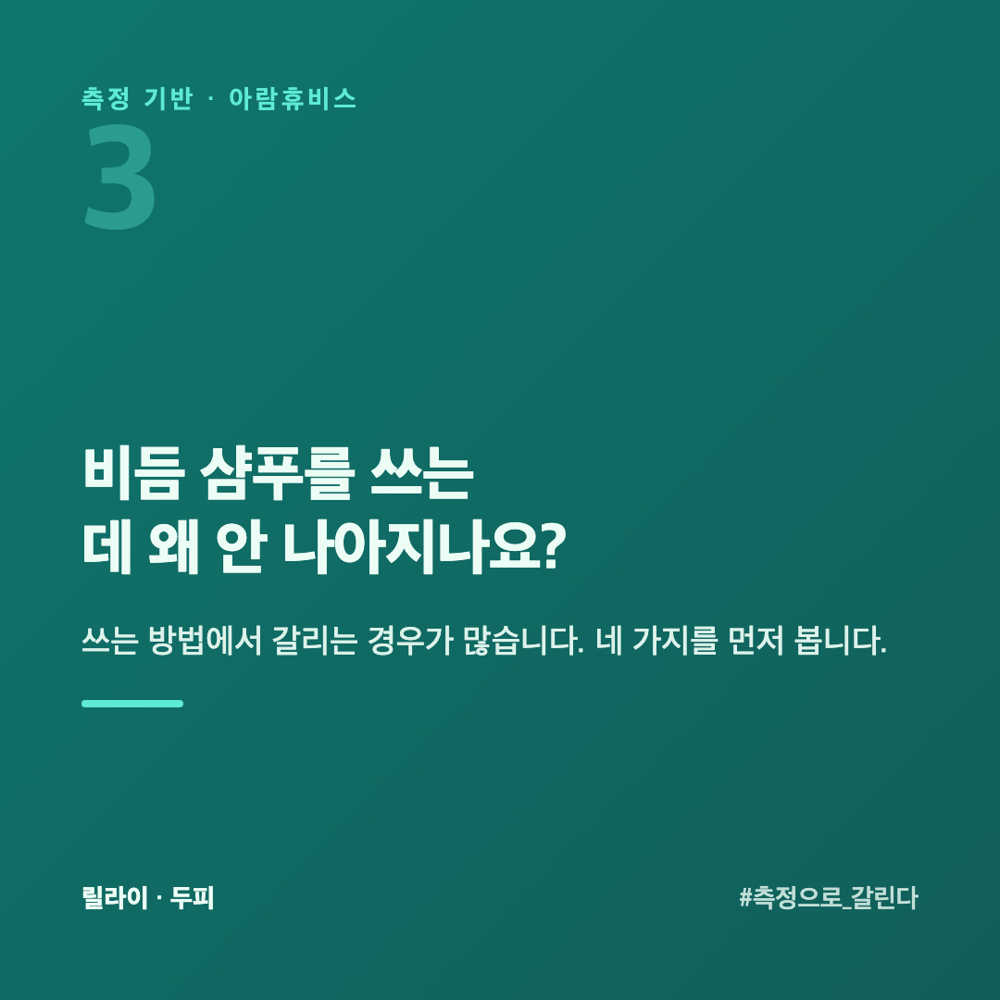
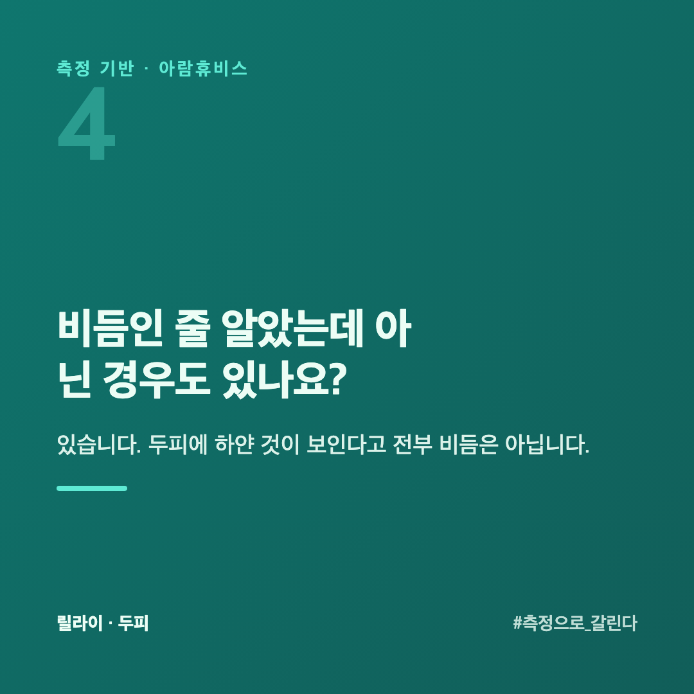
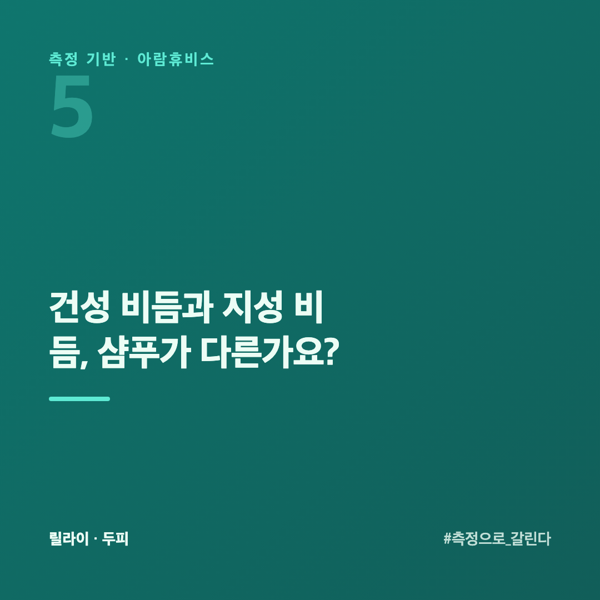

# 비듬 샴푸, 비듬 종류부터 알고 골라야 하는 이유

비듬 샴푸를 검색하면 종류가 너무 많습니다. 그런데 비듬은 하나가 아닙니다. 건조해서 생기는 비듬과 기름져서 생기는 비듬은 원인이 반대라, 같은 샴푸로 둘 다 잡으려 하면 한쪽은 안 맞습니다.

이 글은 두피를 수치로 재 온 회사 입장에서, 비듬 종류를 나누고 무엇을 보고 골라야 하는지 정리했습니다.

## 비듬은 왜 생기나요?

두피의 각질이 눈에 보일 만큼 크고 빠르게 떨어질 때 비듬이라 부릅니다. 원인은 크게 두 갈래입니다.

**건성 비듬** — 두피가 건조해 각질이 잘게 일어납니다. 희고 가루 같은 비듬, 당기고 가려운 느낌이 함께 옵니다.

**지성 비듬** — 유분이 많아 각질이 유분과 엉겨 큰 조각으로 떨어집니다. 번들거리고 눅눅한 비듬입니다.

둘은 방향이 반대입니다. 건성은 수분과 진정이, 지성은 유분 관리와 세정이 먼저입니다.

## 비듬 샴푸는 무엇을 봐야 하나요?

세 가지를 봅니다.

**① 내 비듬에 맞는 쪽인가** — 지성용(강한 세정)을 건성 두피에 쓰면 더 건조해지고, 반대도 마찬가지입니다.

**② 자극이 적은가** — 매일 쓰는 것이라, 두피를 더 자극하면 역효과가 납니다.

**③ 꾸준히 쓸 수 있는가** — 비듬은 한 번에 사라지지 않습니다. 며칠 쓰고 바꾸면 효과를 판단할 수가 없습니다.

## 비듬 샴푸를 쓰는데 왜 안 나아지나요?

쓰는 방법에서 갈리는 경우가 많습니다. 네 가지를 먼저 봅니다.

**① 너무 짧게 썼습니다** — 두피 각질이 새로 만들어지고 떨어지는 데 시간이 걸립니다. 보통 2~4주는 같은 것을 써 봐야 맞는지 아닌지가 보입니다. 일주일 쓰고 바꾸면 무엇이 맞았는지 알 수가 없습니다.

**② 헹굼이 짧습니다** — 비듬 샴푸는 성분이 두피에 닿아 있어야 합니다. 거품을 내고 바로 헹구면 머리카락만 감는 셈입니다. 두피에 문질러 1~2분 두었다가 헹구는 쪽이 낫습니다. 반대로 덜 헹구면 잔여물이 남아 가려움이 생깁니다.

**③ 물이 너무 뜨겁습니다** — 뜨거운 물은 두피의 유분을 한 번에 걷어 냅니다. 건성 비듬은 더 건조해지고, 지성 비듬은 유분이 더 분비되는 쪽으로 갑니다. 미지근한 물이 양쪽 모두에 안전합니다.

**④ 방향이 반대입니다** — 가장 흔합니다. 지성용 강한 세정을 건성 두피에 쓰면 각질이 더 일어납니다. 위 세 가지를 다 지켰는데도 그대로라면 방향부터 다시 봐야 합니다.

## 비듬인 줄 알았는데 아닌 경우도 있나요?

있습니다. 두피에 하얀 것이 보인다고 전부 비듬은 아닙니다.

**샴푸 잔여물** — 덜 헹군 세정 성분이 마르면서 하얗게 남습니다. 헹구는 시간을 늘렸을 때 줄어든다면 이쪽입니다.

**드라이 샴푸·스타일링 제품** — 가루 형태 제품이 두피에 쌓입니다. 쓴 날만 보인다면 제품 때문입니다.

**두피가 붉고 각질이 두껍게 겹칠 때** — 가려움이 심하고 진물이 나거나, 머리 밖(눈썹·귀 뒤·가슴)까지 번진다면 샴푸를 바꿀 일이 아닙니다. 피부과에서 보는 편이 빠릅니다. 샴푸로 버티다 시간을 쓰는 경우가 많습니다.

## 건성 비듬과 지성 비듬, 샴푸가 다른가요?

| | 건성 비듬 | 지성 비듬 |
|---|---|---|
| 비듬 모양 | 희고 가루 같음 | 크고 눅눅함 |
| 두피 느낌 | 당기고 가려움 | 번들거림 |
| 먼저 할 것 | 수분·진정 | 유분 관리·세정 |
| 피할 것 | 강한 세정 | 과한 유분막 |

## 내 비듬이 어느 쪽인지 어떻게 아나요?

눈으로는 헷갈립니다. 지성인데 건조하다고 느끼는 경우도 많습니다. 릴라이는 전용 카메라·센서로 두피의 유분·각질·상태를 수치로 확인합니다. 무엇을 어떻게 재는지는 [두피진단기 원리](https://blog.naver.com/ianlove80/224448093055)에 정리해 두었습니다. 재 보면 "그냥 비듬"이 아니라 어느 쪽에 가까운지 나와, 샴푸 방향이 정해집니다.

유형부터 가늠하고 싶다면 [두피유형 4가지](https://blog.naver.com/ianlove80)를 함께 보세요.

릴라이 공식몰 → [lilai.ai](https://lilai.ai)

## 정리

- 비듬은 **건성·지성 두 갈래**, 원인이 반대입니다
- 지성용 강한 세정을 **건성 두피에 쓰면 더 나빠집니다**
- 매일 쓰니 **자극 적고 꾸준히** 쓸 수 있어야 합니다
- 눈으로 헷갈리면 **측정으로 확인**하고 방향을 정합니다
- 안 나아지면 **2~4주 · 헹굼 · 물 온도 · 방향** 네 가지를 먼저 봅니다
- 붉고 가렵고 머리 밖까지 번지면 **샴푸가 아니라 피부과**입니다
