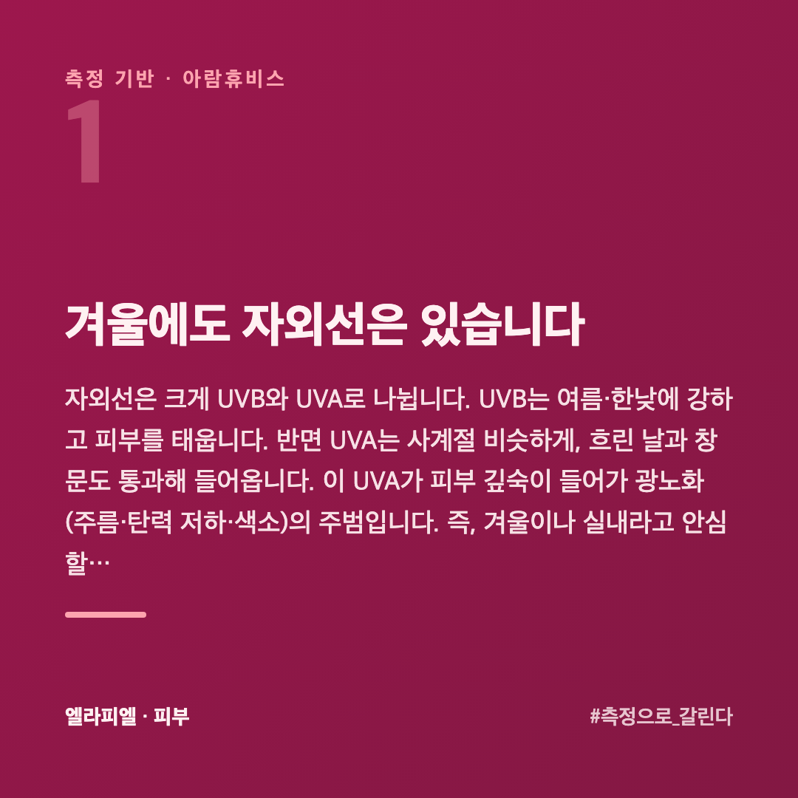
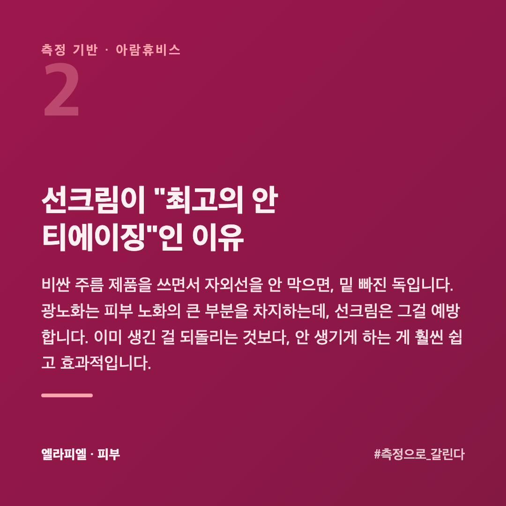
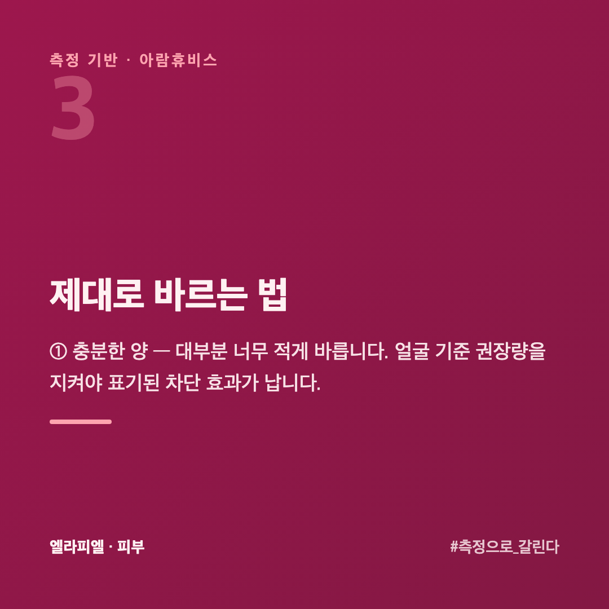
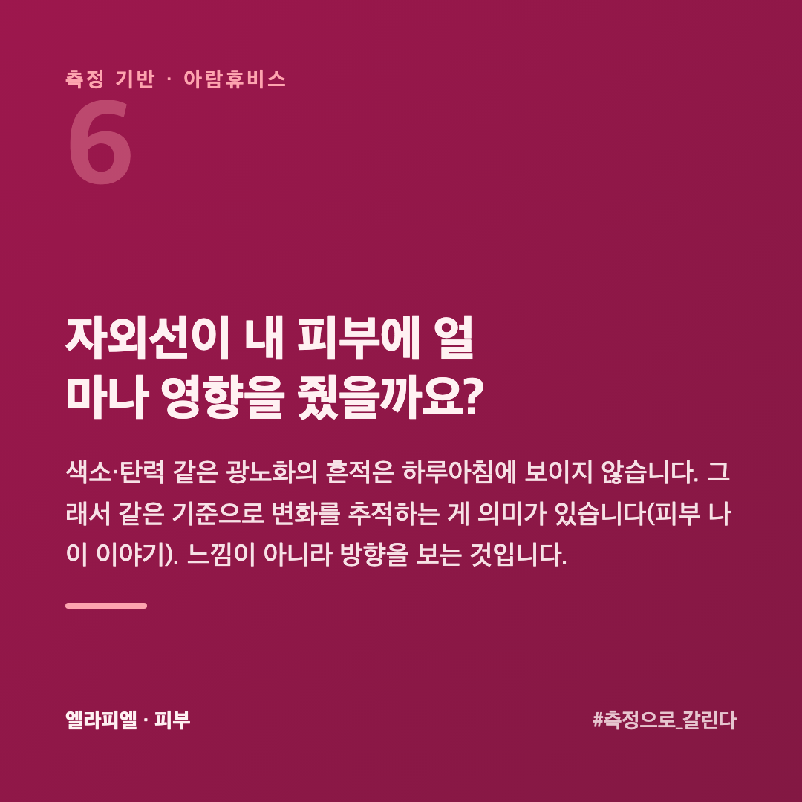
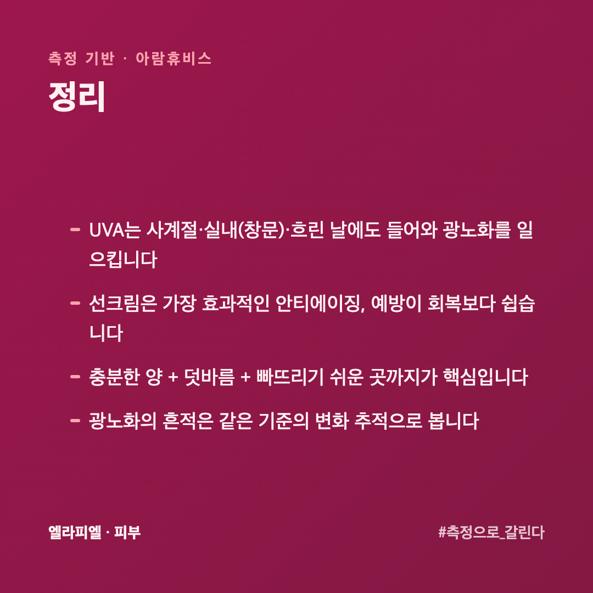

# 선크림, 겨울에도 발라야 할까 흐린 날에는 어떻게 할까

여름엔 챙기던 선크림을 날이 선선해지면 슬그머니 거릅니다. "해도 약한데 굳이" 싶습니다. 그런데 피부 노화를 생각하면, 선크림은 **사계절** 발라야 하는 쪽에 가깝습니다. 피부를 수치로 재 온 회사 입장에서 이유를 정리했습니다.

## 겨울에도 자외선은 있습니다

자외선은 크게 UVB와 UVA로 나뉩니다. **UVB**는 여름·한낮에 강하고 피부를 태웁니다. 반면 **UVA**는 **사계절 비슷하게**, 흐린 날과 **창문도 통과**해 들어옵니다. 이 UVA가 피부 깊숙이 들어가 **광노화**(주름·탄력 저하·색소)의 주범입니다. 즉, 겨울이나 실내라고 안심할 수 없습니다.

## 선크림이 안티에이징의 출발점인 이유

비싼 주름 제품을 쓰면서 자외선을 안 막으면, 밑 빠진 독입니다. 광노화는 피부 노화의 큰 부분을 차지하는데, 선크림은 그걸 **예방**합니다. 이미 생긴 걸 되돌리는 것보다, 안 생기게 하는 게 훨씬 쉽고 효과적입니다.

## 제대로 바르는 법

**① 충분한 양** — 대부분 너무 적게 바릅니다. 얼굴 기준 권장량을 지켜야 표기된 차단 효과가 납니다.

**② 덧바름** — 땀·마찰로 지워집니다. 야외 활동이 길면 2~3시간마다 덧바릅니다.

**③ 빠뜨리기 쉬운 곳** — 목·귀·손등도 자외선을 받습니다.

**④ 실내·흐린 날도** — UVA는 창문·구름을 통과합니다.

## 얼마나 발라야 표시된 차단 지수가 나오나요?

제품에 적힌 SPF·PA 는 **정해진 양을 발랐을 때**의 숫자입니다. 실제로는 그 양의 **4분의 1에서 2분의 1**만 바르는 경우가 많습니다. SPF 50 을 적게 바르면 실제 차단력은 그보다 한참 내려갑니다.

기준은 **얼굴에 500원 동전 크기**, 또는 검지와 중지 두 마디 길이입니다. 생각보다 많습니다. 한 번에 다 바르면 하얗게 뜨니, **두 번에 나눠** 얇게 겹쳐 바르면 자연스럽습니다.

목과 귀 뒤, 손등은 자주 빠집니다. 나이 들며 차이가 가장 눈에 띄는 자리가 목입니다. 얼굴을 바른 손으로 **목까지 쓸어 내리는** 습관 하나로 많이 달라집니다.

## 실내에만 있는 날도 발라야 하나요?

UVA 는 유리창을 통과합니다. 창가 자리에서 일한다면 실내도 바깥과 크게 다르지 않습니다. 창에서 멀고 햇빛이 직접 안 드는 자리라면 영향은 작습니다.

판단 기준은 간단합니다. **낮에 조명을 안 켜도 밝은 자리**면 자외선도 들어옵니다. 그런 자리에서 하루 대부분을 보낸다면 바르는 쪽이 낫습니다.

덧바르기는 **밖에 나갈 때**가 기준입니다. 실내에만 있었다면 2~3시간마다 덧바를 필요는 없습니다. 점심에 나갔다 왔다면 그때 한 번 덧바릅니다.

## 자외선이 내 피부에 얼마나 영향을 줬을까요?

색소·탄력 같은 광노화의 흔적은 하루아침에 보이지 않습니다. 그래서 같은 기준으로 **변화를 추적**하는 게 의미가 있습니다([피부 나이는 숫자로 잴 수 있을까](https://blog.naver.com/ianlove80/224451161634)). 느낌이 아니라 방향을 보는 것입니다.

엘라피엘은 그 측정 관점에서 색소·탄력·장벽을 함께 보는 라인을 설계했습니다 → [ellapiel.co.kr](https://ellapiel.co.kr)

## 정리

- **UVA는 사계절·실내(창문)·흐린 날**에도 들어와 광노화를 일으킵니다
- 선크림은 **가장 효과적인 안티에이징**, 예방이 회복보다 쉽습니다
- **충분한 양 + 덧바름 + 빠뜨리기 쉬운 곳**까지가 핵심입니다
- 광노화의 흔적은 **같은 기준의 변화 추적**으로 봅니다
