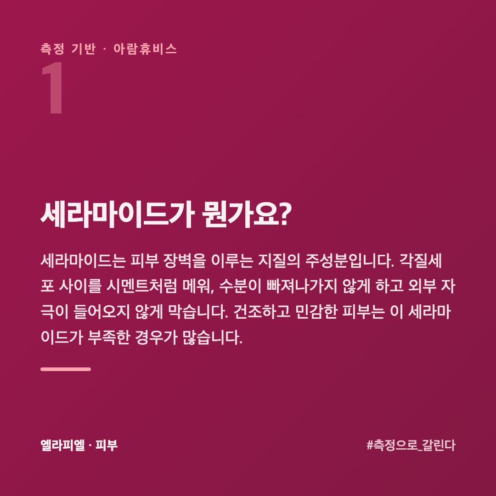
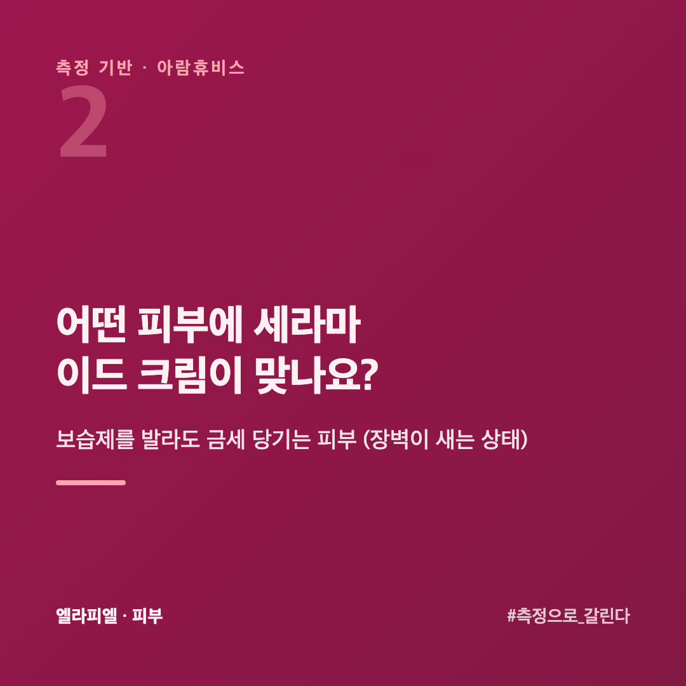
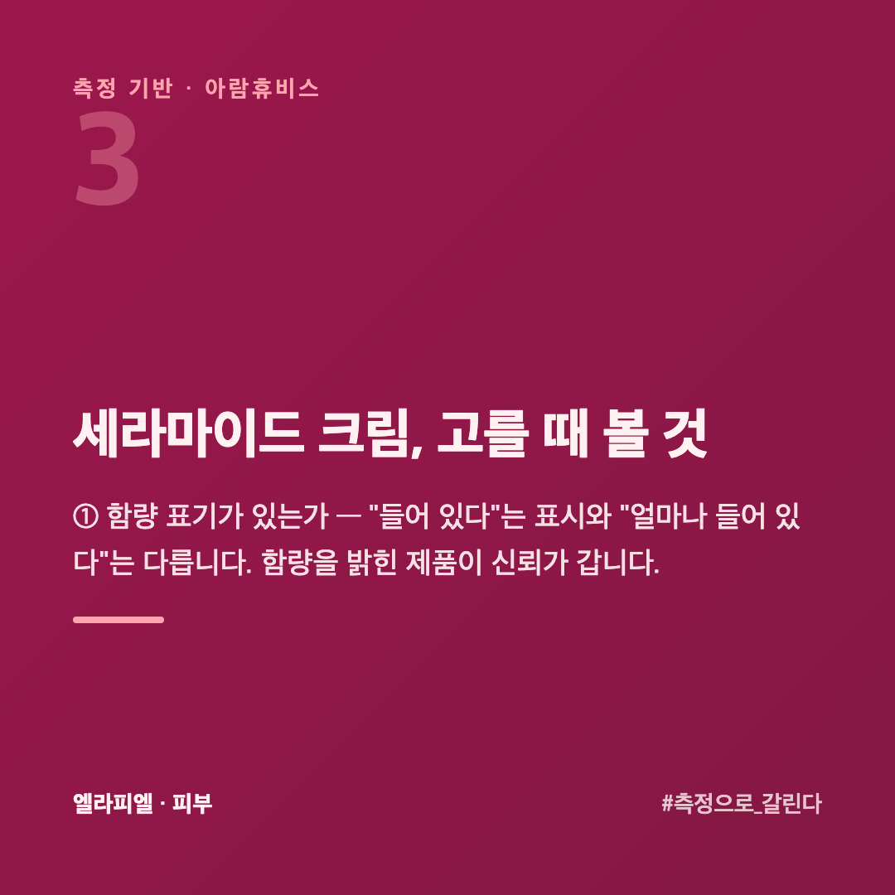
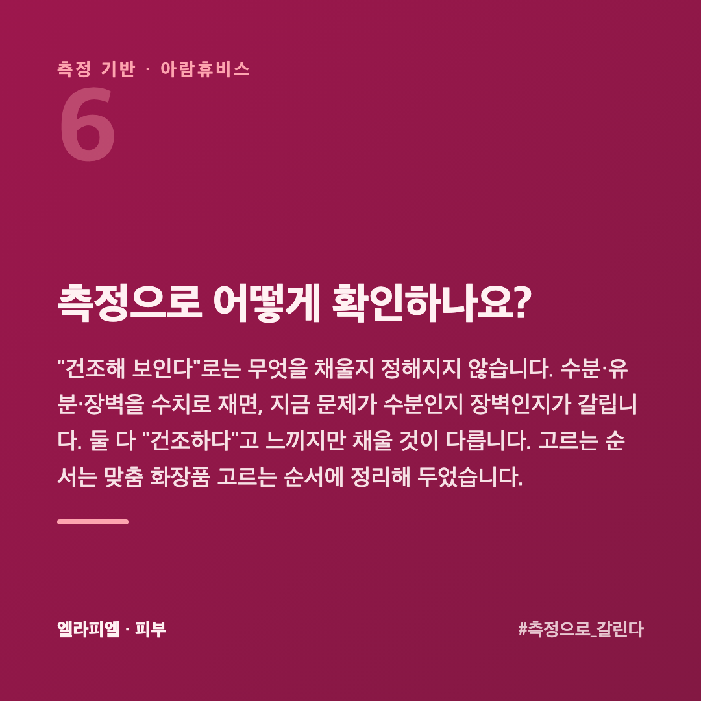
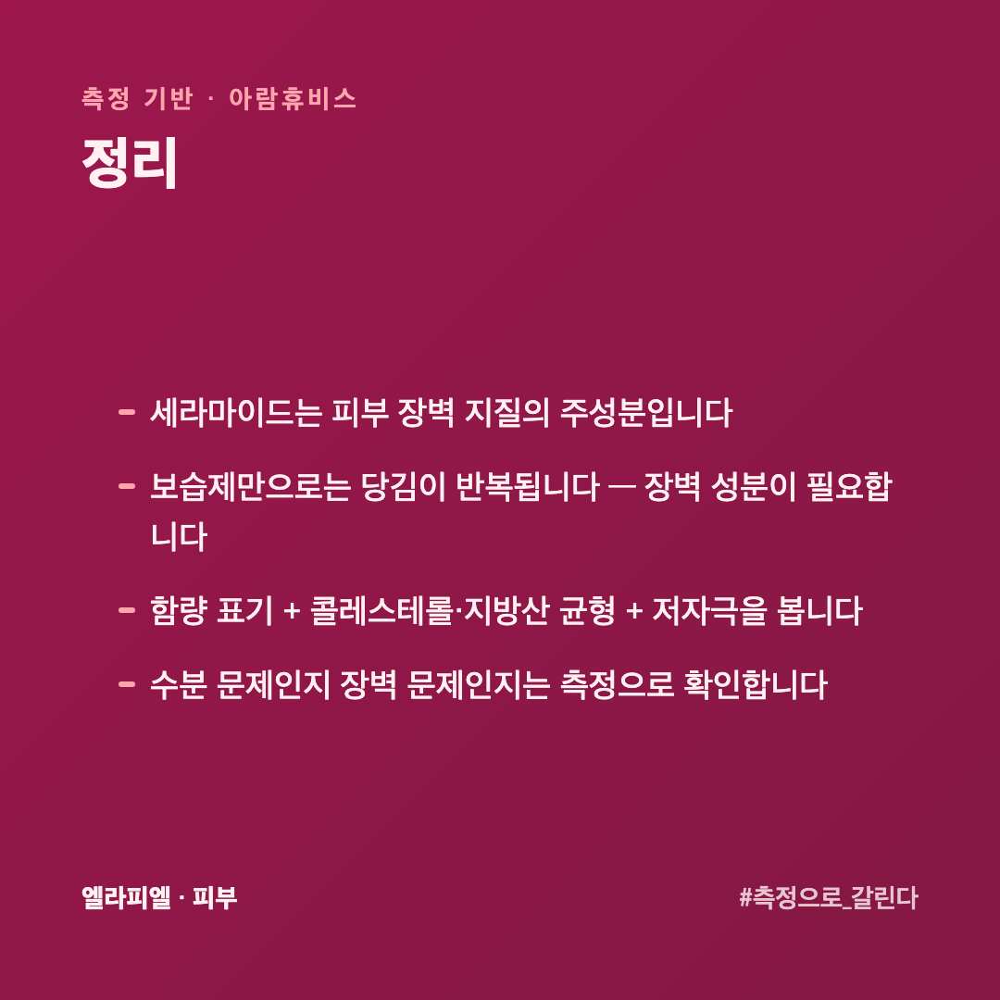

# 세라마이드 크림, 건조하고 민감한 피부에 왜 필요할까

보습제를 발라도 금세 당기는 피부가 있습니다. 환절기마다 뒤집어지고 붉어지는 피부도 있습니다. 이런 피부에 자주 권해지는 것이 세라마이드 크림입니다. 그런데 "세라마이드가 들어 있다"는 표시만 보고 고르면 기대와 다를 수 있습니다.

이 글은 피부를 수치로 재 온 회사 입장에서, 세라마이드 크림이 어떤 피부에 맞고 무엇을 보고 골라야 하는지 정리했습니다.

## 세라마이드가 뭔가요?

세라마이드는 피부 장벽을 이루는 지질의 주성분입니다. 각질세포 사이를 시멘트처럼 메워, 수분이 빠져나가지 않게 하고 외부 자극이 들어오지 않게 막습니다. 건조하고 민감한 피부는 이 세라마이드가 부족한 경우가 많습니다.

## 어떤 피부에 세라마이드 크림이 맞나요?

- 보습제를 발라도 **금세 당기는** 피부 (장벽이 새는 상태)

- 환절기마다 **뒤집어지고 붉어지는** 민감 피부
- 각질이 일어나는 **건성** 피부

수분(히알루론산 등)만 채우면 물을 당겨올 뿐 벽을 세우지 못합니다. 빠져나간 장벽 성분을 **같은 것으로 메워야** 다음까지 지속됩니다.

## 세라마이드 크림, 고를 때 볼 것

**① 함량 표기가 있는가** — "들어 있다"는 표시와 "얼마나 들어 있다"는 다릅니다. 함량을 밝힌 제품이 신뢰가 갑니다.

**② 콜레스테롤·지방산이 함께 있는가** — 피부 장벽 지질은 세라마이드 혼자가 아니라 세라마이드·콜레스테롤·지방산 세 가지의 균형입니다. 함께 들어 있는지를 봅니다.

**③ 자극 요소가 적은가** — 향·알코올은 민감 피부에 부담이 됩니다. 민감할수록 단순한 배합이 낫습니다.

## 세라마이드만 들어 있으면 되나요?

혼자서는 잘 작동하지 않습니다. 장벽은 **세라마이드·콜레스테롤·지방산** 세 가지가 섞여 만들어집니다. 하나만 넉넉하고 나머지가 없으면 제대로 메워지지 않습니다.

그래서 성분표에서 세라마이드만 찾기보다, **같이 들어 있는지**를 봅니다. 콜레스테롤이나 지방산 계열(스테아릭애씨드 같은 것)이 함께 보이면 설계가 된 제품입니다.

순서도 중요합니다. 세라마이드 크림은 **수분을 올린 뒤에** 덮는 자리입니다. 마른 피부에 바로 올리면 가둘 수분이 없습니다.

## 발라도 효과가 없는 것 같으면 뭘 봐야 하나요?

세 가지를 먼저 봅니다.

**① 얼마나 썼나** — 장벽은 하루아침에 메워지지 않습니다. 피부가 새로 올라오는 **4주 정도**는 같은 것을 써 봐야 방향이 보입니다.

**② 다른 데서 깎고 있나** — 뜨거운 물, 강한 세정, 잦은 각질 제거가 같이 있으면 채우는 속도보다 빠지는 속도가 빠릅니다. 제품보다 **씻는 습관이 먼저**인 경우가 많습니다.

**③ 모자란 게 장벽이 맞나** — 당기는 느낌이 수분 부족에서 오기도 합니다. 그 경우엔 덮는 것보다 채우는 것이 먼저입니다. 느낌으로는 안 갈립니다.

## 측정으로 어떻게 확인하나요?

"건조해 보인다"로는 무엇을 채울지 정해지지 않습니다. 수분·유분·장벽을 수치로 재면, 지금 문제가 **수분인지 장벽인지**가 갈립니다. 둘 다 "건조하다"고 느끼지만 채울 것이 다릅니다. 고르는 순서는 [맞춤 화장품 고르는 순서](https://blog.naver.com/ianlove80/224450574979)에 정리해 두었습니다.

엘라피엘은 그 측정 관점에서 세라마이드 고보습 라인을 설계했습니다.

엘라피엘 → [ellapiel.co.kr](https://ellapiel.co.kr)

## 정리

- 세라마이드는 **피부 장벽 지질의 주성분**입니다
- 보습제만으로는 당김이 반복됩니다 — **장벽 성분**이 필요합니다
- 함량 표기 + **콜레스테롤·지방산 균형** + 저자극을 봅니다
- 수분 문제인지 장벽 문제인지는 **측정으로 확인**합니다
