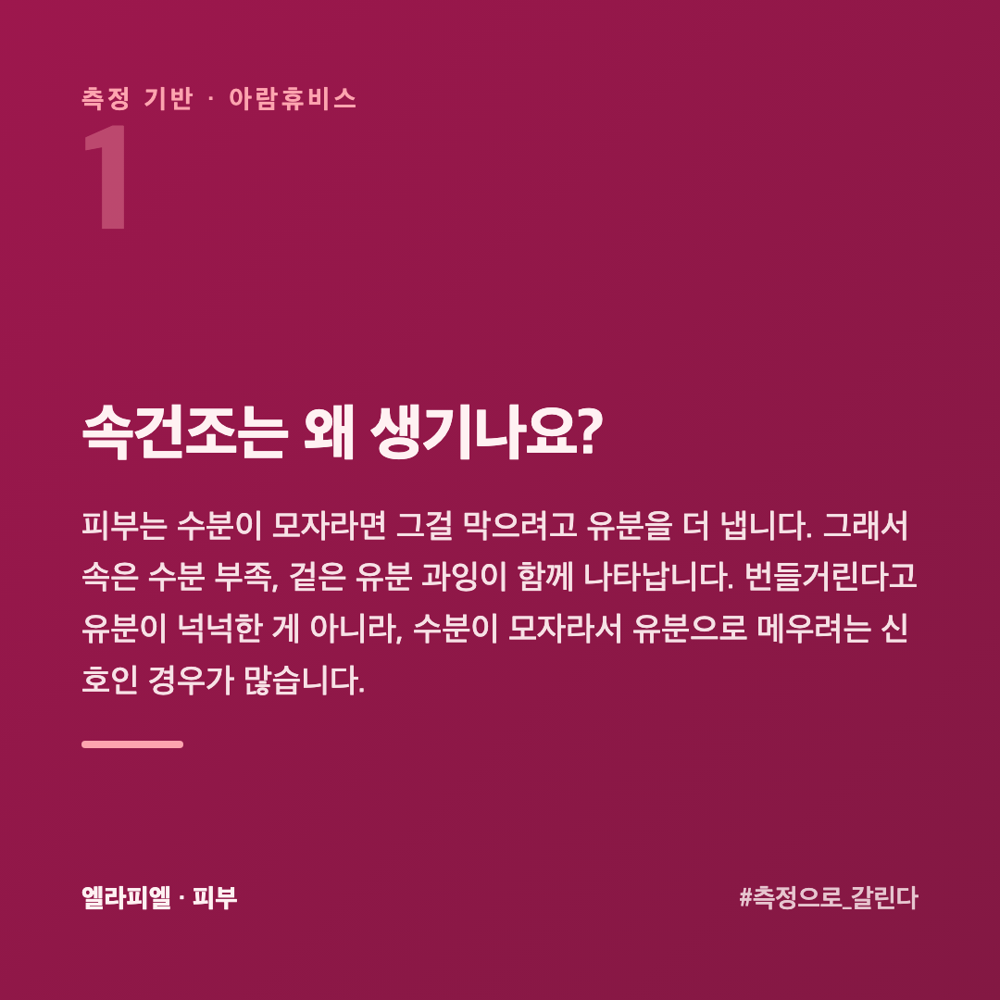
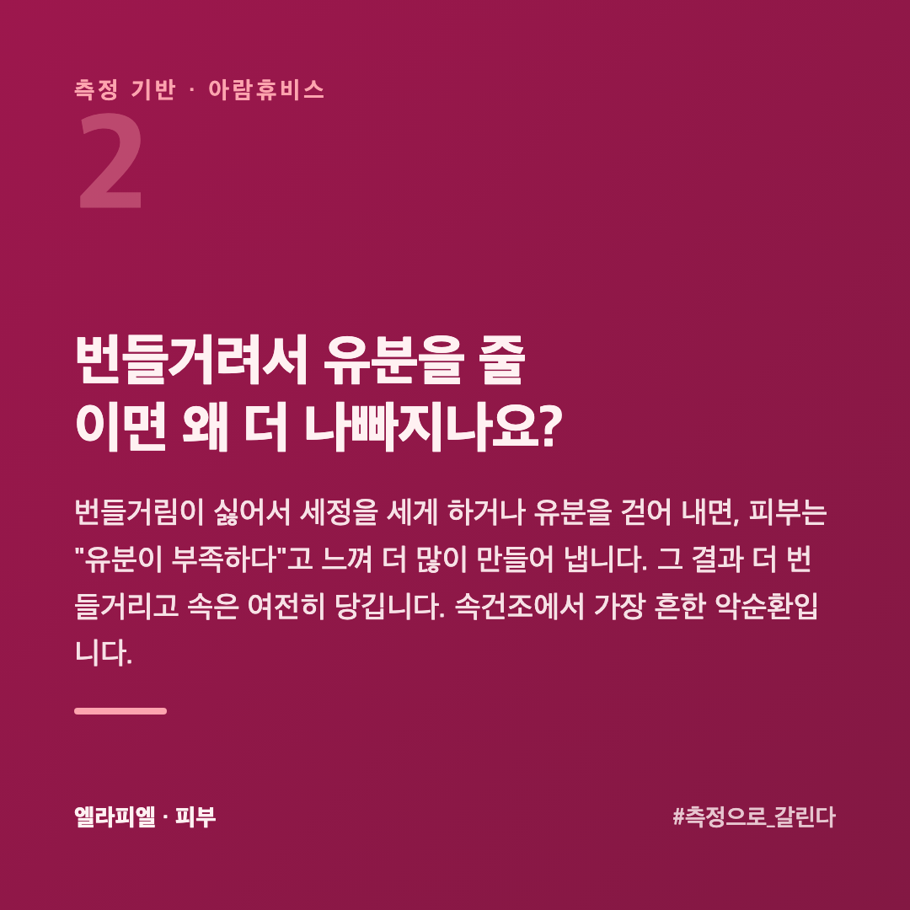
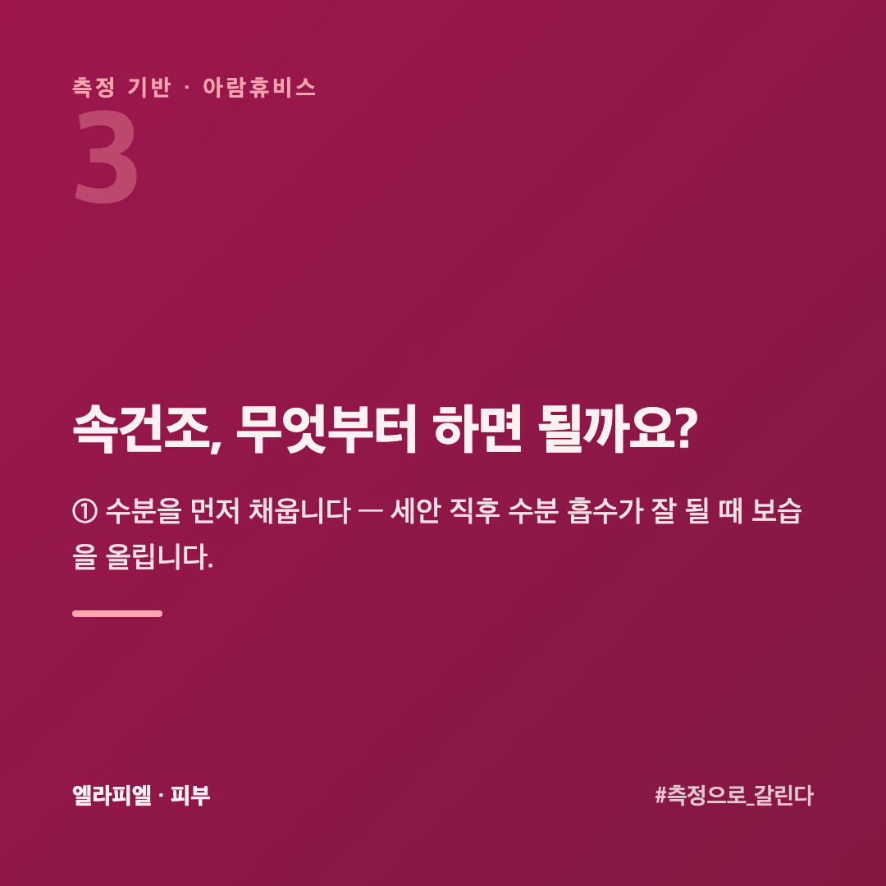
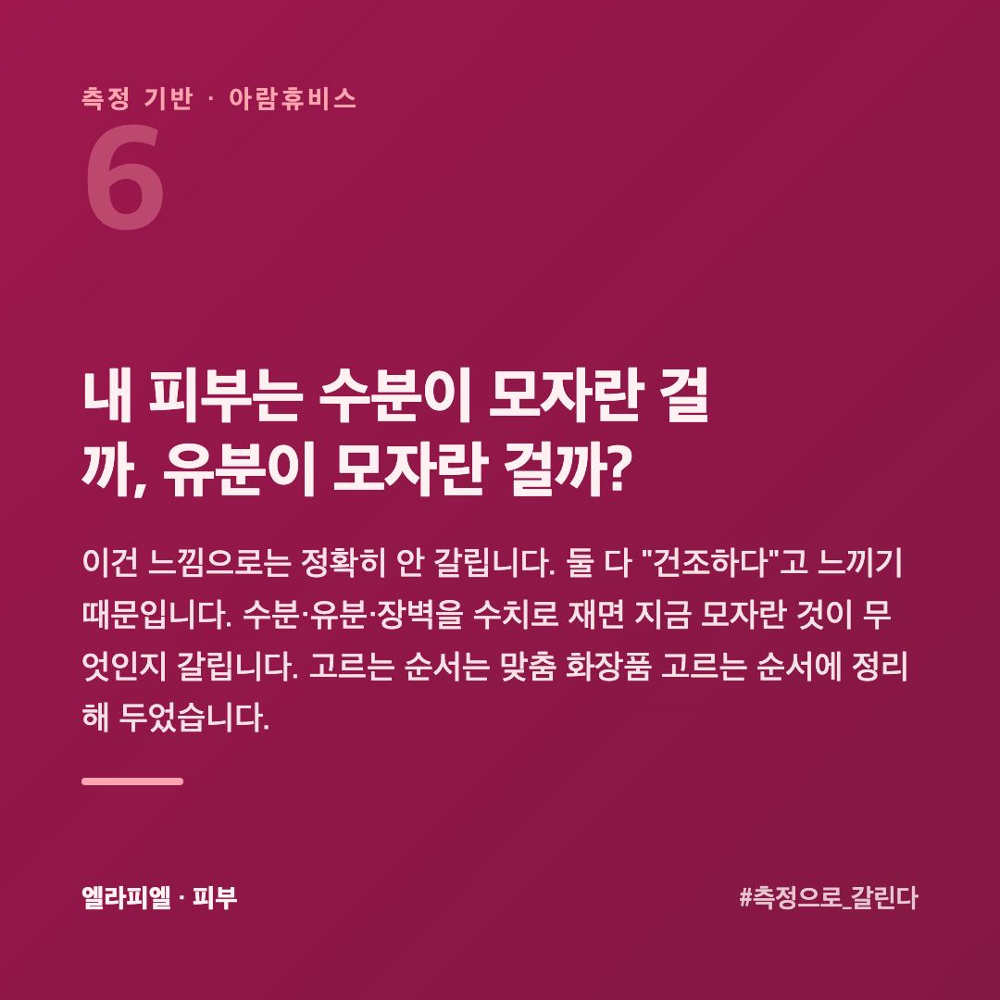
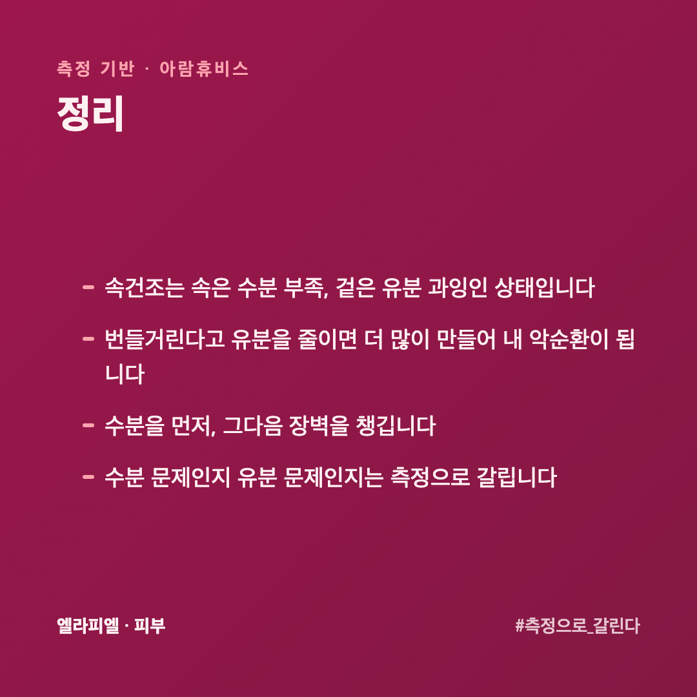
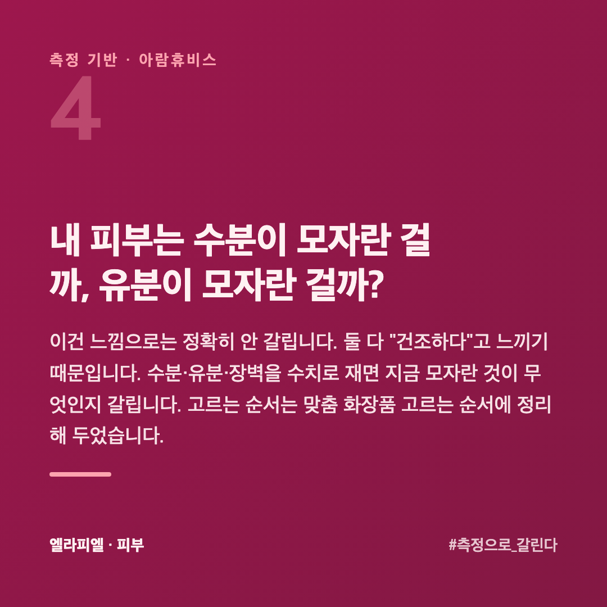

# 속건조, 겉은 번들거리는데 왜 당기고 뭘 먼저 채워야 할까

세수하고 나면 당기는데, 한낮이면 이마와 코는 번들거립니다. "지성인가, 건성인가" 헷갈립니다. 이런 상태를 흔히 속건조라고 부릅니다. 겉은 유분이 있는데 속은 수분이 모자란 상태입니다.

이 글은 피부를 수치로 재 온 회사 입장에서, 속건조가 왜 생기고 무엇부터 해야 하는지 정리했습니다.

## 속건조는 왜 생기나요?

피부는 수분이 모자라면 그걸 막으려고 유분을 더 냅니다. 그래서 **속은 수분 부족, 겉은 유분 과잉**이 함께 나타납니다. 번들거린다고 유분이 넉넉한 게 아니라, 수분이 모자라서 유분으로 메우려는 신호인 경우가 많습니다.

## 번들거려서 유분을 줄이면 왜 더 나빠지나요?

번들거림이 싫어서 세정을 세게 하거나 유분을 걷어 내면, 피부는 "유분이 부족하다"고 느껴 **더 많이 만들어 냅니다.** 그 결과 더 번들거리고 속은 여전히 당깁니다. 속건조에서 가장 흔한 악순환입니다.

그래서 순서가 중요합니다. 유분을 줄이는 게 아니라 **수분을 먼저 채우는** 것입니다.

## 속건조, 무엇부터 하면 될까요?

**① 수분을 먼저 채웁니다** — 세안 직후 수분 흡수가 잘 될 때 보습을 올립니다.

**② 장벽을 챙깁니다** — 수분이 자꾸 빠지면 장벽이 새는 것입니다. 세라마이드 같은 장벽 성분이 도움이 됩니다.

**③ 세정을 과하게 하지 않습니다** — 하루 두 번, 미지근한 물로. 유분을 걷어 내려 할수록 역효과입니다.

## 수분을 채운다는 게 구체적으로 뭔가요?

「수분 크림을 바른다」로 끝나지 않습니다. 순서가 있습니다.

**① 씻는 단계에서 덜 뺏습니다** — 뜨거운 물과 강한 세정이 속건조를 만드는 가장 큰 원인입니다. 미지근한 물로 짧게 씻습니다.

**② 물기가 있을 때 올립니다** — 세수 후 수건으로 꾹 누르고 **바로** 바릅니다. 다 마른 뒤에 바르면 이미 빠져나간 뒤입니다. 1분 안이 기준입니다.

**③ 가두는 것을 덮습니다** — 수분만 올리면 그대로 날아갑니다. 수분을 올린 뒤 유분이나 장벽 성분으로 덮어야 머뭅니다. 속건조에서 이 단계를 빼먹는 경우가 많습니다.

## 속건조인데 번들거려서 크림이 부담스러우면요?

제형을 바꾸면 됩니다. 「유분을 줄인다」가 아니라 「무겁지 않게 덮는다」로 생각합니다.

가벼운 로션이나 젤 타입을 **얇게 두 번** 올리는 편이, 무거운 크림을 한 번 바르는 것보다 번들거림이 덜합니다. T존은 얇게, 볼과 눈가는 넉넉히 — **얼굴 전체를 같은 양으로 바를 필요가 없습니다.**

밤에는 조금 무거운 것을 써도 됩니다. 자는 동안은 번들거려도 상관없고, 수분이 가장 많이 빠지는 시간이기도 합니다.

## 내 피부는 수분이 모자란 걸까, 유분이 모자란 걸까?

이건 느낌으로는 정확히 안 갈립니다. 둘 다 "건조하다"고 느끼기 때문입니다. 수분·유분·장벽을 수치로 재면 지금 모자란 것이 무엇인지 갈립니다. 고르는 순서는 [맞춤 화장품 고르는 순서](https://blog.naver.com/ianlove80/224450574979)에 정리해 두었습니다.

엘라피엘은 그 측정 관점에서 수분·장벽을 함께 챙기는 라인을 설계했습니다 → [ellapiel.co.kr](https://ellapiel.co.kr)

## 정리

- 속건조는 **속은 수분 부족, 겉은 유분 과잉**인 상태입니다
- 번들거린다고 유분을 줄이면 **더 많이 만들어 내** 악순환이 됩니다
- **수분을 먼저**, 그다음 장벽을 챙깁니다
- 수분 문제인지 유분 문제인지는 **측정으로** 갈립니다
