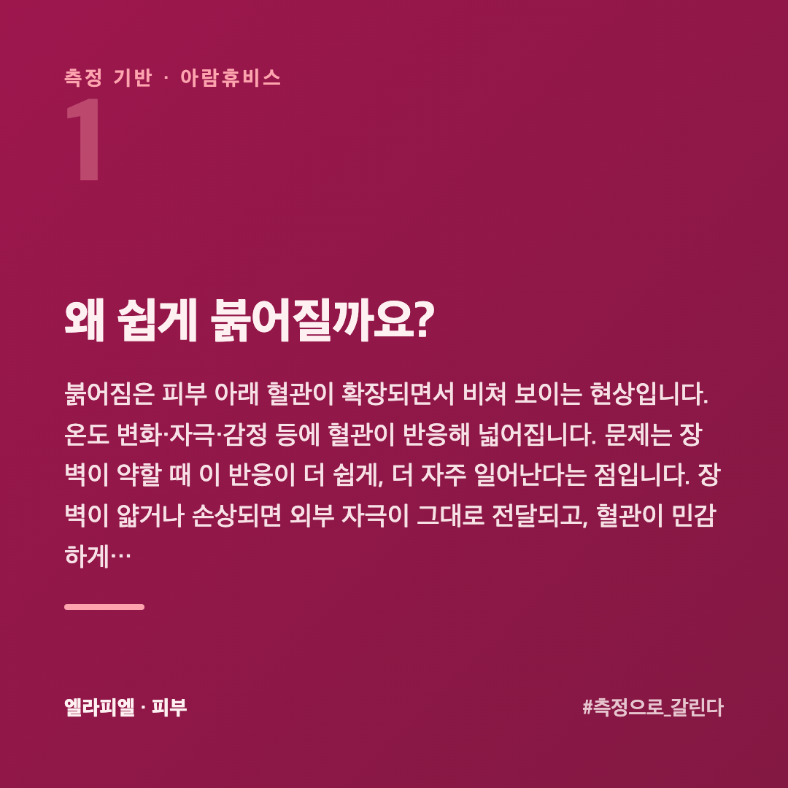
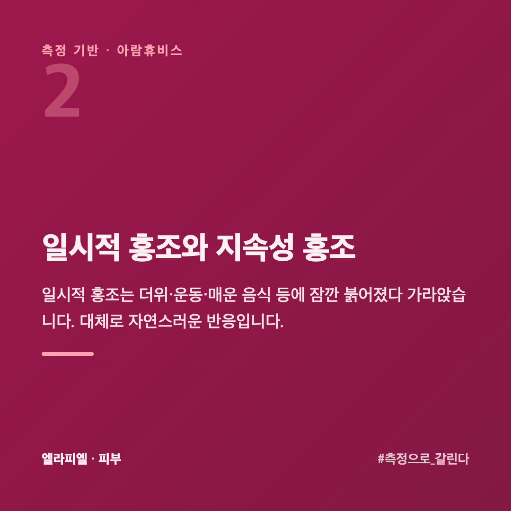
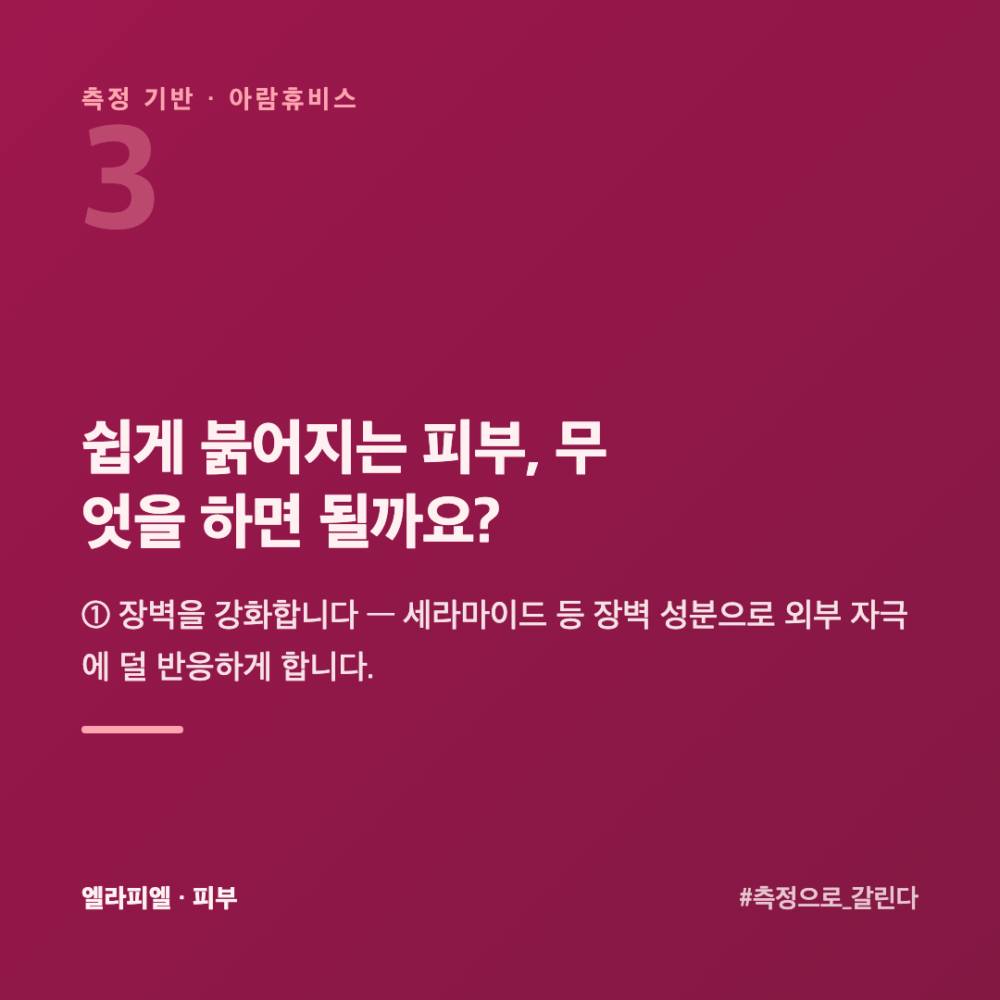
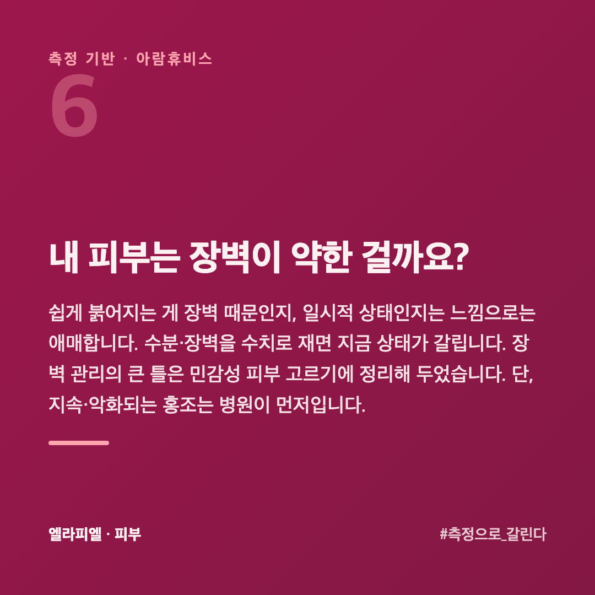
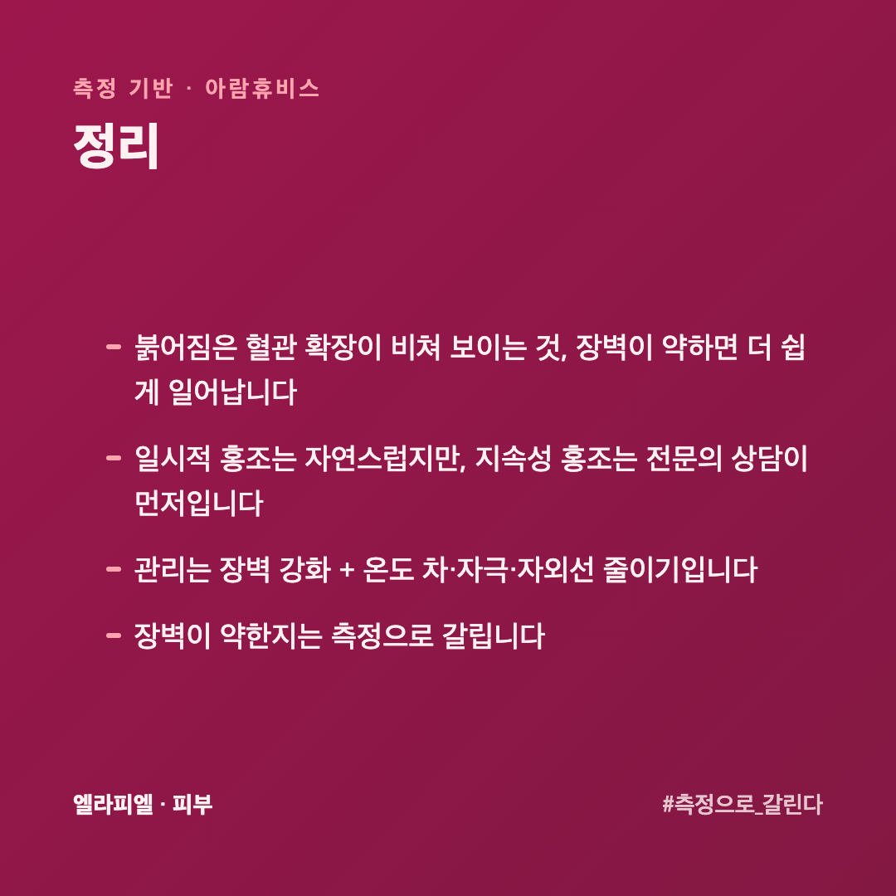
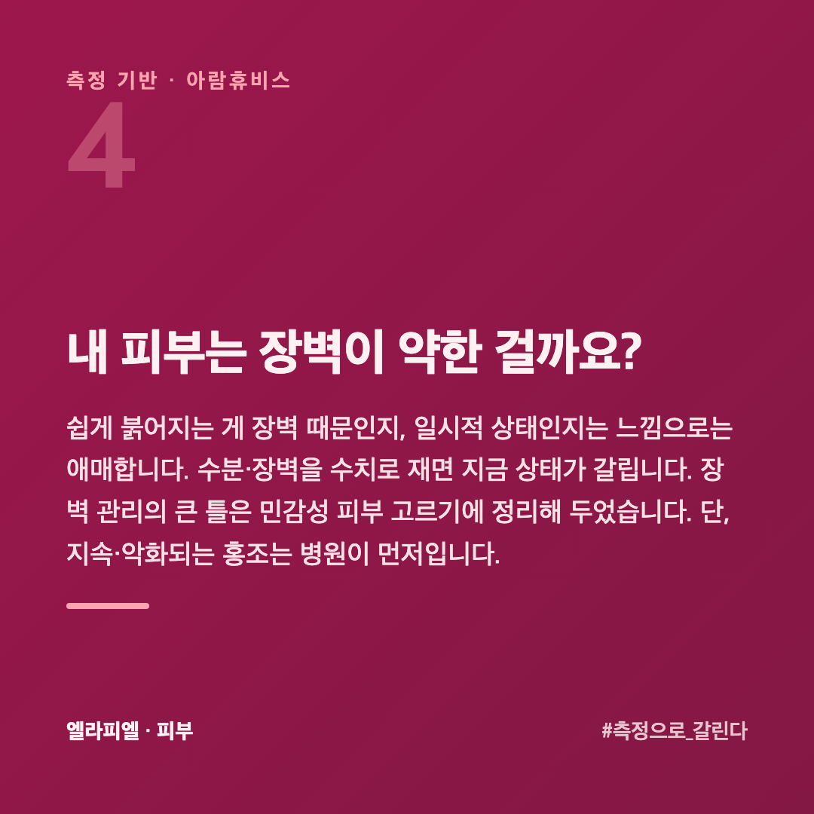

# 세수만 해도 얼굴이 빨개지는 이유, 민감일까 건조일까 혈관일까

조금만 더워도, 세수만 해도, 매운 걸 먹어도 얼굴이 금세 빨개집니다. 열이 오르는 느낌과 함께 볼이 달아오릅니다. 남들보다 유독 쉽게 붉어진다면, 피부 장벽과 혈관 반응을 함께 봐야 합니다.

이 글은 피부를 수치로 재 온 회사 입장에서, 얼굴이 쉽게 붉어지는 이유와 관리를 정리했습니다.

## 왜 쉽게 붉어질까요?

붉어짐은 피부 아래 **혈관이 확장**되면서 비쳐 보이는 현상입니다. 온도 변화·자극·감정 등에 혈관이 반응해 넓어집니다. 문제는 **장벽이 약할 때** 이 반응이 더 쉽게, 더 자주 일어난다는 점입니다. 장벽이 얇거나 손상되면 외부 자극이 그대로 전달되고, 혈관이 민감하게 반응합니다.

## 일시적 홍조와 지속성 홍조

**일시적 홍조**는 더위·운동·매운 음식 등에 잠깐 붉어졌다 가라앉습니다. 대체로 자연스러운 반응입니다.

**지속성 홍조**는 가라앉지 않고 오래 남거나, 점점 자주·심하게 나타납니다. 이 경우 안면홍조·주사(rosacea) 같은 **피부과적 문제**일 수 있어, 전문의 상담을 권합니다. 화장품 관리만으로 해결하려 하지 않는 게 좋습니다.

## 쉽게 붉어지는 피부, 무엇을 하면 될까요?

**① 장벽을 강화합니다** — 세라마이드 등 장벽 성분으로 외부 자극에 덜 반응하게 합니다.

**② 온도 차를 줄입니다** — 뜨거운 물 세안, 급격한 찬바람·더위를 피합니다. 미지근한 물이 기본입니다.

**③ 자극을 줄입니다** — 강한 각질 제거, 고농도 자극 성분, 과한 마찰을 피합니다.

**④ 자외선을 막습니다** — 자외선은 혈관·장벽 모두에 부담입니다.

## 어떤 상황에서 붉어지는지 적어 둘 필요가 있나요?

있습니다. 홍조는 **언제 올라오는지가 원인을 말해 줍니다.**

**뜨거운 것·매운 것·술을 먹고** 올라온다면 혈관 쪽 반응입니다. 피하면 줄어듭니다.

**세수나 제품을 쓴 뒤** 올라온다면 장벽과 자극 쪽입니다. 무엇을 썼는지가 단서입니다.

**찬 바깥에서 따뜻한 실내로 들어올 때** 올라온다면 온도 차 쪽입니다. 겨울에 심해지는 유형입니다.

일주일만 **언제·무엇 뒤에** 올라왔는지 적어 보면 패턴이 보입니다. 바꿀 것이 정해집니다.

## 붉어졌을 때 그 자리에서 뭘 하면 되나요?

**식히는 것이 먼저**입니다. 찬물로 세게 씻지 말고, 시원한 물에 적신 수건을 **얹었다 떼기**를 반복합니다. 문지르면 더 올라옵니다.

얼음을 직접 대지 않습니다. 급하게 차게 하면 혈관이 수축했다가 더 크게 확장합니다.

가라앉은 뒤에는 **자극이 적은 것으로 덮습니다.** 붉어진 직후는 장벽이 흔들린 상태라, 평소 괜찮던 제품도 따가울 수 있습니다. 그날은 단계를 줄이는 편이 낫습니다.

## 내 피부는 장벽이 약한 걸까요?

쉽게 붉어지는 게 장벽 때문인지, 일시적 상태인지는 느낌으로는 애매합니다. 수분·장벽을 수치로 재면 지금 상태가 갈립니다. 장벽 관리의 큰 틀은 [민감성 피부, 화장품 고를 때 볼 것](https://blog.naver.com/ianlove80/224451155409)에 정리해 두었습니다. 단, 지속·악화되는 홍조는 병원이 먼저입니다.

엘라피엘은 그 측정 관점에서 장벽·진정 라인을 설계했습니다 → [ellapiel.co.kr](https://ellapiel.co.kr)

## 정리

- 붉어짐은 **혈관 확장**이 비쳐 보이는 것, **장벽이 약하면** 더 쉽게 일어납니다
- **일시적 홍조**는 자연스럽지만, **지속성 홍조**는 전문의 상담이 먼저입니다
- 관리는 **장벽 강화 + 온도 차·자극·자외선 줄이기**입니다
- 장벽이 약한지는 **측정으로** 갈립니다
