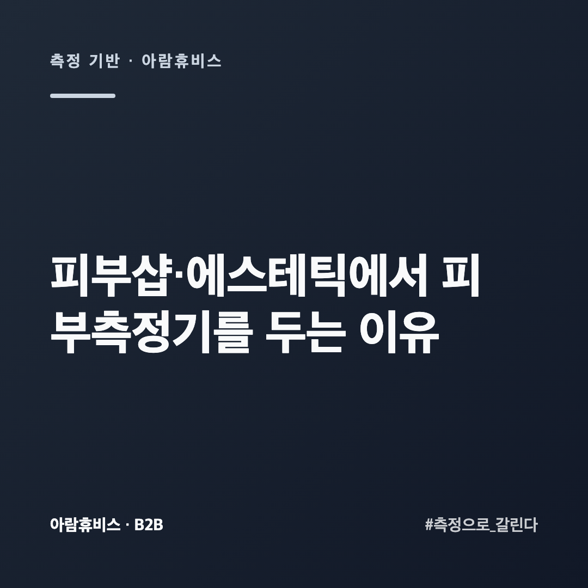
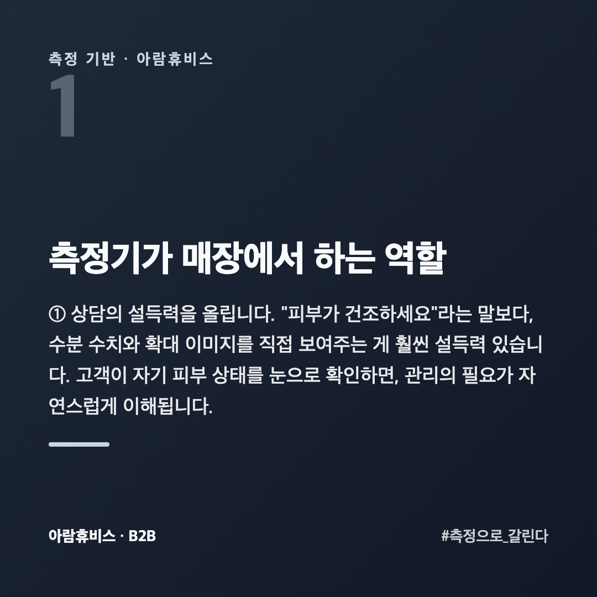
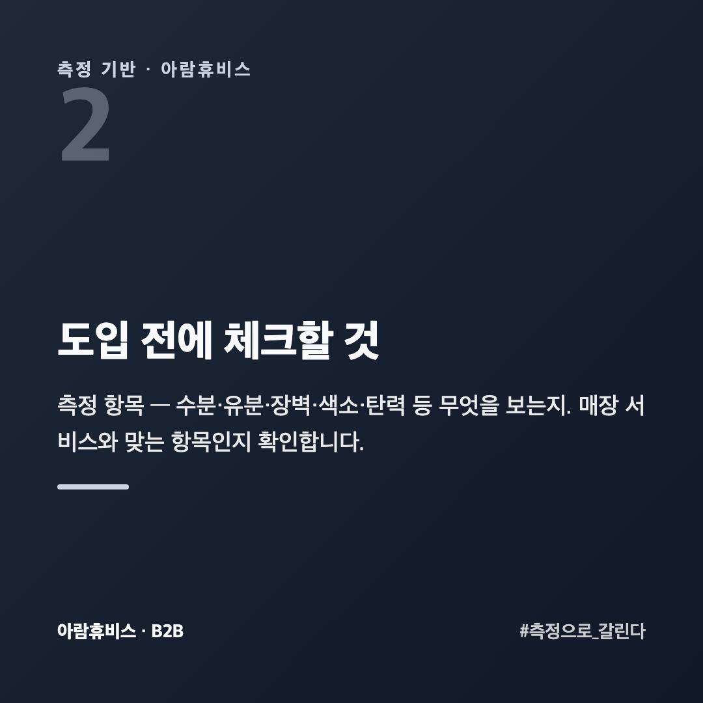
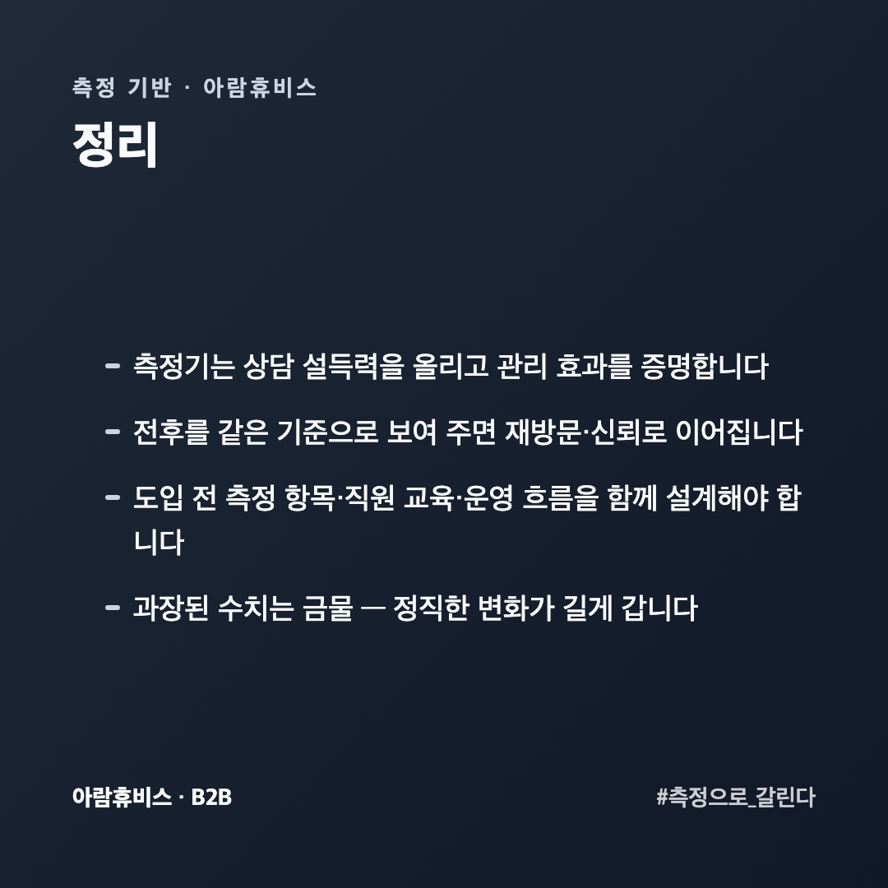
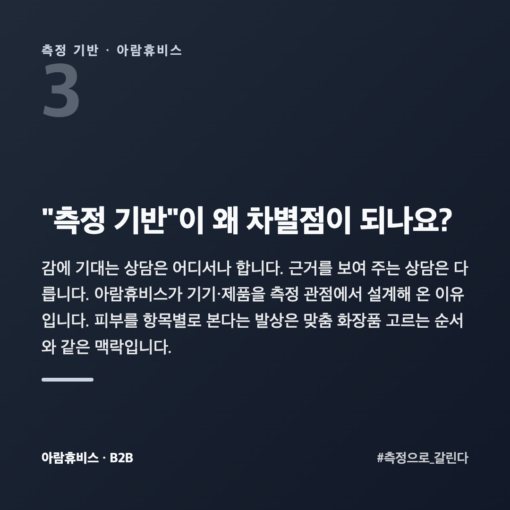

# 피부샵·에스테틱에서 피부측정기를 두는 이유와 고를 때 볼 것

피부관리실·에스테틱을 운영하다 보면 고민이 생깁니다. "손님이 관리 효과를 잘 못 느낀다", "재방문으로 이어지지 않는다". 이때 많은 매장이 피부측정기를 도입합니다. 왜일까요?

이 글은 피부 측정 기기를 만들어 온 회사 입장에서, 측정기가 매장에서 실제로 하는 역할과 도입 전 체크포인트를 과장 없이 정리했습니다.

## 측정기가 매장에서 하는 역할

**① 상담의 설득력을 올립니다.** "피부가 건조하세요"라는 말보다, 수분 수치와 확대 이미지를 **직접 보여주는** 게 훨씬 설득력 있습니다. 고객이 자기 피부 상태를 눈으로 확인하면, 관리의 필요가 자연스럽게 이해됩니다.

**② 관리 효과를 증명합니다.** 관리 전후를 같은 기준으로 재면, 고객이 **변화를 눈으로** 봅니다. "좋아진 것 같긴 한데..."가 "수분이 이만큼 올랐네요"로 바뀝니다. 이게 재방문과 신뢰의 핵심입니다.

**③ 고객 데이터를 쌓습니다.** 방문마다 측정값을 남기면 고객별 히스토리가 됩니다. 다음 상담이 훨씬 정교해집니다.

## 도입 전에 체크할 것

**측정 항목** — 수분·유분·장벽·색소·탄력 등 무엇을 보는지. 매장 서비스와 맞는 항목인지 확인합니다.

**직원 교육** — 핵심은 기기가 아니라 **해석과 설명**입니다. 수치를 고객 언어로 풀어 주는 역량이 있어야 자산이 됩니다.

**운영 흐름** — 측정을 상담 어느 단계에 넣을지, 전후 측정을 언제 할지 미리 설계합니다.

**과장 경계** — "며칠 만에 -N살" 같은 단정적 수치는 신뢰를 오히려 깎습니다. 정직하게 변화를 보여 주는 쪽이 길게 갑니다([피부 나이 이야기](https://blog.naver.com/ianlove80)).

## 손님에게 결과를 어떻게 보여 주나요?

숫자만 보여 주면 **대부분 못 알아듣습니다.** "수분 32" 가 좋은 건지 나쁜 건지 모릅니다.

세 가지를 같이 보여 줍니다. **지금 값**, **기준과의 거리**(평균보다 높은지 낮은지), **지난번과의 변화**입니다. 이 중 손님이 가장 반응하는 건 세 번째입니다. 좋아진 게 눈에 보여야 관리를 이어 갑니다.

확대 이미지는 숫자보다 설득력이 큽니다. 다만 **보기 불편한 화면을 크게 띄우지 않습니다.** 문제를 과장해 보여 주면 그 자리에서는 사지만 다시 오지 않습니다.

## 측정기를 들이면 뭐가 달라지나요?

**대화가 달라집니다.** "건조해 보이시네요"는 의견이고, "지난달보다 수분이 내려갔습니다"는 사실입니다. 사실 위에서는 권하는 말이 영업처럼 들리지 않습니다.

**관리 주기가 생깁니다.** 4~8주 뒤에 다시 재자는 말이 자연스러워집니다. 그 주기가 재방문 주기가 됩니다.

**직원마다 다른 말을 하지 않게 됩니다.** 눈으로 보고 말하면 사람마다 다르지만, 같은 기기로 재면 기준이 하나입니다. 손님이 "저번엔 다르게 말했는데"라고 하는 일이 줄어듭니다.

## "측정 기반"이 왜 차별점이 되나요?

감에 기대는 상담은 어디서나 합니다. 근거를 보여 주는 상담은 다릅니다. 아람휴비스가 기기·제품을 측정 관점에서 설계해 온 이유입니다. 피부를 항목별로 본다는 발상은 [맞춤 화장품 고르는 순서](https://blog.naver.com/ianlove80/224450574979)와 같은 맥락입니다.

엘라피엘 제품·기기 도입 문의 → [ellapiel.co.kr](https://ellapiel.co.kr)

## 정리

- 측정기는 **상담 설득력**을 올리고 **관리 효과를 증명**합니다
- 전후를 같은 기준으로 보여 주면 **재방문·신뢰**로 이어집니다
- 도입 전 **측정 항목·직원 교육·운영 흐름**을 함께 설계해야 합니다
- **과장된 수치는 금물** — 정직한 변화가 길게 갑니다
