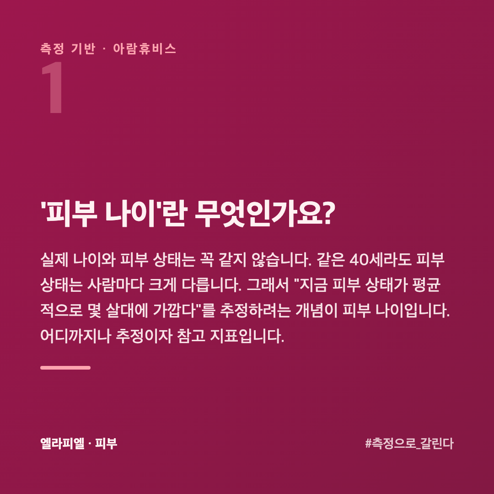
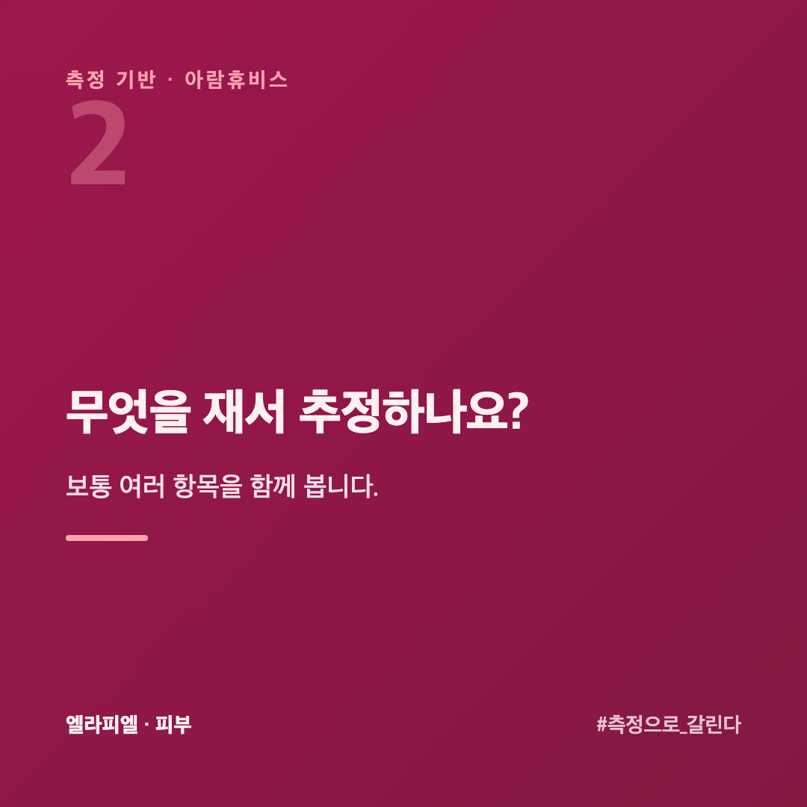
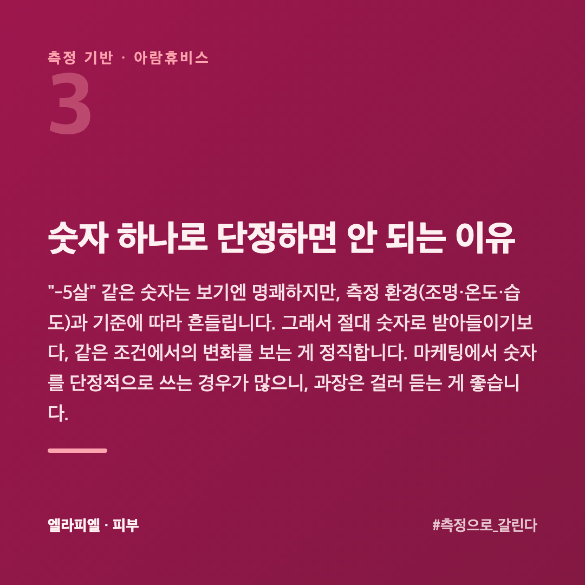
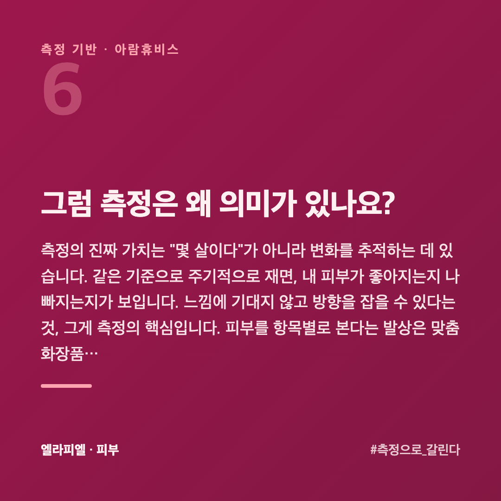
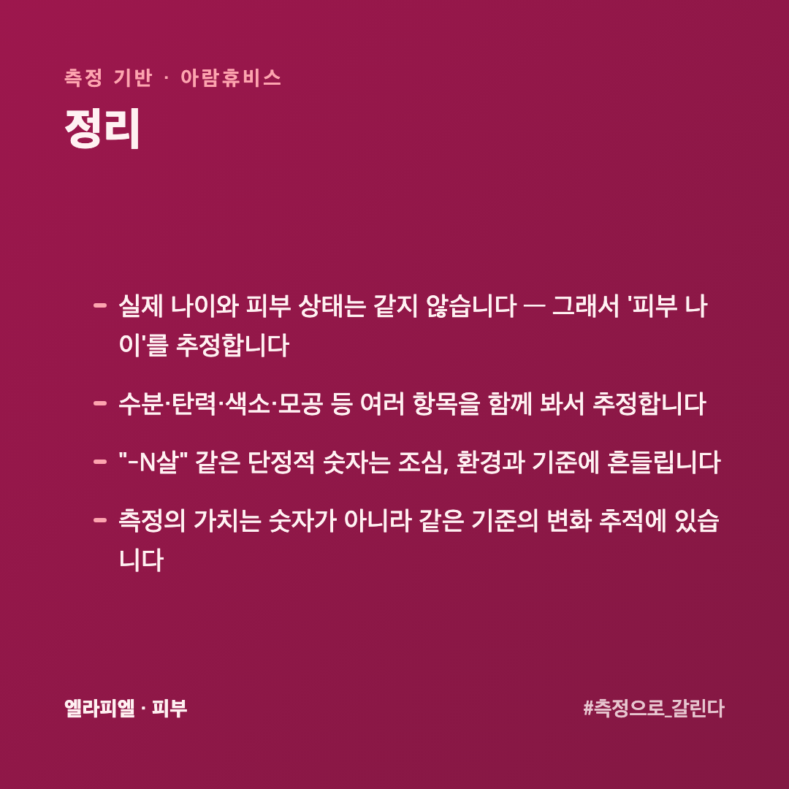

# 피부 나이는 숫자로 잴 수 있을까, 그 숫자를 어떻게 읽어야 할까

"피부 나이 -5살" 같은 말을 자주 봅니다. 그럴듯하지만, 피부 나이를 하나의 숫자로 딱 잘라 말할 수 있을까요? 피부를 수치로 재 온 회사 입장에서 솔직하게 정리했습니다. 결론부터 말하면, **방향은 맞지만 숫자 하나로 단정하는 건 조심**해야 합니다.

## '피부 나이'란 무엇인가요?

실제 나이와 피부 상태는 꼭 같지 않습니다. 같은 40세라도 피부 상태는 사람마다 크게 다릅니다. 그래서 "지금 피부 상태가 평균적으로 몇 살대에 가깝다"를 추정하려는 개념이 피부 나이입니다. 어디까지나 **추정이자 참고 지표**입니다.

## 무엇을 재서 추정하나요?

보통 여러 항목을 함께 봅니다.

- **수분** — 피부가 얼마나 촉촉한지
- **탄력** — 눌렀다 돌아오는 정도
- **색소·톤** — 잡티·칙칙함
- **모공·주름** — 표면의 변화

이 항목들을 종합해 "현재 상태"를 그립니다. 중요한 건 **한 항목이 아니라 여러 항목을 함께** 본다는 점입니다.

## 숫자 하나로 단정하면 안 되는 이유

"-5살" 같은 숫자는 보기엔 명쾌하지만, 측정 환경(조명·온도·습도)과 기준에 따라 흔들립니다. 그래서 그 숫자 자체를 결론으로 받아들이기보다, **같은 조건에서의 변화**를 보는 게 정직합니다. 마케팅에서 숫자를 단정적으로 쓰는 경우가 많으니, 과장은 걸러 듣는 게 좋습니다.

## 같은 날 두 번 쟀는데 숫자가 다릅니다, 왜죠?

재는 조건이 조금만 달라도 값이 흔들리기 때문입니다. 영향을 주는 것이 생각보다 많습니다.

**시간** — 아침과 저녁은 수분·유분이 다릅니다. **세안 직후**는 특히 흔들립니다. 세안하고 20~30분 지난 뒤가 안정적입니다.

**환경** — 측정실의 온도와 습도가 바뀌면 값도 바뀝니다. 같은 매장이라도 여름과 겨울이 다릅니다.

**자세와 압력** — 기기를 피부에 대는 세기가 다르면 값이 달라집니다.

그래서 **같은 시간대·같은 자리·같은 조건**으로 재는 것이 숫자 자체보다 중요합니다. 조건이 흔들린 두 값을 비교하면 아무 뜻이 없습니다.

## 그러면 얼마에 한 번 재는 게 맞나요?

**4~8주**가 기준입니다. 피부가 새로 올라오는 데 그 정도가 걸리기 때문입니다. 일주일 만에 다시 재면 바뀐 것은 피부가 아니라 그날의 조건입니다.

바꾼 것이 있을 때 재는 것이 의미 있습니다. 제품을 바꿨거나 관리를 시작했다면, **시작할 때 한 번 재 두고** 4~8주 뒤에 같은 조건으로 다시 잽니다. 그래야 바뀐 것이 그 변화 때문인지 보입니다.

## 그럼 측정은 왜 의미가 있나요?

측정의 진짜 가치는 "몇 살이다"가 아니라 **변화를 추적**하는 데 있습니다. 같은 기준으로 주기적으로 재면, 내 피부가 좋아지는지 나빠지는지가 보입니다. 느낌에 기대지 않고 **방향**을 잡을 수 있다는 것, 그게 측정의 핵심입니다. 피부를 항목별로 본다는 발상은 [맞춤 화장품 고르는 순서](https://blog.naver.com/ianlove80/224450574979)와 같은 맥락입니다.

엘라피엘은 그 측정 관점에서 수분·장벽·탄력을 함께 보는 라인을 설계했습니다 → [ellapiel.co.kr](https://ellapiel.co.kr)

## 정리

- 실제 나이와 피부 상태는 **같지 않습니다** — 그래서 '피부 나이'를 추정합니다
- 수분·탄력·색소·모공 등 **여러 항목을 함께** 봐서 추정합니다
- "-N살" 같은 **단정적 숫자는 조심**, 환경과 기준에 흔들립니다
- 측정의 가치는 숫자가 아니라 **같은 기준의 변화 추적**에 있습니다
