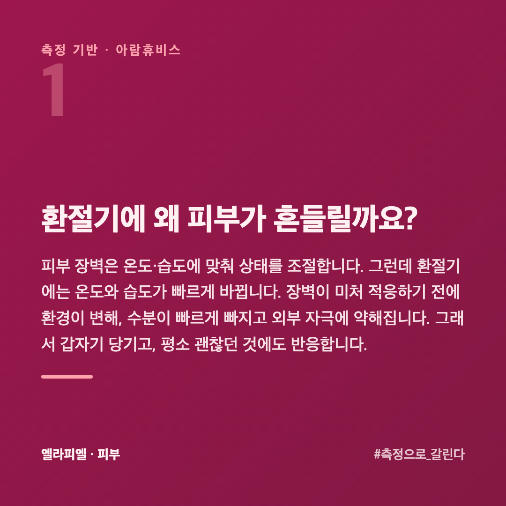
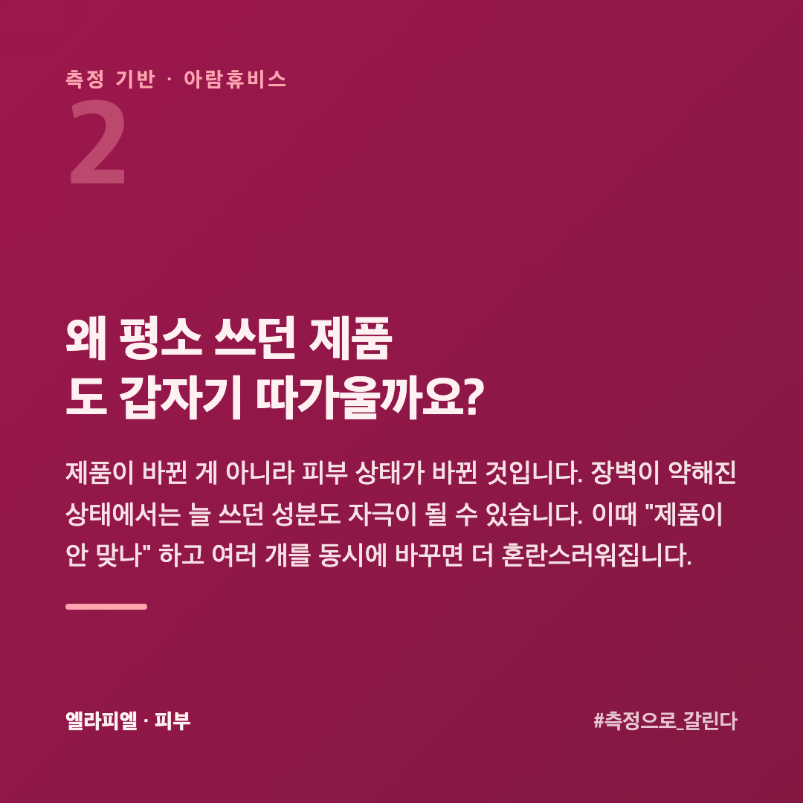
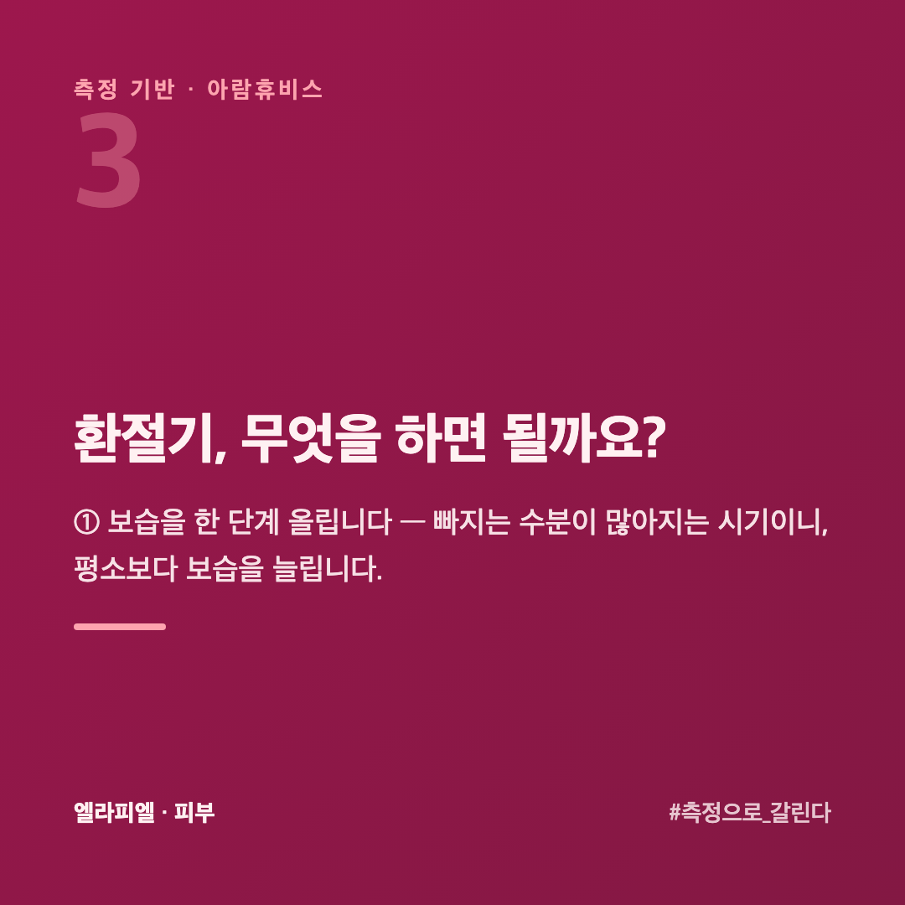
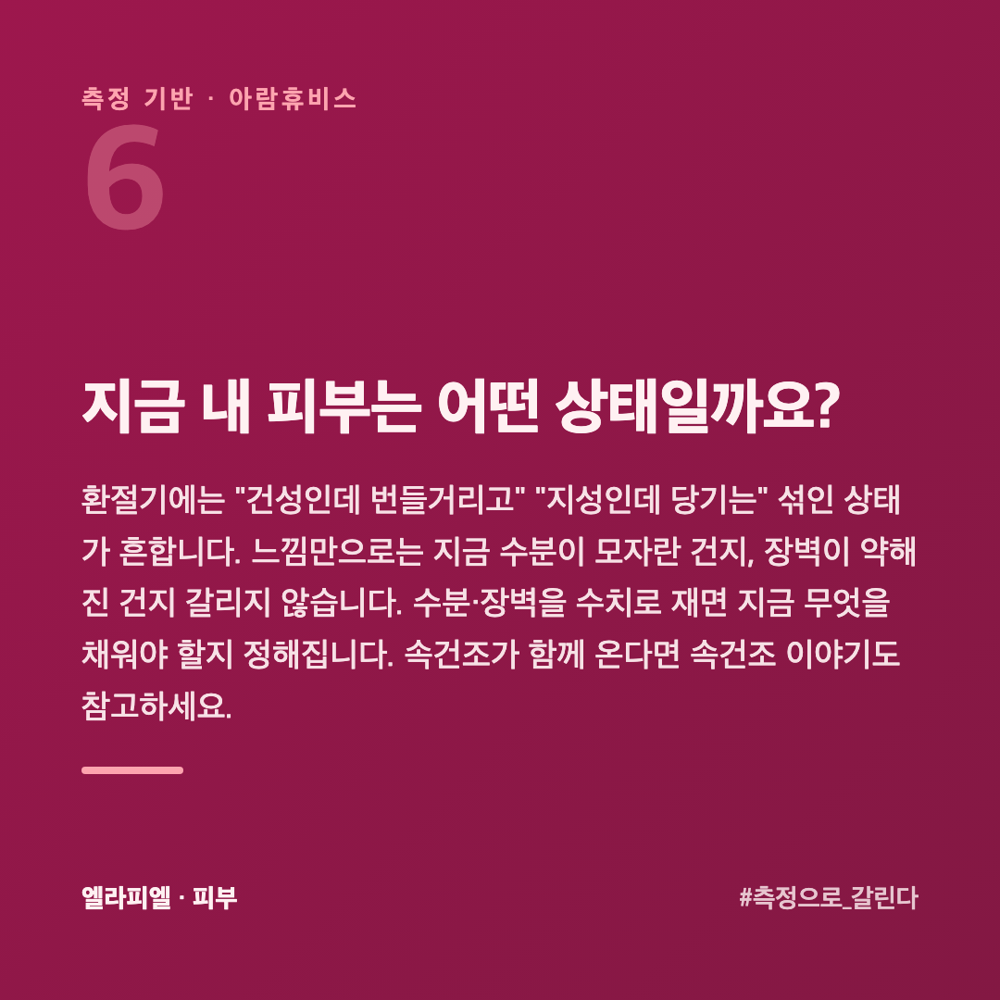
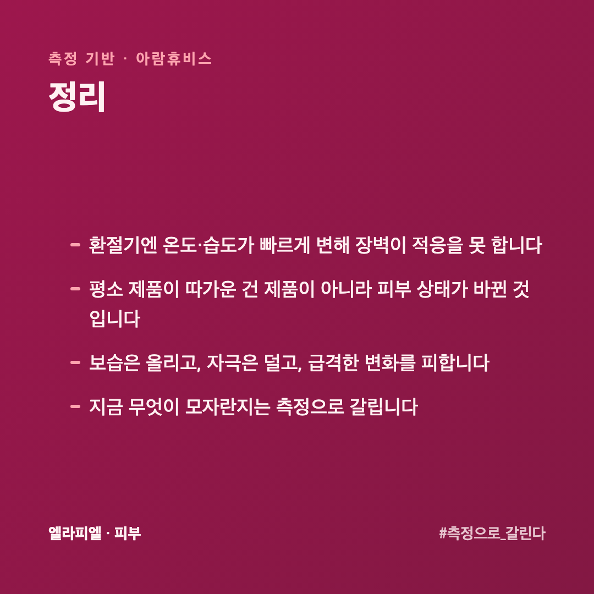
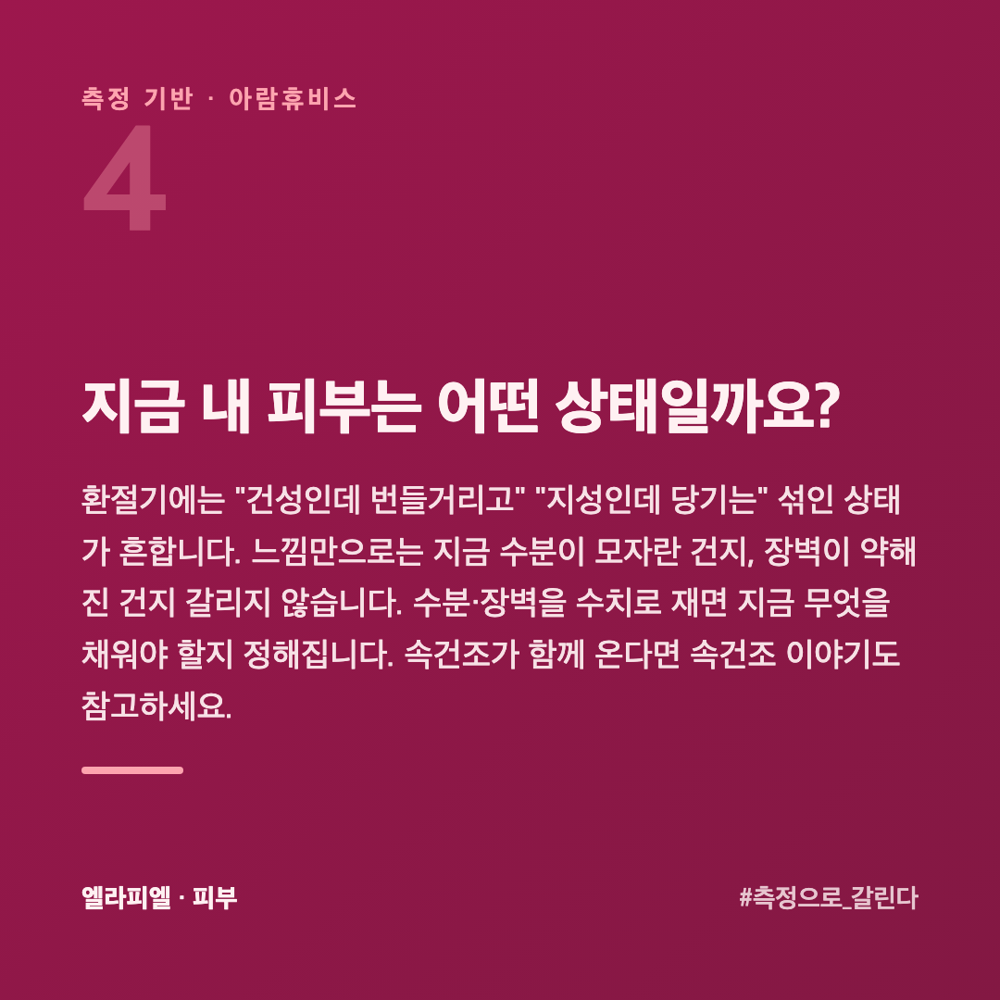

# 환절기만 되면 피부가 뒤집히는 이유와 먼저 손봐야 할 세 가지

여름에서 가을로, 가을에서 겨울로 넘어갈 때마다 피부가 예민해집니다. 평소 쓰던 것도 따갑고, 갑자기 당기거나 트러블이 올라옵니다. "계절 탄다"는 말로 넘기기엔 매번 반복됩니다.

이 글은 피부를 수치로 재 온 회사 입장에서, 환절기에 왜 피부가 흔들리고 무엇을 해야 하는지 정리했습니다.

## 환절기에 왜 피부가 흔들릴까요?

피부 장벽은 온도·습도에 맞춰 상태를 조절합니다. 그런데 환절기에는 **온도와 습도가 빠르게 바뀝니다.** 장벽이 미처 적응하기 전에 환경이 변해, 수분이 빠르게 빠지고 외부 자극에 약해집니다. 그래서 갑자기 당기고, 평소 괜찮던 것에도 반응합니다.

## 왜 평소 쓰던 제품도 갑자기 따가울까요?

제품이 바뀐 게 아니라 **피부 상태가 바뀐** 것입니다. 장벽이 약해진 상태에서는 늘 쓰던 성분도 자극이 될 수 있습니다. 이때 "제품이 안 맞나" 하고 여러 개를 동시에 바꾸면 더 혼란스러워집니다.

## 환절기, 무엇을 하면 될까요?

**① 보습을 한 단계 올립니다** — 빠지는 수분이 많아지는 시기이니, 평소보다 보습을 늘립니다.

**② 자극을 줄입니다** — 강한 각질 제거, 새로운 고기능 제품 추가는 잠시 미룹니다. 장벽이 약할 때는 덜어내는 게 낫습니다.

**③ 급격한 변화를 피합니다** — 뜨거운 물 세안, 과한 세정을 줄입니다.

**④ 한 번에 하나만 바꿉니다** — 뭐가 문제인지 가릴 수 있어야 합니다.

## 환절기에 제품을 바꿔야 하나요, 두는 게 나은가요?

**한꺼번에 바꾸지 않습니다.** 흔들릴 때 여러 개를 동시에 바꾸면 무엇이 맞고 무엇이 틀렸는지 못 가립니다. 피부가 예민한 시기라 반응도 더 크게 옵니다.

순서는 **덮는 것부터**입니다. 쓰던 것을 그대로 두고 마지막 단계에 **가두는 제품 하나만** 더합니다. 그래도 당긴다면 그때 보습 단계를 손봅니다.

기능성 제품(각질 성분, 비타민C, 레티놀 같은 것)은 **횟수를 줄이는** 쪽이 먼저입니다. 끊지 않고 주 3회를 주 1회로 내려 봅니다. 환절기가 지나면 원래대로 올립니다.

## 환절기가 지나면 저절로 돌아오나요?

대개는 돌아옵니다. 조건이 원래대로 되면 장벽도 회복합니다. 다만 두 경우는 다릅니다.

**매년 같은 시기에 같은 일이 반복된다면** 조건 탓만은 아닙니다. 평소 장벽이 간당간당하다가 환절기에 넘어가는 것입니다. 이런 경우는 **환절기 전부터** 보습을 올려 두는 쪽이 낫습니다.

**가라앉지 않고 두 달 넘게 간다면** 다른 원인을 봅니다. 계절 탓이라고 넘기다 시간을 쓰는 경우가 많습니다.

## 지금 내 피부는 어떤 상태일까요?

환절기에는 "건성인데 번들거리고" "지성인데 당기는" 섞인 상태가 흔합니다. 느낌만으로는 지금 수분이 모자란 건지, 장벽이 약해진 건지 갈리지 않습니다. 수분·장벽을 수치로 재면 지금 무엇을 채워야 할지 정해집니다. 속건조가 함께 온다면 [속건조 이야기](https://blog.naver.com/ianlove80)도 참고하세요.

엘라피엘은 그 측정 관점에서 수분·장벽 라인을 설계했습니다 → [ellapiel.co.kr](https://ellapiel.co.kr)

## 정리

- 환절기엔 **온도·습도가 빠르게 변해** 장벽이 적응을 못 합니다
- 평소 제품이 따가운 건 제품이 아니라 **피부 상태가 바뀐** 것입니다
- **보습은 올리고, 자극은 덜고**, 급격한 변화를 피합니다
- 지금 무엇이 모자란지는 **측정으로** 갈립니다
